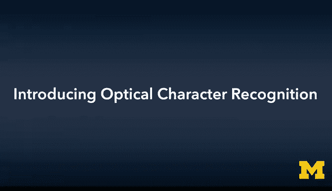
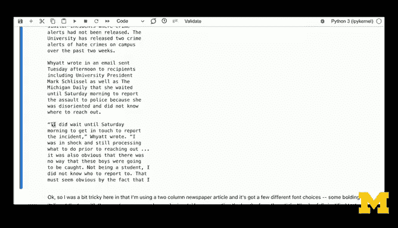
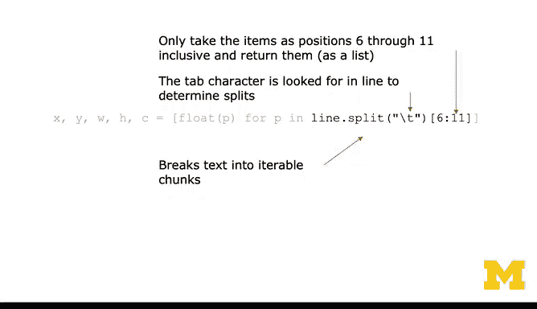
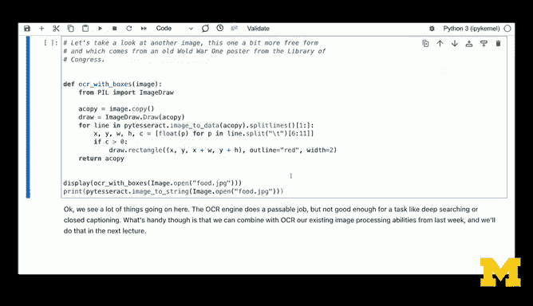
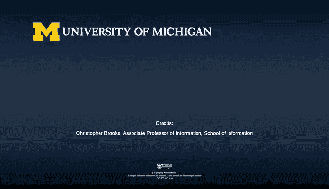

# 密歇根大学《Python3编程（课程3、4、5）》｜Python 3 Programming（Python for everyone进阶）（中英字幕） - P122：14_03_01_光学字符识别简介.zh_en - GPT中英字幕课程资源 - BV1gj41177yd

Optical character recognition or O C R is a very hard problem。 The goal is simple。

 Take an image which has some natural language in it and convert that to a digital string representation so that we can process the text and do stuff with it。

Numerous challenges arise， the first being that the characters in an image might not be clear。

 or they might be clear， but of all sorts of different fonts， sizes。

 languages or orientations in the image。While the field is old and I've been using O C。

 R since the first scanner I owned， which would have been in the late 1990s。

 there have been remarkable breakthroughs， which have come with advancements in the field of deep learning。

Beyond the techniques used in deep learning， transformer based artificial intelligence systems such as ChatGBT have made this even easier now that media inputs can be manipulated by AI as well。

But using large language models for image recognition and processing is a different course。

 so instead we're going to talk about how to do OCR work more directly in Python。

The first thing to note is that just like with the Python Iaging Library。

 using OCR in Python requires the support of external libraries。In this case。

 we're going to use the Py Teserak library， this is a Python wrapper for the Tesserak OCR engine。

Now this is a bit different than with the case of P， with images。

 we just installed the Python library and we're done， but with Py Tesser Act。

 we have to install the Tesseract command line tool first and then we have to install the Python Rapper Library。

This is a pretty common pattern within Python libraries。

 where sometimes they leave the heavy lifting of computation to a tool which is used in a variety of different contexts。

Of course， we've installed all of that for you here on Coursera。

 so let's take a look at how we can start doing OCR in Python。

 so Py Tessar Act builds on and uses the Python Iaging library。

 so I'm going to bring in that module as well as the new module Py Tearak。

The very first thing we probably want to do is see if we can detect some text。

 we can do that with the image to string function， note that there are no methods here P Tesser Act is a very simple module with a few functions。

 so I'm going to open up this image just like we would normally in pill to call PNG I'm going to display it and then I'm just going to see if I can get some text out of it and print that text to the screen。

Okay， so here's the image。And then we see here is the text underneath that was detected。

And this looks pretty good。 There's something here。

Okay， so I was a bit tricky here in that I'm using a two column newspaper article。

 and it's got a few different font choices， some bolding and italics at the top with the reporter's name and some horizontal bars separating the header from the article。

 It's also fully justified text， which means that the spacing between words is a variable amount。

 and this can be a challenge for some OCR systems too。 However， to my read。

 this is almost a perfect replication of the text with the one error being in the last paragraph。

 which starts as I did wait， but was interpreted as it did wait。

 Another handy function for us to use is called image to data。

 This function will return the bounding box coordinates， as well as the text detected in each box。

 This can be very useful for visualizing how the OCR layout engine is working。

 This also demonstrates some of the challenges in working with Python rappers for C libraries。

 The return value of the image to data function is a string， which is formatted as a tab separation。

Values， because it's meant to be easily read by humans。 but on the command line。

 So let's take a look。 It's really simple here。 we're just going to call image to data。

 get back the results。 And then I'm going to go through every line in these results and just print them out。

 Now， normally， I would try and format this using a library which can handle spreadsheets in Python like pandas。

 And if you're interested in that and may be interested in doing data science with Python。

 The University of Michigan has courses here on the Coursera platform that you might want to check out。

 But let's take a look at this table first。 We see that the Tesser Act is returning to us a level。

 a page number， a block number， paragraph number and a line in a word for each and every word it detects。

 including white space。It also includes the top left corner in pixels and the width and height of that text。

Finally， it includes the text itself as a string and a confidence in its correctness。

Now that confidence is interesting。 if we scroll down。

 we can see that the confidence in the incorrectly identified text is quite low at 27。

 while the confidence for most of the other words is well above 90。

So let's draw those bounding boxes on the image， this is good practice and then we can see how Tesser Act itself is working。

 so I'm going to get a handler to the draw of the newspaper article and then I've written another little for loop here to just go through and draw it and let's take a look。

All right。There we go， so we see all of the bounding boxes around the words。Now。

 I've deliberately written things in a very tight format here。

 and that's mostly for pedagogical reasons。 By the end of this course。

 you should be able to read this style of Python and understand what's going on。

 It might not be super fast for you to read。 but let's deconstruct this one line in particular。

 on the left hand side。 you can see that I've got several different variables。 X， Y， W， H and C。

This alone says to Python that we're going to do some tuple unpacking。

 so the right hand side of this argument needs to be an iterable。

 like a lister of tuple and needs to have five and only five values。

If there are more or less than five values， Python' is going to throw what's called a value error。

Now， looking at the right hand side， we see everything is wrapped in square brackets。

 the indexing operator or the list construction syntax if you prefer in Python。

What this means is that we are defining a list of items either directly where they are separated by commas or through a list comprehension。

 It's actually a list comprehension that I'm using here。

 which means that the right hand side is going to be broken up into four parts。

 The first being the function we want to apply to each data element。 Then the word4。

 then the variable name we're going to use。 And I just chose letter P for brevity。

 Then the word in and some sequence or iterable。 The function I actually want to apply to everything is just the function float。

 which is a built in method for defining new floating point numbers。

 And when you pass in a parameter like this， it does the type conversion to make the input of floating point number。

 This is often referred to as type casting。 All right， So looking further on the right hand side。

 we can see that P is defined in relation to the results of line dot split。Line is a string value。

 and the split method just breaks up by the line by whatever string that you pass in is an argument。

 I've used back slash T， which means a tab character， but I actually only want five values。

 and the line has 11 values。 So then I've used the Python slicing syntax with the indexing operator indicating that I only want item 6 through 11 inclusive。

This gives me exactly five elements， which are then all changed into integers or floats and bound to the variables X。

 Y， W， H and C。 Now， that was a big discussion。 But I don't want this code to confuse you or overwhelm you with Python。

 just go line by line， chunk by chunk and you can reason out what's happening in other people's code。

 And frankly， this is a bit of a superpower。 because once you can read other people's code。

 you can learn from what they've written。 and the world is filled with wonderful open source libraries that you can explore to enhance your own work。

😊。

Actually， maybe that would be a good time to clean this coat up。 Why don't you take a stab at it。

 taking this and turning it into a function with documentation， of course。

 which takes in an image and returns a new image with all of those bounding boxes on it。Okay。

 now that we've looked at one image， let's take a look at another image and this one's a bit more free form and comes from an Old World War I poster from the Library of Congress。

See， I've written a function here called OCR with boxes because I'm going to use that in a couple of other lectures。

 I make a copy of the image when you're drawing on the image you always want to make a copy of it because it modifies in place。

 remember we talked a little bit about patterns with images and whether they work in place or not I've still used my ugly code but you can fill in the code that you want to have here to draw the boxes around and then I just return the image back to the call and then I can use it like this。

 just display OCR with boxes and then the image that I'm interested in and then I'll pull out the text that we detect there with Piteser Act as well。

Okay， we see a lot of things going on here。 The OCR engine actually does a passable job。

 but not good enough for a task like deep searching or closed captioning where you want 100% accuracy。

What's handy though is that we can combine our knowledge of OCR with our existing image processing abilities from last week。

 and we're going to do that in the next lecture。

