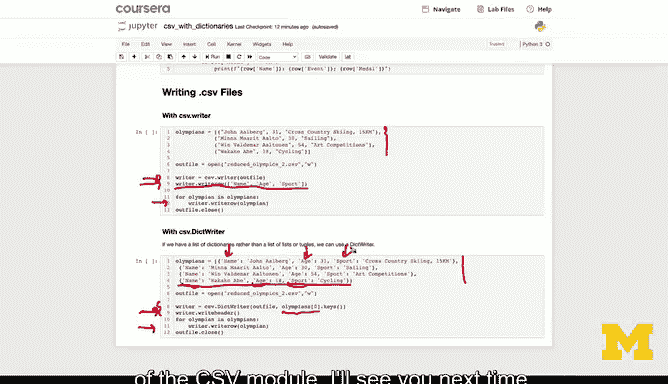

# 密歇根大学《Python3编程（课程1、2）》｜Python 3 Programming（Python for everyone进阶）（中英字幕） - P122：34_02_06_字典与csv模块整合.zh_en - GPT中英字幕课程资源 - BV1CM411Z72u

Welcome back。Now that you know about dictionaries， it's worth revisiting the CSV module。

 which helps in reading and writing files that are in the CSV format。

Instead of reading each row and parsoning it to be a list of values。

 we can ask the CSD module to make each row into a dictionary。We'll be using these two classes。

 I'm showing you the documentation again， we'll be using the dictionary Read class and the dictionary writer。

For writing from dictionaries into CSV files。So let's look at the code。

Remember our code for reading the Olympics data file using a CSV reader。

We first had to import the CSV module。And then we could ask for a reader object。And we just。

Went through the roses。And。Printed some fields from some of them。

Let's run that just to remind you of what we get。So we got the rose for the medalists。

We can use a dictionary reader instead。You can see that instead of calling CSv。reader online too。

 I call CSv。 dictionary reader， that reader object then has some。One different thing we can do。

 which is it's got a field names attribute， it's extracted the first row and treated them as the field names。

I'm just printing out。The first two rows of the reader object。Let's see what they look like。

So from line three， when we print the field names。That's this。And then。When we。

Print the first two rows of the radar object。 Here's the first one。

It's actually a special kind of dictionary called this ordered dictionary。

Which just means that it has a slightly different representation。

 but we can still work with it the same way as we can with regular dictionaries。

Using this dictionary reader， I can accomplish the same thing that I did up in cell too。

 but in a little bit more elegant way， let me just hide some of the outputs that you can see。

All of the code together。And compare。The code here and here。With the dictionary reader。

Instead of the ordinary reader。Instead of having to refer to things positionally。The fifth。

Element of row， I can。Take advantage of the fact that row is a dictionary and ask for the metal key。

 what's the value associated with metal？If it's not NA， then print out and suddenly。

The positional row0 becomes row name， row event。Row metal。

If you look at the two versions of the code， the one with the dictionaries is a lot clearer because you know。

Which fields you're getting？You only know by positions。With the list version。

 you get the zeroth element， the fourth element， and the fifth element。Here you know。

 you're getting the name， the event， and the medal。

If you happen to have a data set as a list of dictionaries and want to write it to a CSV file。

 there's a corresponding CSv。dictionary Write function。

Which produces a writer object that works with dictionaries instead of lists。

So here's our old version that you've seen before。Where we make a regular。Wri or object。

 and we ask it to。Right row。That's when each row was a tuple or each row was a list。

The writer would work fine there。Here。Each row is a dictionary。

And then we want to use the dictionary writer， we can call right row on each Olympian。

A dictionary writer is expecting that that row will be a dictionary。Now。

 a dictionary writer also expects that。We will explicitly tell it what the header row should be。

 And in our case， I grabbed。One of the Olympians。And pulled out the keys。So that's like name。

Age and sport。And I made that。I pulled those out。In order to write them as the header。

That's a little ugly， but it's still better than the code in the other version。

Where the headers defining what the three elements of each row are supposed to mean just appeared out of nowhere。

 on line 9。So in the old version of the code。Somehow we just magically got these headers。

Line8 and nine in the dictionary writer version， it's a little ugly。

 but at least we know that we sort of got the field names。From。

The names of the fields in the dictionaries。So that's how to read from CSV files to Python dictionaries and write from dictionaries into CSV files using the diict reader and diict Write features of the CSE module。

I'll see you next time。

