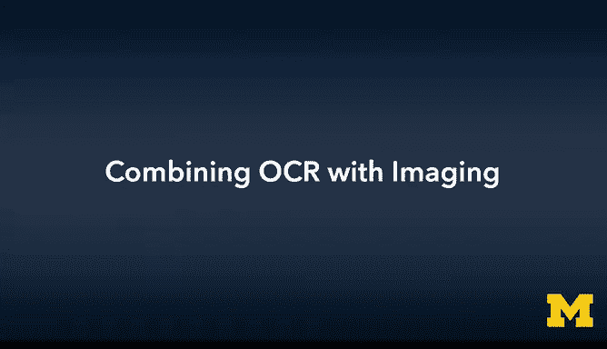
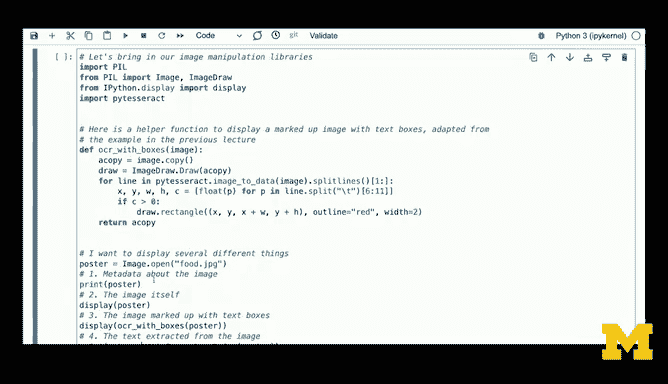
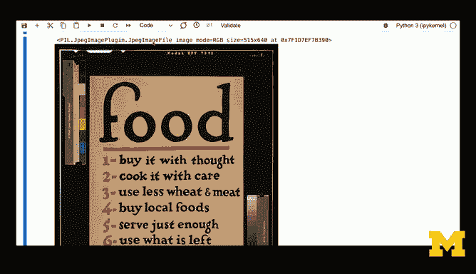
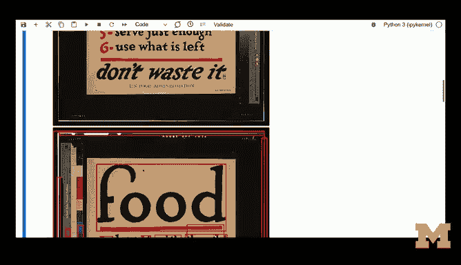
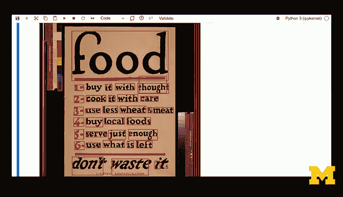
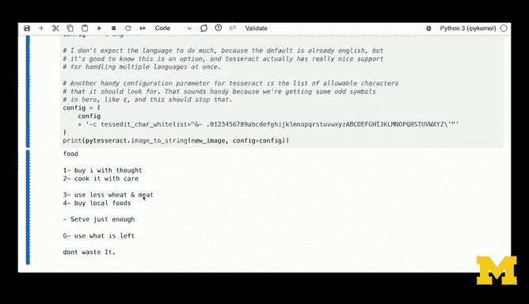
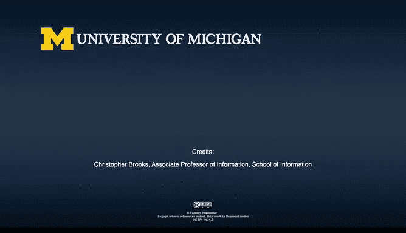

# 密歇根大学《Python3编程（课程3、4、5）》｜Python 3 Programming（Python for everyone进阶）（中英字幕） - P123：15_03_02_OCR与图像处理结合.zh_en - GPT中英字幕课程资源 - BV1gj41177yd

In this week of the course， we've tiptoed into the world of optical character recognition。

 and while we saw a really nice example of OCR working well with clean text。

 the more authentic poster image text doesn't seem to really come through very well。

There's a few things we can do to try and improve our ability to recognize characters and these techniques are actually rooted in image manipulation。

So let's just remember what we're dealing with I'm going bring in our image manipulation libraries。

 Here's the handy function that I wrote last time on OCR with boxes that hopefully you made much more readable and I really just want to display a few different things to the screen I want to display some metadata about the image remember if we just print the image object itself。

 it'll call that STR function or the for the string and print that out I want to show the image itself。

 I want to show the image marked up with the text boxes and I want to show the text extracted from the image so I like showing these four things when I'm trying to debug some of my OCR work right so we can see first we get its Jpeg image plug in JpeG image file with some information there's our nice image from the US food administration Here's a annotated version with the boxes and we can see some challenges with some of the boxes going on there and then here's。

Our actual text as determined by Piy Tessra。Now， this image recognition isn't really that bad。

 We see that the bounding boxes tend to be correct。

 and there's just a few transcription issues with some of the lettering。 However。

 there are a few different techniques that you can use in pill to improve this。

 So let's go through them and see how it actually improves the quality of this image。So step one。

 removing extraneous information。Extraneous information。

 pixels that we know are not going to contain the text we want should be removed。 In this image。

 I think cropping around the food poster itself is probably what we want to do。

 And you should keep in mind that Tessaract was heavily tuned to work well on scans of books。

 So keeping a margin around your text is a pretty reasonable thing。Step 2， resizing the image。

The Tessaric doc suggests that larger images will generally work better。

 so we can experiment a bit with scaling the image to improve the results。

I found Tesser Act is actually much better with bigger images in practice。

 and this one is pretty small， being only 515 by 640 pixels in size。Step 3。

 converting to black and white。Generally， OCR tools do not work well on color images。

 realisticistally， Tessaract and other OCR tools convert a color image to a grayscale image before doing text detection。

As we saw in last week's lecture though， the way in which you convert a color image to a grayscale image can change the information that's retained。

 If we convert the image to grayscale before sending it to Teser Act。

 we can ensure that we're retaining maximum information。Step4。

 binizing the grayscale image to black and white。Text generally has a high contrast with its background。

 like black text on a white page。 Otherwise， it makes it very difficult for us humans to read the text。

 We can exaggerate this even more through a process called binization。

 where we change each gray pixel to either black or white based on a threshold。 Now。

 what the threshold value we should choose is is actually somewhat unclear。

 and that depends on your source material。 And we want to represent this as a single bite of information。

 A number between1 and 255 that indicates the cut off between black and white。Step5。

 using Tessaract specific optimizations。Teser Act has many different configuration parameters that you can pass to it。

 which can improve the quality of the results， including forcing a specific page segmentation algorithm and setting a limit on the words or characters that you want to look for。

We can play with those parameters a bit to experiment and see if it leads to an increase in quality。

Now these are just five steps I use to improve my OCR results and how well they work depends on the kind of image you're dealing with and the level of quality you need to get out of it。

 Let's go play with these in the notebook。Let's tackle the first three together as we can use pill for them all。

 so I like to actually make a copy of my image， so here I'm going to take my poster。

 make a copy of it because some of our pill functions actually change that image。First up。

 I'm going to crop out some of the extraneous information at the top and sides of the image。

 so I just experimentally found these numbers， the XY position。

 remember your origin is the upper left hand corner and then the width and the height。

And then I'm going to resize the image and I'm just going to resize it by multiplying it by four。

 Now I'm going to change the image to a grayscale single channel image。

 So here's a shorthand for that image dot convert， and then you just pass in L will change it to a luminosity。

 and it's going to do this by averaging the value of the pixels across。Now。

 thats steps1 through three。 Now we actually have to binize。

 or sometimes it's called threshold the image。 This means that we're going to convert all pixels to either black or white。

 remember that the image is now in L mode。 So each pixel is a single byte。

 We can set our threshold value as this cut off。 I'm going to use 140 as that number。

 but please feel free to experiment in the notebook and see how changing this threshold actually affects the image。

 Okay， after setting the threshold， remember that the bys object in Python is immutable。

 but we can actually create a new byte array of the same size and copy the bytes into it。

 So that's what I'm just doing here。 I'm taking our original image2 bytes。

 I'm turning it into a byte array and I'm assigning it to new image。

 Our new image isn't actually an image object here。

 It's a byte array because we're going to be doing some thresholdholding。

Then for each location and value in that new image， so for all of the pixels。

 essentially in that new image， I'm going to check if the value is less than the threshold。

 if so I'm going to turn it down to a zero and otherwise I'm going to take it and send it all the way up to 255。

And then I'm going to create a new image from that byte array。

 so again this is just pill dot image dot from bytes。

 we say which mode because the byte array doesn't have that mode in it。

 it's literally just a whole bunch of integers， we actually have to tell pill what we want the mode to be。

 so we're just going to copy it from image which is safe because that's what we did to create the byte array。

Pill also has no idea what the size is， it's got a single dimensional array so we actually have to tell it what the dimensions are of that image so that it knows when we want to display it and then we just tell it what the bytes are and so we just pass in a new bytes and im mututable object from the image and we'll get back a pill image and now we're going to have this bigger cropped binized black and white image so let's take a look at it and let's do some OCR on it。

Okay， so we see it's a huge image， you could see the effect of that binization here and the cropping。

 you could see that we got a little bit better job with the OCR text here as well。Okay。

 not a huge difference between these results and the initial results right out of the gate。

 We get rid of a few extraneous characters， but it's still not perfect and not enough for something like close captioning。

We could keep tweaking here， trying different sizes or thresholds。

 but we could also consider what Tesseract can do for us。

 If you look online at the Teseract documentation， you'll find that there's a huge number of different parameters that we can tweak by setting their values in a configuration file。

 This is okay， but it doesn't really work well with Jupiter notebooks where we're actually doing our experimentation in our real time writing and inspection with Python。

The Piteser Act Library allows us to set some options。

 and we're going to give a couple of these a try。 So there's actually quite a few different configuration items。

 I'm just going to show a few。 The first one is about the language by default Teser Act will try and recognize all the languages knows about。

 you could set the language to a single language or a list of languages。

 So here I'm just saying it's English minus L Now I don't actually expect the language to do much。

 by default， it's already going to find that it's English。

 but this is actually a handy option because Tesser Act has really nice support for handling multiple languages at once。

 For instance， if you have an English and French in the same image。

 if you tell it the languages English and French， it can do a better job recognizing those characters。

Another handy configuration parameter for a Tesser Act is the list of allowable characters that it should look for。

That sounds handy because we're actually getting some odd symbols in here。

 so we're getting like a sent symbol and a couple of others， depending on when you run this。

 And I should note that the OCR is not always deterministic So you might be seeing slightly different OCR results than I'm seeing here and then when I put the lecture together。

 So I just put a whole bunch of characters in here all the numbers。

 all the letters in capitals in lowercase and so forth。 And so we just pass that is minus C。

 then we say we want Te edit car whitelist equals and then in a string we indicate which characters we want Tesser Act to include when it actually does the OCR and so let's run this。

Okay， so one of the things I notice actually just in running this is when I scroll up here。

 I have these dashes after the numbers and those dashes actually exist in my image。

 but when I scroll down here， actually I don't have dashes in in this white list of allowed characters。

 so if I put this in maybe it'll pick up those dashes after all。

Okay so I ran that again and yeah it did pick up those dashes So that's handy。

 You see it's still not perfect。 The G and a6 oh， that's a very common OCR mistake because a G and a 6 often looks similar but I got the dashes in with that What else are we missing from here I tried to put an apostrophe in there but that one's a tough one this apostrophe is this font is bolded and italicized and it's a non standard font。

 maybe even a hand drawn font from the time Oh I see there's an n percent there do we have an n percent in here let's see if we can add the n percent and see if we'll catch that too。

Yeah， there we go。 So we caught that one， too。 So you can see how changing this configuration item can be pretty powerful。

 Okay， well， that's a moderate improvement。 Se the list of allowable characters does help us。

 but you have to be very careful when you do this。 you must make sure you are inclusive of all characters。

 When I first put this together。 I didn't include the ampersand and and the dash。

 and it looked kind of funny as a result。 And actually， when I was putting this lecture together。

 I didn't have white space in there。 And that caused all sorts of problems。😊。

Now， I've included below a few more images for you to try and experiment with。

 I really encourage you to jump into this notebook and see if you can detect the text in these images。

 and if not， how you might use your abilities with the Python Iaging library to improve text detection。

Open ended exploration and practice is key in becoming a better programmer， so please give it a shot。

