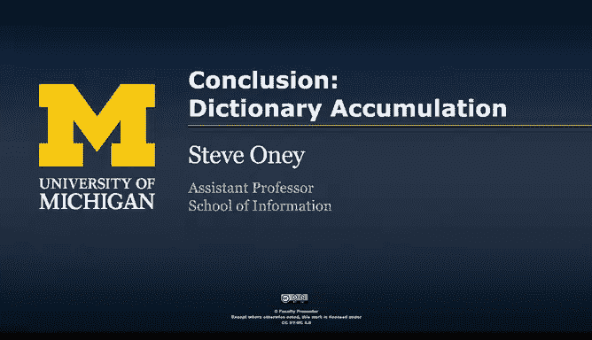

# 密歇根大学《Python3编程（课程1、2）》｜Python 3 Programming（Python for everyone进阶）（中英字幕） - P123：35_02_07_字典累积总结.zh_en - GPT中英字幕课程资源 - BV1CM411Z72u

Great job so far。 You've covered many of the most important techniques for writing good Python code。

 and in this lesson we learned about dictionary accumulation。

 which combines dictionaries in the accumulator pattern to make both more powerful。

 and it does this by extending the accumulator pattern to be able to use any number of accumulator variables。

Now we can adapt dictionary accumulation to solve a variety of problems， as we'll see going forward。

I want to conclude this lesson with one of my favorite short dad jokes。Now。

 this joke is only two words and it goes like this。Not false。It's funny because it's true。

See you next time。