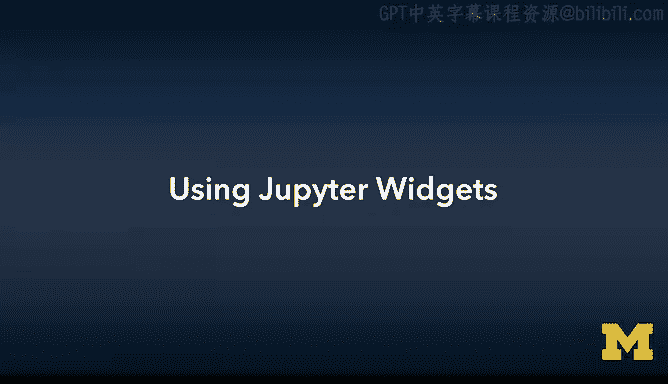
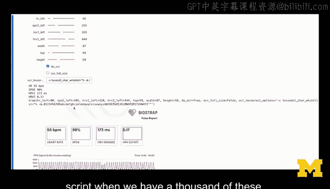
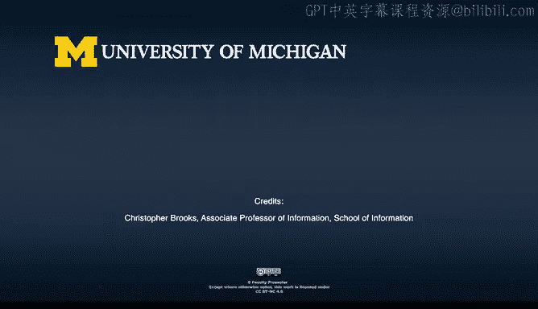

# 密歇根大学《Python3编程（课程3、4、5）》｜Python 3 Programming（Python for everyone进阶）（中英字幕） - P124：16_03_03_使用Jupyter交互组件.zh_en - GPT中英字幕课程资源 - BV1gj41177yd

Okay， we're towards the end of the course， and I want to introduce you to one more thing。

 Jupiter lab widgets。 Before I do that， though， let's reflect a bit on what you've learned。

 The first week of the course， I showed you some methods from software engineering。

 specifically diagraming through class and interaction diagrams。

 which I used to design software solutions。These methods are commonly used in large teams that are helpful in thinking through the entities and the relationships that you want to represent in your software。

Through this module， we also practiced our object oriented programming skills in Python。

 and you tackled the creation of our gameplay bot wordy Pi in the assignment。

In the second week of the course， we expanded beyond the Python Standard Library and learned how to manipulate images using the Python imaging library。

 Now， all third party libraries are different， so we went a bit in depth here covering both imaging fundamentals。

 as well as the nuance of the pill library itself。At the end of the week。

 you tackled bringing image manipulation into the wordy pi game to detect the state of the game。

Finally， in this week I introduced you to another new library， Teserak。

 which does optical character recognition。I showcased how this library works both by itself and with the skills you' already have with the Python Imaging Library。

In the assignment for this week， you'll utilize Test Act in order to add state to the wordy Pi game。

 specifically， my game engine will send you partial game plays， which it expects you to finish。

 and you need to detect whatever the current game state is in order to do that。

But before we do all of that， I want to introduce you to a form of interactivity called Jupiter widgets。

You've seen the real power firsthand of the Jupiter Lab notebooks。

 quick editing that allows you to instantly see some results in an easy to use web system。However。

 if you've played it all with the extra images I gave you at the end of a previous lecture。

 then you've undoubtedly recognized that it can still be a bit of a pain to explore all of the different options you might want to try when working with images。

Especially when coming up with bounding boxes for images。

 I find this can be very slow to do in Jupiter notebooks。

What Jupiter widgets allow you to do is move the parameters for your functions out of your code and into the regular display functionality that you would expect to have in a modern computer。

Really， the widgets allow you to build a very basic user interface to the objects and the functions that you've written。

For this lecture， we're going to actually use a real problem I was facing this week。You see。

 I've been doing some research with wearable devices， a platform called Bistrap。

 which is a bit like a smart watch。 This strap analyzes a few physiological processes while you sleep and provides a P D F report when you wake up。

Now I actually have 50 of these I want to analyze all from different subjects。

 so a PDF is a bit of a pain to work with。Instead， I'm going to convert each of these reports into images and then use pill and Tesserak to extract all of the information I'm interested in。

 Let's jump in and do it。First， let's check out what this report actually looks like。

 So here's one of mine， not one of my subjects。 so I'm just going to open it's called Bisstrap do PNG。

 a portable network graphic， and I'm going to print out the image and then I'm going to print out a smaller version of it so I'll just div by four here。

A few things to note first， the image is very large。

 I scaled it down to 25% size just to render it in the notebook。

 it's okay that it's large though that's actually good for OCR。Next we see that there's lots of text。

 I actually don't want most of it， I just want the summary text in the top four boxes as this provides measures of the physiological processes that I'm trying to understand。

 so we're going to do a bit of cropping here。Finally， check out the mode of the file， it's RGBA。

Now we know RGB stands for red， green and blue color channels， but what is this A color channel？Well。

 this is actually called the alpha channel， and it captures transparency of a pixel。

 This channel determines how the display can determine whether the pixel color should be shown or only partially shown。

 depending on what's behind it on the screen。This is actually really quite cool。

 If we turn this value all the way up， then the image becomes fully transparent， invisible。

 While if we turn it all the way down， it becomes just like any other image we might want to show。😊。

If you've ever used dark mode for an editor or application and some of the images were completely unreadable。

 it's likely they had a transparent background。 That is the pixels that make up the background had RGB values。

 but also had this alpha channel value， and the designer for the website or the application just assumed you would be viewing it with a white background。

 maybe didn't even check。In this example， we're not going to use the alpha channel because we're going to convert everything to grayscale or L for processing。

 Okay， let's see how we can use widgets for interaction。 First。

 I'm going to make a small image that will work from。

 which is a quarter of the size of the normal one。 So thisll take place of my copy instead here。

 I'll just make a small image。 Now I'm going to import something from i Python widgets。

 So i Python widgets actually holds all of the Jupiter widgets and what I'm going to use for defining this is called interactact。

 There's a couple of different decorators that you can use or methods that you can use。

 but this one's by far the most straightforward。The way this works is that we're going to put the interact decorator right before the function we want to make interactive。

 and then we're going to ensure that the interact call matches the parameters of our function。

 For this example， we have four parameter。 So I want four onscreen widgets for the user。

 The first is going to be an integer and it's going to be bounded by0 and the width of the image。

 So you can see here I've got interactact。 So remember that's a decorator。

 It's just a function that wraps the function that comes after it。

 So the function here is called interact。 That's the one we're using。

 I want the first parameter to be the heart rate on the left。

 and I want it to be bounded between zero and whatever the width is of the image。

The second then is the same thing。 It's bounded between0 and then whatever the height is of the image。

 Remember 0，0， your origin， It's always the top left of the image in Python imagingaging library。

So together， these two parameters help us specify that corner of where the rectangle is going to be。

 Then we also have a width and a height。 So right now I'm going to make it a square。

 so it's going to be a 100 by 100 pixel image that I'm going to render at position 00。

Now that's all we actually have to do。 Now we just write the function that we want to interact with。

 It's got to have these same parameters， but unlike the decorator， it actually has to do our work。

 You see here the decorator just describes what our parameters are and how we bound them。

 but here in the function that I've called draw I first make a small copy of the image。

 then I get a drawing object， then I make a rectangle and I draw a rectangle at whatever the parameters are。

 set the outline to red and then I display it。 You'll see that this is all done within that function draw。

 including the display So every time draw is called it's going to display the image and it's going to start over from scratch。

 Let's run this。Okay so when we run this， we see that we have our image and we have our red bounding box and it's located at 00 and it's 100 by 100。

 but we can see here that Jupiter actually has a four slider widgets and they're named after our variables。

 So if we want to take HR underscore left and if we drag this that image actually becomes recreated each time。

 and it's giving us a five pixelel bump each time we drag this over。

 if we move it very quickly you might even see the image disappear from you and so you can see very quickly we can actually play around with and find a way to put that bounding box。

 maybe I have to move this slightly down maybe I want to change the height a little bit more and so forth。

So you can see that we can actually nail down and zoom in a little bit here on what we're interested in。

Trying to OCR。 Now， this is pretty neat， a quick way to build a little user interface right inside of Jupiter。

 which is helpful for finding parameters you might actually want to explore。Actually。

 there's a lot you can do with these Jupiter widgets， including video， date and time pickers。

 string functions and so forth。 I'm not going to go into this in detail because it's a rapidly changing area。

 And honestly， it's a bit out of scope for an introductory Python course。

 But let me just walk you through what I did to tie all of this together for my analysis。First。

 observe that all of the boxes I'm interested in pulling data out of are in a row at the top of the image。

 So each box will have the same top value， and they will have the same width and height。

 This will make it much easier for me to write my application。

 So starting with what we had from before， I make a copy of the image as a little smaller for displaying it inside of Jupiter and import piteact。

 Now， I'm interested in four different measures， Heart rate。

 blood oxygen and two heart rate variability measures。

 And each one of those has its own offset from the left of the image。 I also need a top coordinate。

 which they're all going to share and a width than a height。

 which I'll also have them share because they're all the same。😊。

I'd like to make it optional to do the OCR OCRN can be slow and the quality of OCR gets better with full size images。

 so I don't know if I want to be OCRN on this small copy。Finally。

 I would like the option to use this full sized image when I do get those boxes lined up。

 and I want to include this parameter for the Teseract options because honestly it was pretty handy in the last lecture and probably will be handy here。

So I've decided that my method signature or function signature， I guess here has the heart rate left。

 the SPO2 left， the HRV1 left and the HRV2 left， so all of these are just going to start with zero but I want to be able to change them all using the sliders and they're going to start at0 and go to the small image with the top for all of these will be shared because they're all on the same line in the image so it makes it really easy and I'll start that at zero as well and I'll set my width and height to 100。

Now I've also included a few more flags， do OCR， which I've set to false， so that's a Boolean。

 OCR full size that I've set to false， another Boolean。

 and then OCR Teser Act options and this is just copy and pasted from our previous lecture as a string。

Remember， interactact here is a decorator what's a decorator。

 a decorator is a function that wraps another function and we use it with this at sign at the beginning。

It has to be declared as a decorator and it is in the package that we're using。

 that means Interact has to have the same set of parameters as the function which comes immediately after it。

 which is called draw。Al right， so here's our updated draw I've set a bunch of default values for draw。

 actually those don't matter because Interact is going to call it every time we update the user interface or do something in the user interface。

 Interact is going to actually call the draw function with its parameters。

Let's look at the logic here。 I've decided to nest this run OCR function inside of the draw function。

 Remember， it isn't actually run every time draws called。 So we have a function here called de draw。

 And then we have de run OR inside of it。 This is just a definition。

 This doesn't actually get executed multiple times。

 It only gets executed when we're inside of draw and we call run OCR。

 So just be aware that this is not actually being executed more than once。

 It's only being run once on initialization。 the first time it's run。

The OCR function here is pretty much a copy and paste from the previous lecture I've added a bit of logic though so it's going to change behavior based on this do OCR so if do OCR remember this function because it's nested inside of the draw function if there's no do OCR variable and nothing's being passed in it will actually look up one level into the draw function so again this is an important part of Python that maybe you don't run into every day it's equivalent scoping it's called but it's something that you should be aware of certainly by the end of this class you should be able to read this kind of code。

If we do OCR， then I'll actually do the OCR work and otherwise we'll just return an empty string。

Now if we're actually going to do the OCR， I do a bunch of cropping and so forth here。

 but what we return at the end is the image to string and I replace all the new line characters with white space characters just to make it a little easier。

Remember， you don't need an if and an LSif， if do OCR and if that's false。

 then we just go straight to return the empty string。Each time this function。

 the draw function is called we're going to render an image。

 so we always want to start with a small clean copy。

 so I've got a small clean copy here and then I'm going to draw the different rectangles on it。

 I've got different colors for them， red， blue， green and black。

 this should all be fairly straightforward to you now。

 I'm also going to print out the OCR results just with print。

 so I'm going to print out the heart rate and then whatever comes back from running the OCR。

 I'm going to then print out the SPO2， the blood oxygen level and then whatever comes back from that call and so forth。

And then at the very end， I'm going to print out the function call signature and I'll show you why later。

 but basically I want to be able to narrow down my parameters to something I like and then actually be able to copy that into my code。

 let's run this Okay so here's what our notebook looks like after Ive run it。

 Now you could see a black rectangle here。 a square。

 actually that's all four squares on top of one another。

 We can also see that we have sliders as we expect。 and then we have two checkbox。

 one for do OcrR and OCR full size。 So when we actually just pass into a Boolean something of Boolean type interacts going turn those into check boxes so that we can control that type and for a string actually it just uses a little text area here。

 and there's a lot more you could do here with functionality。

And then it's called this the first time， and so you can see here it's actually showing me what is the method call that or the function call that I've given。

 and that's nice because once we've nailed down the parameters， I can copy and paste that out。

So let's see if we can nail down our height heart rate here first。

 and I'm going to bring in our width， I think， with something like that。

And our height may be something like that。And then let's see if we can't get this heart rate first。

This over， you could see that every time I move this we're getting some text bleeding through and that's actually because the image is being recreated automatically for us by Jupiter because every time I move that slider。

 it's actually recalling that function and that function takes time to run there's a few tricks that you can do to speed that up if you want to build your user interface in Jupiter。

So here I've got the heart rate and the IPO2 chosen I'm going to just tweak that height a bit。

And then I'm going to check this do OCR。 And so what you see here now is the heart rate is 55 Bpm and it says heart rate。

 So that's being selected out of this box here。 If we actually didn't want this heart rate underneath it。

 if we just wanted 55 BPm。 one of the things we could do is change our height even further。

 so we just lower our height of this box until now it's no longer in that bounding box。

 and so now the OCR doesn't pick up anything there。

So I like to do something like this to try and figure out where I'm actually trying to crop on the image and what I'm trying to do on the image that work。

 okay？The other thing I notice is that the SPO2 should be a percentage and it's not and that's because I don't have a percentage in here。

 so if I add the percentage to our Teser Act settings。

 I should be able to get it and there's no need to do the full OCR because of this。

So what's handy is that I could just copy this line and I can drop it into my other Python notebook and I could just now run that over all 50 of those images so load image after image and actually have it rip out the text that I'm interested in So a handy little way to automate looking through what was a bunch of PDFs that some people would just have a grad student type in all of the results for those。

 but here we could just write a Python script to do it for us not only is it fun and it practices what we've learned but now I have that Python script when we have1 thousand of these when we scale up our study in the future Okay there we have it a simple little user interface to help me explore my data a bit。

Now， it's not the prettiest of code。 And I wouldn't write a full application inside of a Jupiter notebook book。

 But honestly， people do。 The Jupiter widgets allow us to enhance the development environment a little bit if we're willing to put in the effort。

 And the interact module in particular， makes this pretty easy。

 as we just wrap our function in this decorator object and parameterize it appropriately。

If you're interested more in this topic than I highly encourage you to check out the I Pi widgets documentation。

 There are many more sophisticated widgets available to use， including layout managers， tabs。

 buttons and even streaming video。😊。

