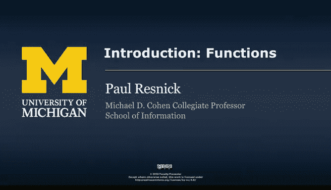

# 密歇根大学《Python3编程（课程1、2）》｜Python 3 Programming（Python for everyone进阶）（中英字幕） - P124：36_03_01_函数导论.zh_en - GPT中英字幕课程资源 - BV1CM411Z72u

Welcome back。Take a look in your calendar and mark this date。

 Today is the day you are crossing over the line from someone who can just write code that does something to being a real programmer。

Someone who can abstract from a bit of code that works on one piece of data。

To writing a function that will operate on any similar piece of data。TodayTo is your day。

 I hope you'll celebrate in some way。 Have a special treat， Brag to your friends。

 or at least make a celebratory post in the forums。😊，At the end of this lesson。

 you will be able to define functions with appropriate names for formal parameters。

Identify formal parameters and parameter values in a code sample。

And you'll be able to predict the return value of a function given sample parameter values。

See you next time。