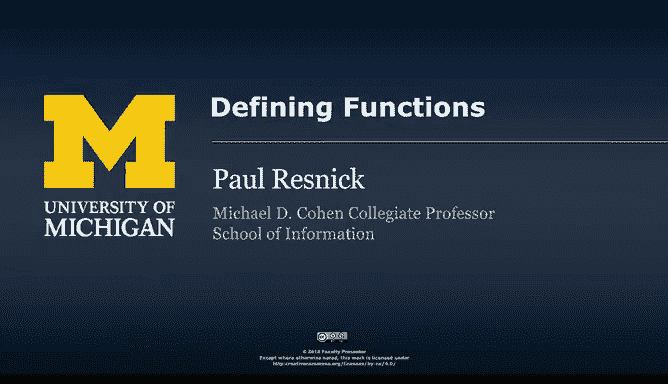
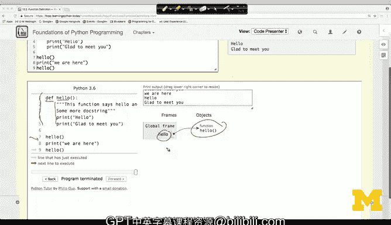

# 密歇根大学《Python3编程（课程1、2）》｜Python 3 Programming（Python for everyone进阶）（中英字幕） - P125：37_03_02_函数定义方法.zh_en - GPT中英字幕课程资源 - BV1CM411Z72u

Welcome back。The basic syntax for defining a function is the word de。 D， E， F， It's short for define。

Then you get。Any Python variable name。And then you have an open and closed parenthesis。

Inside the parentheses， we're going to see later that you could have more variable names。

 but we don't have any for this function， then we've got a cohen。Below that。

 you've got an indented block of code。 You've already seen indented blocks of code。

With the while loop， the for loop or if。If statements。It works the same way for function definitions。

 all the lines that are indented by that same number of spaces。

 They're all part of the function definition for the hello function。

And when we get another line of code down here on line 5 that's outdentted at the same level as de。

 that's going to be the end of the function definition。We have an optional comment。

And the first line of the function。If it's included， it's called a dock string。

 and there are some tools in Python for automatically generating documentation of a program。

 they'll show the doc strings that are associated with functions。It's often a multi line string。

 and that's why we use this triple quotes。No， we could have some more。Dock string here。

The triple quotes le you have a string that goes on to multiple lines。

Now when we execute just the code that we have here。Nothing is going to print out。

Even though there are two print statements on lines 4 and 5， they won't actually be executed。

 All that happens from lines 1 through 5 is that the function object gets created。

That function doesn't get executed。Lines of4 and5 here are only going to。

Execute if we invoke the function。So I'm going to have some code that's outdentted at the same level as the de。

And I'm going to invoke the function， hello。Now， when we execute it。Lines 4 and5， will run。

It says hello， glad to meet you。😊，Suppose I print something that says we are here。

And then another invocation of hello。See if you can predict what we're going to get in the output window。

It'sWhat we get。Heres the first two lines。Come from our first invocation of hello。

And then we get that we are here。And then we get two more lines that come from the second invocation of Hello。

Let's see that in code lens。So， you can see that。Executing lines，1 through 5。Just creates。

A variable called Ho， whose value is a function object， it doesn't execute that function object。

When I invoke the function。On line 7， it passes control to the function。

 so we then actually execute the contents that are inside of it。So we execute line4。

Which prints out hello， we execute line 5。 And now we're done。 So we're going to resume。Back here。

After the execution of Hello。So we get to line 8 and we print， we are here。

 and then we have another in。 so that passes control to the function。It does its stuff。

 and then it passes control back after line 9， and we're at the end of the function execution。

So that's the basics of function definition。The syntax， we start with the word deaf。

And then we have a function name。And then parentheses and then a colon。

 we've got an indented block of code for the contents of the function。Executing the death statement。

That just creates。The function， it doesn't execute it。

And we need other code afterwards like we have on line 7。

When we do a function in vacation it passes control to the code for the function。

 so those lines of code inside the function get executed。

 and then we resume right after the spot where the function and vacation happens。

See you next time when we add formal parameters。

