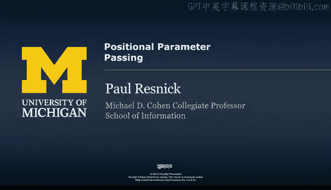
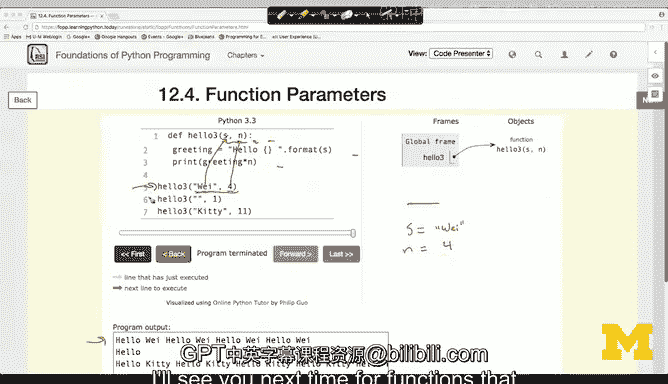

# 密歇根大学《Python3编程（课程1、2）》｜Python 3 Programming（Python for everyone进阶）（中英字幕） - P126：38_03_03_位置参数传递.zh_en - GPT中英字幕课程资源 - BV1CM411Z72u

Welcome back。A function can be defined so that it does different things。

Depending on parameter values that are passed to it。For example， heres a definition of the function。

 Ho， too。The only difference in this function versus our previous hello is that we have another variable name inside the parentheses。

We've called it S。That's called a formal parameter name， any variable name inside those parentheses。

So sometimes we call it a formal parameter or a parameter name。Then when we invoke the function。

Down on line 5。We'll pass some string into it。 In this case， we're going to pass this string。Iman。

By the way， that's Iman Yakazari， he's the guy who developed the practice tool that I hope you're using a lot。

When we do that in vacation， the variable S gets the value Iman at the beginning of the execution of the function。

 It's like having a behind the scenes assignment statement。

It as if we have a line of code that says S equals。Yman。😔，And then in the rest of the execution。

 we'll be able to refer to the variable S。So let's actually do this using code lens。

We first create the function and assign it to the name Hello to。And then we get to line 5。

We're going to invoke the function。But behind the scenes， there was this assignment。

S is now bound to imman。So， that when we。Print hello plus S。 We get Ho imman in the output window。

And then it says， gladla to meet you。And we're done with that invocation。

 The second time we invoke it。We're going to get。Asked bound to Jackie。Because Jackie is。

The value that is。It's past in。So now S is bound to Jackie。And we'll get。Jackie greeting。

 appearing in the output window， Ho， Jackie。Often we'll refer to the parameter values as inputs。

Don't confuse that with the input function。 Remember。

 the input function asks the user to type in a value Here。

 we're talking about a value that is passed into a function as an input to it。So this Jackie。

It's an input to the hellello2 function。Or sometimes we'll call it an input parameter or a parameter value。

A function can take more than one input parameter。Here， the function Ho 3 has two formal parameters。

S。And Anne。We're going to refer to both of those parameters。As we refer to On line 2。

 and we refer to on line 3。Remember that star， when applied to strings。

 means to repeatedly concatenate the string together。 So the greeting is going to be something like。

Hello way。Or hellello， kittty。And we're going to concatenate that together to itself a bunch of times。

 so it just repeats that string and times。Let's step through that code。We create。The string。

 that we create the function， rather。And then we call it the first time we call it。

We are passing in two parameter values， way and 4。The very first parameter value automatically gets matched with the first formal parameter name。

So we get S。Bound to weigh。The second value。Goes to the second parameter name， so n gets the value4。

We call this positional parameter passing。The first parameter value goes with the first parameter name。

And when we execute On line two。We'll get。A value for greeting that's hello way。And on line 3。

 we will print that out。A bunch of times。 you can see down here， we have said Howay four times。

The next time we execute this， we have ss is bound to an empty string， and an is one。

So our greeting is just going to be hello with a couple of spaces。

We're going to print that out one time and it looks just like hello on the output because we can't see the spaces。

the last time we invoke this， we've got Kitty and 11 is our two parameter values， our two inputs。

And so。We get hellello kitty， hello Kity， Hello， kitty， 11 times。In summary。Formal parameters。

 sometimes called parameter names or input parameters。Those are inside the parentheses。

 in the function definitions。So S and N are our formal parameters。

And then we have parameter values where sometimes they're called arguments or actual parameters。

Those go inside the parentheses on the function andvocation。They get matched up。Positionally。

 first parameter value with first parameter name， second parameter value with second parameter name。

The values are bound to those parameter names at the beginning of the function execution with this behind the scenes assignment。

 It's as if we have S equals。Wei。😔，And n equals 4。And that those assignment statements are executing behind the scenes at the beginning of the invocation of Hello3。

We'll see you next time for functions that produce outputs by return values。

