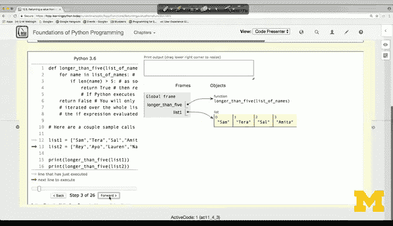

# 密歇根大学《Python3编程（课程1、2）》｜Python 3 Programming（Python for everyone进阶）（中英字幕） - P127：39_03_04_返回值机制.zh_en - GPT中英字幕课程资源 - BV1CM411Z72u

Welcome back。One metaphor I find helpful is to think of a function as a machine。

It may take some inputs， the parameters。And then when you run it。

 that's the kind of shaking that you see in this。In this animation， it can produce an output。

So let's look at how to make a function return a value。So here's a definition of the square function。

Notice line 3。We have a special word， return。And then afterwards， any Python expression。

 in this case， just a reference to the variable， why。

The value of that variable is some Python object， and that's the value that will be returned from the function。

Let's take a look at line 6。We are invoking the function square。We're passing in an input。

An argument。That's going to be bound to the first formal parameter name x。

And then we'll execute this function。 We're going to multiply。Whatever x is。

 x is going to be whatever just square was。And we'll multiply it by itself on line 2 and assign it to the variable Y。

 we're going to return a value and whatever is returned becomes the value of the entire expression。

So that is what is going to be bound。To the variable result。

Note that the word result here is not any kind of special word。 that's just a variable name。

 Return is a special word。That means to return a value from the function。

So let's see that in code lens。So we first defined the square function。

Then we get2 square is bound to the value 10。That happened on line 5。 and on line 6。

 we're going to invoke the square function。So behind the scenes， we're going to get an assignment。

That the variable x is going to get whatever value to square head。So2 square was 10。

And so x is going to have the value 10。We then execute the code that's inside the square function。

We get。W is 10 times 10 or 100。 And then we return y。So the value of this entire expression。

 square of two square becomes 100。And that is the value that gets assigned to the variable square result。

Now， if you were paying close attention there， you will have seen that when we finished the execution of the square function。

 some of the variables。Disappear over here。We had them。And then they disappeared when we finished。

 we're going to talk more about that in later screencasts， so hold on for some of those details。Now。

 if a function doesn't have a return statement， it will automatically return a special value called none。

Let's see that。Here's an example illustrating a common confusion for students。

Printing a value doesn't return that value。So on line3。We really should have a return statement。

In our definition of the square function， we've calculated 10 times 10 or whatever it is。

And we should be returning it。 But instead， we're printing it。

If we don't have a return statement at all in the function definition， it says if。

We had a statement at the end saying return the special value， none。

So let's see what's going to happen in this execution。We define the function square。

 we set to square to have the value 10。And now， we invoke the function。X。Cat has its value。

And are behind the scenes assignment。X is getting whatever to square head。 So x gets。

The 10 that two square was。TheX has the value 10。And we execute。Yhy gets the value 100。

 And then we print y。So we can see in the output window we've already printed y。

But we didn't return anything。 and so it's as if we have returned the value none。

And that means that square result is going to have as its value。None。You see here。

Square result has the value， none。And that means that when we go to print。This formatted statement。

 the result of。Something squared is something。We're going to get that the result of 10 squared is none。

 rather than the result of 10 squared being 100。What we really needed to do was not print。

But return why。And then we would have gotten that the result of 10 squared is 100。

One other important thing about the return statement。It interrupts the execution of the function。

No other code in the function executes after a return statement is executed。

If you've played the board game Monopoly。It's like the go to jail move。 Do not pass go。

 Do not collect $200。In our case， do not execute any more code inside this function。

 even if you're in the middle of a for loop or an if statement。

 a return statement makes you skip the rest of the code in that function。And here's an example。

D find this function weird。Not actually useful， but it's going to be very illustrative。

Of how this immediate return works。So lines1 through5 define the function， line 6 invokes it。

So when we invoke it and we get to line 2。We'll print out the word here。

 and we'll return the value 5。As soon as we return。

Means we are not going to do anything with the remaining lines of code。 They are orphaned。

We will not as go， We will not。Execute print there。We will return。

The value 5 and x will have the value 5， and we will print。5。So， we do get。The here printing。

We don't get there。There never shows up in our output。And the five is coming。From line 8。

And that's not a very useful function， which is why I called it weird。

But let's look at a common programming pattern。Where return does occur in the middle of a function。

 and it's a good idea。This function called longer than5， returns a boolean value， true or false。

It takes as an input。This one formal parameter called list of names。

It's expecting that to be a list of strings。If any of those strings has more than five characters。

The function returns true。And otherwise， it returns false。So， with。List1。

All the names Sam Terra Salamiita。 They're all five characters or less return false because none of them have a name longer than five characters with list2。

Both Lauren and Natalie are names that have more than five characters。

 and so longer than five will return true。How does it work？Well， we loop through all of the names。

That's what's happening。On lines 2 through 5。And if we ever get a long one。

If the current name is long。Then we will execute line 4， and we will return the value true。

As soon as we do that， we're done with the for loop。We're done with everything。 Do not pass go。

 Don't collect $200。 Get out of this function。And just return the value true。If， however。

We managed to get through the entire iteration， without ever。Exiting。The function。

 without ever executing line 4， then we will execute line 6。Whi says to return false。

So the reason this logic works is that we're never going to get to line6。

If any of the names are long。We'll only get to line 6 if we've processed all of the names。

And none of them caused us。To return true。So， that means。That none of the names were long。

 and it's safe to return false。So let's see this in code lens。We'll go step by step。

So we define this function， we invoke it the first time on the list one， Sam Terra Salonamiita。

So， behind the scenes。We get list of names。Getting bound to。To that list。Then we're going start。

Iterating through that list of names。And the first iteration， our variable name is bound to Sam。

Is it longer than five characters。No， it's not。So we go on and get a new value for name。

 Name is now bound to Terra。Tara is not long。Sile is not long。Aidita is also not long。

And now we've iterated through all of the list of names and we get to line 6。Where it says。

I guess none of them are long。 So let's return false。The second time we invoke it。

 we get the other list of names。And now， when we iterate through， Ray is not longer than 5。

 I is not longer than 5， but Lauren is longer than 5。 And so finally， line 4 executes。

 we return true。We never even get to look at Natalie。But Lauren was long。

 and that's enough to know that one of them was too long， and we get an answer of true。So。

 in summary。To return a value from a function， we have the word return。And then some expression。

That evaluates to a value。 In this case， the value falls。If we're in the middle of the function。

 then we have a return。We ignore the rest of the code in the function。 We exit out of the for loop。

 We exit out of the if。We don't pass go。 We don't collect $200。 We're just done with this function。

If。We have a function that never executes any return statement at all。

 We will return the special value， none。And the other thing to remember is that print is for people。

 you can use it inside of a function and it'll generate an output in the output window。

 but it doesn't cause anything to return from the function。Return is for functions。

 It doesn't print anything。But it returns a value to the spot where the function was invoked。

See you next time。