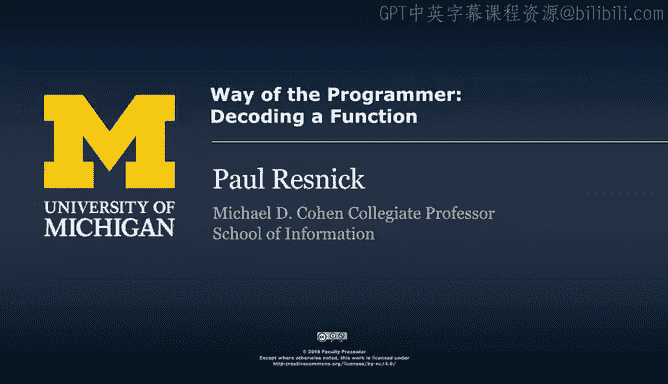
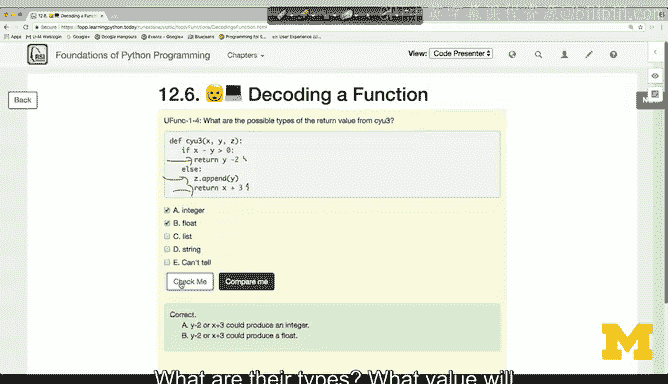

# 密歇根大学《Python3编程（课程1、2）》｜Python 3 Programming（Python for everyone进阶）（中英字幕） - P128：40_03_05_程序员之道：函数解析.zh_en - GPT中英字幕课程资源 - BV1CM411Z72u

Welcome back for a little way of the programmer segment on how to decode a function。

Here's a habit that I hope you'll cultivate whenever you see a function definition or whenever you write one。

Decode that function definition。Ask yourself three questions。First。How many parameters。Second。

 what types of values will be bound to those parameter names？And third。

What is the type of the return value？So let's work through a few examples。Here's a function。 C。

 Y U 3。How many parameters does it have， That's our first question wheneverever we try to decode a function。

 And it's the easiest one to answer because you can just look inside the parentheses。

And you can see that there are three variable names separated by commas。3 inputs。

And that's exactly the question that's being asked。Sure， three inputs， X， Y， and Z。

The next question is， what will their types be？So what are the types of X， Y， and Z。

 The first question is asking you is for x and Y as it turns out they have to have the same type。

 How can you tell that。There's nothing in the function declaration that tells you that。

 So you have to look in the code and see how those variables are used。In particular。

 we have x minus y in this expression。What are the types of objects that you can do a minus on。

The answer is numbers。They could be integers， They could be floats。Strings， not so much。

And not let's see either。So， let's。Try that integers and floats。Sure enough， we are correct。

How about the type of z。Well， we have to look where Z is used。And Z is used。Down here in the Ls。

We're running an append method on it。 Which kinds of objects can you do append on。And the answer is。

 only lists。Remember that lists are mutable。 You can do a pen strings you're not allowed to。

So C is correct， if I had answered D， I'd get a little feedback telling me a pen can't be performed on strings。

And then the final question for decoding a function is what kind of。Return value。 Does it give you。

And there are two spots in this code。Where we're returning a value， either y minus2 or x plus 3。

We previously inferred that both Y and X had to be numbers， either integers or floats。

And this doesn't tell us any more about whether。There are going to be integers or floats。

 minus and plus are both operations that work on both of them。

So the return value could either be an integer or a float。

Your debugging sessions will be a lot shorter if you can always answer those questions about any function that you're working with。

 So build the habit whenever you see a function， Decode it by figuring out how many input parameters and what are their types。

And what kind of value will be returned。See you next time。

