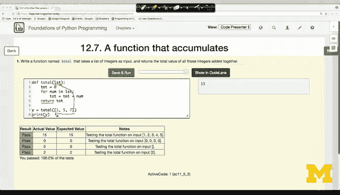

# 密歇根大学《Python3编程（课程1、2）》｜Python 3 Programming（Python for everyone进阶）（中英字幕） - P129：41_03_06_累积功能函数实现.zh_en - GPT中英字幕课程资源 - BV1CM411Z72u

Welcome back。Let's take a snippet of code that we've seen before and turn it into a function so we can invoke it at any time instead of copying and editing the code。

We've seen something like this before。We're trying to。Eventually get to defining a function total。

 But here's some code that computes the total。Of a list， the sum of all the values。

And it uses the accumulator pattern。Here we've got a particular list，1，5 and 7。

 We start our accumulator with0。We iterate through the list each time updating the total。

 the accumulator gets its old value plus the current number。So the accumulator tote starts at zero。

And it ends up being0 plus1 for1， 1 plus 5， makes 6， 6 plus 7 makes 13。And we print out。13。Now。

 the question is， how can we make it work for any list of integers rather than just for 1，5，7。

 You can see here that the problem。That we're being asked to do is define a function called total。

 And so we're getting an error because total wasn't even defined。

 We never created the function called total。So let's do that。Let's define a function called total。

And we'll put all of this code inside that function。So we're defining a function total。

It's going to have some parameters。 We're going to come back to that in a second。

 and then all of this code。We'll put inside here。And we're going to have to make some adjustments。

The first thing is。That we want total to take an input。

 We don't want it to just work on this particular list of 1，5 and 7。We wanted to work on any list。

So let's make that be a formal parameter when the total function gets invoked。

 that's when 157 or some other list will be specified。

So we're going to have that behind the scenes assignment to whatever list we want to run this on。

 rather than having。The assignment to a particular value。And then， of course， we need to。

Let's invoke total。We're going to invoke it and assign。Value。To a variable called Y。

Now let's see what happens in code lens with this。So we first。

Get the variable total bound to the function。We've defined the function。

 and now we're invoking it on the list 1，5，7。So there's a behind the scenes invocation。

The variable LST。Now gets bound。To the list 1，5，7， And we're ready to execute the lines of code。

So we're going to set tote equal to 0， and we're going to iterate。 None is first bound to 1。

 Then it'll get bound to 5 and then to 7。This time is bound to1。And tote gets updated to be0+ 1。Now。

 number is 5。Toad gets updated to beef1 plus 5。And so on。Now we're printing out that total。

And we're returning it。Oops， no， we're not。So this is that gotcha that often gets people when they're new to writing functions。

That we don't want to print out the total inside the function。 We want to return。The total。

What' will happen here is that y is going to be bound to none when we really wanted y to be bound to 13。

So the way to fix that is instead of printing the total。We're going to return the total。

And before I do that， I just want to show you one other thing that's kind of instructive。

I hide code ends。 if I run this。I'm going to get errors because our function is not right。

 but I'm also going to get a lot of outputs。And the reason is， and this can be kind of confusing。

We have tests when we give you these exercise， for example， writing a function name total。

 we have some tests where we behind the scenes are invoking the function total and checking to make sure that it's giving the right output。

So for example， we're invoking it on the list 1，2，3，45， and we're expecting the total to be 15。

1 plus 2 plus3 plus4 plus5。But the actual value that's getting returned is none。

And so we're getting an error。But each time we invoke the function。Our line 5 is running， and so。

We're actually printing out the 15。The 13 is coming from our invocation。

But the 15 is coming from when there's that behind the scenes invocation for the test。

 Then we have 0。When we invoke it on a list of zeros and we have another zero and when we invoke it on an empty list。

And we have list of just two。It's printing out every time， but it's returning the value none。

 and so our tests are failing。Let's fix that。Let's return。Tote in return does not use parentheses。

 It's a statement， not a function call。Now when we run it。We will。Pass the tests。And we will not。

Print out anything here。In the output window， because we had no print statements。

If we wanted to print out。Wai。We could get the value 13 to print。The 13 prints。

But we don't get any printouts from the rest。Of the tests。All of those。

Cause the code inside total to run， but it doesn't have any print statements。

So we don't get any confusing outputs there。Let's look back at what we did。

We started with our accumulation snippet with just one hard coated list。And just to remind you。

So we started with just this hard coded snippet that worked to find the total of a particular list。

Then we converted it to a function definition。The list became a parameter。Of the function。

 rather than being hard coatd as a particular one。The specific list that we were originally working with。

Became an input。Or an actual parameter。It gets bound to the formal parameter。

And then we needed to change the print to return。 We needed to return the total。

And print it out here rather than doing a print inside the function。

This is a common process for abstracting from a bit of code that works on a particular value。

You make that value be a formal parameter name of the function。

You pass specific values in when you invoke the function。

And the challenge is to make the bit of code inside the function be more general so that it works on any possible input in this case。

Any list of numbers。

See you next time。