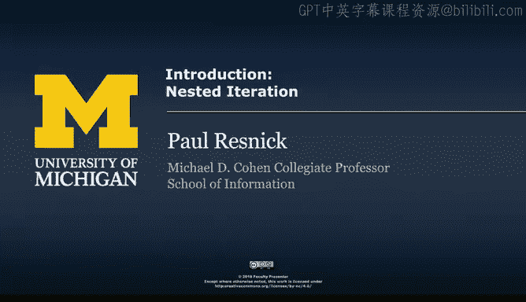

# 密歇根大学《Python3编程（课程3、4、5）》｜Python 3 Programming（Python for everyone进阶）（中英字幕） - P12：11_02_01_嵌套迭代简介.zh_en - GPT中英字幕课程资源 - BV1gj41177yd

Welcome back， everybody。You've already seen that you can use square brackets multiple times to extract an item from deep inside a nested data structure。

Often， you'll want to traverse all the stuff that's in a nested data structure。

 or at least some subset of it。 Perhaps you'll print all the items out or accumulate them into a flat。

 unnesed list。In this lesson， you'll do that through nested iteration。

 a for loop indented inside a for loop， indented inside a for loop as many levels as you need。

We'll also look at the confusions that can occur from a list or dictionary being nested inside other lists or dictionaries。

 It's analogous to the problems of aliasing that we've seen before。

 where multiple variables point to the same object。If you mutate a list。

 say by appending an extra item， you've effectively changed all the lists and dictionaries that contain that list。

And we'll introduce the notion of deep， as opposed to shallow copies of nested data structures。

Finally， we'll introduce the understand， extract， repeat method of incrementally figuring out how to extract data from the nested data structure。

At the end of this lesson， you should be able to write nested for loops to traverse a nested data structure。

Recognize when an inner list or dictionary is shared among multiple outer objects， and if necessary。

 make deep copies instead of shallow copies to avoid that。

And you should be able to incrementally develop code to extract the data you want from a complex nested data structure using the understand extract repeat process。

Bye for now。 will see you at the end。