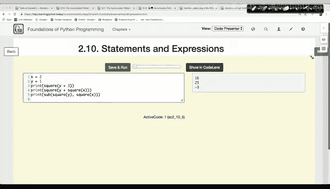

# 密歇根大学《Python3编程（课程1、2）》｜Python 3 Programming（Python for everyone进阶）（中英字幕） - P12：12_01_08_语句与表达式.zh_en - GPT中英字幕课程资源 - BV1CM411Z72u

Welcome back。 So so far， we've talked a little bit about expressions。

Which are the building blocks of programs， values。Which are what Python evaluates an expression to and then types and in Python。

 every value has a type。So there's one more concept which is called a statement。

 a statement is a complete instruction that the Python program executes。

So the only statement that we've seen so far has been the assignment statement。

 or that's when we say something like x equals 1 plus 2 plus 3。So here this。Is a complete statement。

And in this case， it's an assignment statement。But this part。Is an expression。

And so when Python is computing the value of this expression， it breaks it down into smaller parts。

 so it first adds 1 plus 2， takes the result， and then adds3 to that。

 and then it gets6 as the value of this expression。

And then the statement says assign the value6 into the value for the variable x。

Now let's look at just a few other examples of expressions。

 so here the expression 500 is what's called a literal expression because the value。

500 is going to be the same as the expression itself。 And this has type integer。

Another literal expression with a float might be 3。14， which has value 3。14 and has type float。

And again， we can have slightly more complex expressions as well。

 so we might have an expression that adds two numbers。

 so 200 plus 300 is an expression when Python sees this expression， it computes its value。

 which is 500 and an integer。And we can have expressions， of course， with floats as well。

 so we can have 10。0 plus 5。0， an expression that has the value 15。0， which is a float。Now。

 whenever we call a function， including the print function。

 Python first evaluates the value of the expression that we're actually printing。 So here on line1。

 we're calling the print function and Python sees that the argument to the print function is this expression。

 And so what Python does is it doesn't print out the expression itself。

 and instead first computes the value of this expression。

 and it computes the value of this expression by breaking it down into smaller sub expressionpressions。

 So here Python is going to compute 1 plus1 and get2。

And then it's going to compute the value of this sub expression two times 3， and it gets 6。

 And then we add2 plus 6 to get 8。And eight is the final value that we actually print out。Here。

When we print out the value of this expression， then Python first figures out what's the value of this expression here it's a literal expression。

 so Python figures out it's a string that has H ELLO as its characters。

And then when we call the L function on that string， then we see that there are 1，2，3，4，5 characters。

 So the value of this overall expression is going to be 5。 And that's what gets printed out。

 So again， Python does the work of computing the value of the expression that we're printing out。

 And it prints out the value of the expression and not the expression itself。

So you'll see when we on our code that the first line prints out8 because that's the value of this expression。

 the second line prints out five because that's the value of this expression。

And the same thing goes when we're actually assigning variable values， so if we say y equals 3。14。

Then that assigns the variable， Y to the value。The float，3。14。

But when we say x equals the length of hello， then as python is evaluating line2。

It crosses this out and computes the value of the actual expression。

 so the value of that expression is 5。And so that value of5 gets assigned to x。

 so in our variables values diagram， x points to5。Now， when we print out x。

 we're going to print out5。 When we print out y， we're going to print out 3。14。Now。

 we can combine different kinds of expressions into larger expressions as well。So here。

 this print statement prints out the value of one large expression。

This expression combines literal expressions。With function call expressions。

and also arithmetic operators，Now， when Python is computing the value of this more complicated expression。

 then again it kind of breaks down every expression。

 So here Python goes from kind of the inside out and it says， okay。

 what's the lens of hello and it crosses this out and replaces it with5 What's the length of goodbye we get1。

2，3，4，56，7 so it crosses this out and it gets 7 and then it knows we're printing out the value of 2 times 5 plus 7 So 2。

Times 5 plus 7。 Then Python computes the value of this sub expressionpress，2 two times 5。

 and it gets 10。And it adds7 to that。And then， it gets。17 as the value of the overall expression。

So if I run this code， it's just going to print out 17。So in this code， we first assign x to B2。

 so in our variables。valuealues table。We say that x points to 2。And then we assign y to be1。

 so we assign y to be1。Now， again， when Python sees a complex expression like square when called with y plus 3。

 it evaluates kind of from the inside out。 So it first figures out what's the value of y。

And then it teas that y is 1。And then we add one plus three。And that gives us four。

And so that means that we're taking the square of four。And that gives us 16。

And that means that the value of this overall expression。It's going to be。16。Here on line 4。

 we're printing out square of y plus square of x。 So Python again。

 you can think of it as competing from the inside out， so Python is going to replace x with2。

So that means that square。Of2， the value of this expression is going to be 4。When we add why。

 whose value is one。To 4， then we get 5。So thats we're taking the square of 1 plus 4 or the square of 5。

 and then when we take the square of5， then the value of this overall expression is going to be 25。

In this third example， we're taking a sub of square of y and square of x。

 so Python first asks what's the value of y for y gets 1？And then square of 1 is going to be 1。

 That's what's the value of x。 That's 2。 It takes square of 2 to get 4。And then so we're calling sub。

With one as the first argument and4 is the second argument。

 And that's going to give us 1-4 or negative 3。So you'll see that's what gets printed out for this line。

And 25 gets printed out here and 16 gets printed out for line 3。That's all for now， until next time。

