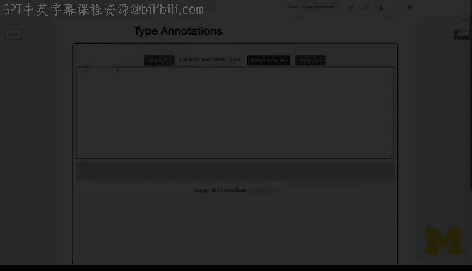
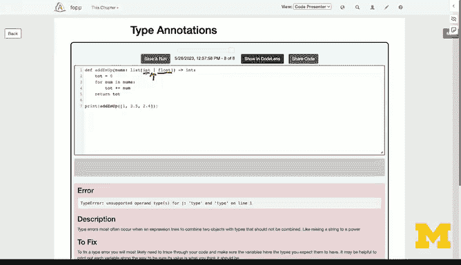

# 密歇根大学《Python3编程（课程1、2）》｜Python 3 Programming（Python for everyone进阶）（中英字幕） - P130：42_03_07_类型提示技术.zh_en - GPT中英字幕课程资源 - BV1CM411Z72u

Python is a language known for dynamic typing。You can have a variable name X whose value is an integer。

 and later assign a string or a list to it。Like I can say x equals three。X equals。Hello。Usually。

 I like to have a space between these。And。Print。X。And that is perfectly fine in Python。

I get the latest value of x， which is hello。In some other languages like C++ and Java。

They have what's called static typing。Whenever you have a variable。

 you have to declare what type of object it's going to refer to。

 it's either going to be an integer or it's going to be a string and that can never change。

Dynamic typing gives you flexibility， makes a lot easier to write small programs。

 but it does make it harder to reason about programs。When you define a function。

 you might intend that every time it's invoked， itll be past a string。

 but it could get invoked on a different type of object。

 And that might produce a runtime error or worse surprising results that are hard to debug a semantic error。

Also， when you see a function definition。You don't have type declarations for parameters to help you decode what kind of objective the function expects as inputs。

 and that can be really helpful。If you did have it。

 it would be helpful in understanding what the function does。Starting with version 3。5 of Python。

 a new feature was introduced calledTpe Annotations or T His。

It doesn't do everything that static typing would do， but it does help a bit。Ite。

 especially with decoding what a function does， you can think of it as a structured machine readable comment that says the type of data that's expected。

It's especially useful for formal parameters and return values of functions。Here。

We already have a dock string， a comment about the function。

Saying that it's supposed to return a strict。That's just a comment。

 and it's written in regular English text。We can document that same idea in a machine readable form as I've done at the top。

This arrow。The right arrow， it actually a hyphen or dash and then a greater than sign。

 but I'll refer to that as arrow。Says that the return value is supposed to be a string。

And the input that's going to get bound to the former formal parameter message。

Is also supposed to be a stray。That is a type annotation， or type painting。

Now this says that the input to the duplicate function is expected to be a string。

And I keep saying expected， not required。 The Python interpreter doesn't actually check when it's running to make sure that when the function is invoked。

 the value that's passed in is， in fact， a string。 Perhaps some future version of Python will do that。

 Ra a runtime error if the value passed in has the wrong type。 But that's not what happens as ofal 3。

11， at least。 And if they did ever make that change。

 I'm sure there's a lot of existing Python programs out there that would break。

The type hints can be read by people as they try to understand code。 There are also machine readable。

 There are linting programs and other useful tools out there that can statically analyze your code and alert you about potential problems。

 For example， if you use a variable name as the input in a function call。

 It can check whether the type annotation for that variable and the type annotation for the parameter name are the same。

 Let's decode a few more type annotations。Get several in this one。Add is a function。

 It has two inputs， X and Y。 They are both integers。And it's supposed to return an integer。

Gett number takes one input MSG， it's supposed to be a string。

 and it's supposed to return a floating point number。

I guess the string will have a number in it and we're supposed to extract that as a floating point number。

Display message takes a string。And it doesn't really say。What we're going to do with the output。

In fact， in this case， there is no return value and that's why we didn't specify that。

 but we also have the option。To specify a right arrow， none。

And all of this has to go before the colon。And that would be an allowable annotation as well。

In the context of type annotations， none acts as a type， even though it's really a value。

Here we have a function， count words。 It'd seen this kind of code before。 it takes。A text input。

 which is going to be a string。It's going to chop it up。Into words。We split it up。

 and then we do our counting thing， we make a dictionary。Whose keys are the words？

And whose values are going to be the count of how many times each word appears in the original text。

 What it's going to return。Is a dictionary。In that dictionary。

 it's going to have words or strings as keys and counts， integers as the values。When I run this。

You can see that the output is indeed a dictionary with strings as keys and integers as the values。

This form of type annotation。Where we get to say dictionary and。

What the keys are and what the values are is a later version。Of how Python does type annotations。

 if you're using a later version， certainly the 3。10。That I'm using currently。

 this is a perfectly allowable annotation， if you have the very first version of type annotation with Python 3。

5， you have to do something more complicated than that in order to tell it a hint about what kinds of keys and values you have in your dictionaries。

This function atom up takes one input。Whi we're calling nus， and it's going to be a list。

 each item in the list is supposed to be an integer。And it's gonna。Do an accumulation pattern。

 total it up， and return another integer。So if I run this。Add up 1，3， and 5， I get a total of 9。

Now actually add up， the code would work just fine， even if I passed in floating point numbers。

 I ought to be able to print at up。Of1，3。5 and。2。4。And the way I would do the type painting for that。

Looks like that color coding is telling me I put the parenthesis in the wrong place。

The way I would do the type painting for that is I can say。

That the list has to be of either integers or floating point numbers。

 the ways say that its or is this pipe character。The pipe character in a lot of computer programming languages is used to signify the ore of two things。

 It can either be an int or a floatat， and sometimes people will pronounce it as pipe。

 int pipe float， or they'll say int or float。Now this is， again。

 something where the form of annotations has changed over time as as we got to later versions of Python in this version of Python in Runestone。

 it actually isn't going to recognize this as a valid form of annotation。

It says it's an unsupported operaran type for the pipe， in the most modern versions of Python。

 this would be a valid annotation saying that it's going to be a list of either integers or floats。

So that's type annotations for you， they're helpful for indicating what functions are expecting as inputs and what they're going to produce as outputs。

 they help people to understand the code and they can be an input to some nice automated tools like Lis。

We won't always use them in the rest of these courses。

 a lot of the textbook was written before type annotations were even available。

 but it is really a good practice and I encourage you to use type annotations as much as possible in the final course you'll see code from us that that does use type annotations and I encourage you especially as you start to do more complicated code to include these type annotations I'll see you next time。

