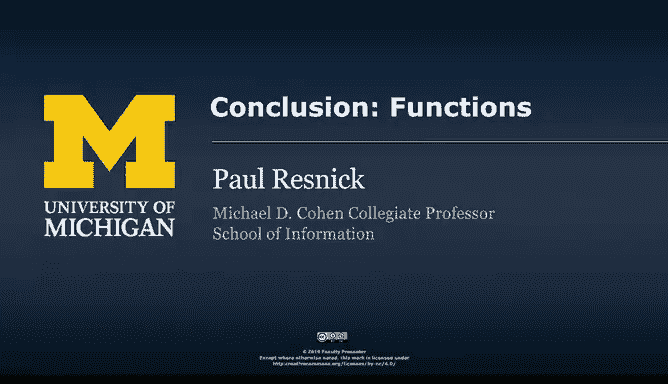

# 密歇根大学《Python3编程（课程1、2）》｜Python 3 Programming（Python for everyone进阶）（中英字幕） - P131：43_03_08_函数章节总结.zh_en - GPT中英字幕课程资源 - BV1CM411Z72u

Woray， you now have the tools to write reusable functions rather than just one off bits of code。

You should now be able to define functions with appropriate names for formal parameters。

Identify formal parameters and parameter values in a code sample and predict the return value of a function given sample parameter values。

I'm going to assume that you've managed to work your way through the exercises we've given you for this lesson。

 and so。By the power vested in me， by the University of Michigan and by Coursera。

 I hereby W U programmer with all the privileges and responsibilities that entails。Let's finish。

With a joke about functions。Why did the functions stop calling each other。

Because they had too many arguments。See you next time。

