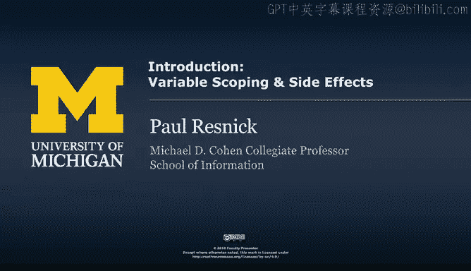

# 密歇根大学《Python3编程（课程1、2）》｜Python 3 Programming（Python for everyone进阶）（中英字幕） - P132：44_03_01_变量作用域与副作用导论.zh_en - GPT中英字幕课程资源 - BV1CM411Z72u

Welcome back。In this lesson， we're going to highlight a few subtleties with functions， including。

That each execution gets a fresh set of local variables that disappear at the end of the function execution。

That functions can call other functions。And that functions can have side effects on mutable objects。

At the end of this lesson， you should be able to one。

 avoid the use of global variables and function definitions by creating formal parameters for all values that are needed。

And two， identify whether a function has any side effects。

 including mutations to lists and dictionaries。We'll see at the end。

