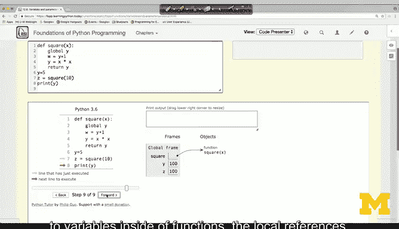

# 密歇根大学《Python3编程（课程1、2）》｜Python 3 Programming（Python for everyone进阶）（中英字幕） - P133：45_03_02_局部与全局变量.zh_en - GPT中英字幕课程资源 - BV1CM411Z72u

Welcome back。The scope of a variable is the set of statements where a variable name can be accessed。

In the function square。A mine， too。We assign。Why to have a value。

Since that assignment is inside the function definition。

 the scope is only the rest of that function definition。On line 6。We really can't refer to why。

In fact。We really can't refer to why。We get an error。A mind 6。

The error message is telling us the name， why is not defined。And that's true。

 even though line 2 will already have executed。Line 5 causes the square function to run。

So line2 will have executed， but even so。We say that that variable Y was local to the function square。

And its scope is local， we can't access it out here on line 6。Now。

 suppose we had a variable Y at the top level。Outside of any function definition。Say， we did。

Y equals。5。Now when we get to line 6。Why will be defined。But the value will be 5。And not 100。

What we get is。The value 5 that we that we assigned on line 4 and not the value 100 that we would have assigned on line 2。

It's going to help to introduce a little vocabulary here。The idea of a name's face。

A name space is an environment where all names are unique。In the city of Ann Arbor， Michigan。

 we can only have one main street。In a single stadium boulevard。

But names can be reused in other name spaces。 Other cities have a street named Main Street。

But it doesn't refer to R street， it refers to theirs。In Python。

 there was one global or top level namespace。And then each invocation of a function creates a new namespace。

In code lens， we show these namespaces as stack frames。

There's a global frame where we've defined square， and we've defined why。

And then we invoke the square function that creates a new stack frame。

And code lens is nice enough to label it for us。 It says this is the stack frame for the invocation of the square function。

The behind the scenes assignment， where。The formal parameter name X got its value of 10 because we passed in the value 10 for it。

That goes into the local stack frame， that's in the local namespace for the invocation of square。

Then we set y to be 100。That's also in the local stack frame。

So it's really interesting to notice here。 We've got y is 5。 We've got y is 100。

This works just fine because they're different name spaces。

Just like we have Main Street in Ann Arbor and Main Street in another city。

 we can have Y in the global frame and why in the local frame。

So here's the gory details of how variable lookup and variable assignment work with namespaces。

I'm just going to adjust this example slightly。The first rule is if you refer to a variable in the code inside a function。

If that variable name is ever assigned a value inside the function definition。

 even further on in that function definition。Then treats the reference as local。

If it finds the value on the local stack frame， it uses that value， and otherwise it's an error。So。

 here。It's going to be an error。Online， too。We are referring。To the variable y。

Y is assigned a value somewhere in the square function。

 which means that y should be a local variable throughout。But when we are online， too。

 why doesn't have a value。It does not go and get the y equals5 from the global stack frame。

It just says why is referenced before assignment online too？So that's an error。If， however。

 the variable name is never assigned a value inside the function definition。

Then it will look in the global stack frame。Suppose I do。W equals Q plus 1。Well。

 let's show it in code lens so we can really see what's happening。

Define all these variables in the global frame。And now we start running squares。 we get to line 2。

 it tries to look up Q。Q is never。Going to be a local variable in the square function。 So therefore。

 when we look up Q， it'll go look it up。In the global frame。And we get7， add one to it。

 and W gets the value 8。So if we look up a reference to a variable and that variable is ever local inside the function。

It's got to look it up only in the local frame。 It's never going to be a local variable in that function Then it looks it up in the global frame。

This can be pretty confusing。And your programs will be a lot easier to understand if all of your。

Variable references are just references。In the local frame。

So my recommendation is avoid referring to global variables inside a function definition。

Don't do this。It's legal Python。But it's not a good idea。

 Make another formal parameter for the function and have whatever value you need to get passed in。

 get passed in as a parameter to the function。So that's how variable lookups。

 references happen inside of functions。 What about assignment inside of function。

Assignment is always done in the local name space。The stack frame for that function call。

So if we go back to our original code。Notice that line 2 creates a variable Y。

On the local stack frame。So there is already a y in the global frame。But when we get to line2。

We create one on the local stock freight。So， the rule for。

Assignments is that we're always assigning to a local variable。

There actually is a way to force look up an assignment inside of a function to use the global stack frame。

I'm going to show you how to do this， for your understanding。But don't do it in your programs。

 It'll lead to confusing programs that are harder debug。Other programmers will shun you。

 you'll have no friends and you'll live a miserable life。 Okay， maybe it won't be that bad。

 but just don't do this。I'm going to show you for your understanding。I can declare why to be global。

If I now say w equals y plus 1。Again， don't do this just so you can understand it。

Why is5 on the global frame。We say， please。Treat why as the global why。Now。

 line 3 works because we can get to the y equals 5。And W gets to be the value 6。 Now。

 we're going to change y in the global frame。And we're going to return our 100。

So this is doable that it leads to very confusing code。That's local and global variables for you。

Inside a function definition， variable assignments create local variables。

 They can't be referenced outside the code for that function。

And that includes the formal parameters of the function。 Those will also be local variables。

Variable references use the local version of the variable。

You can reference a global variable inside a function either by explicitly declaring it global or by referencing a variable name that is never assigned a value inside the function。

But your life will be better if you never do that and make all of your references to variables inside of functions。

The local references。

I'll see you next time。