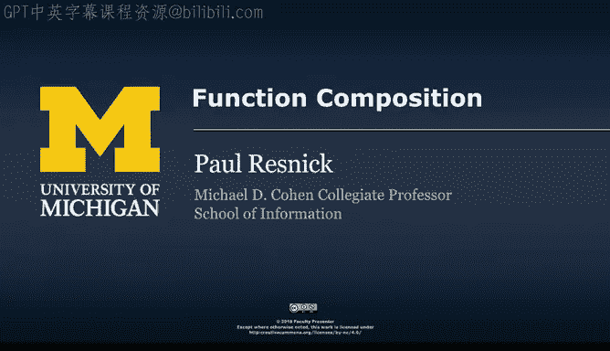
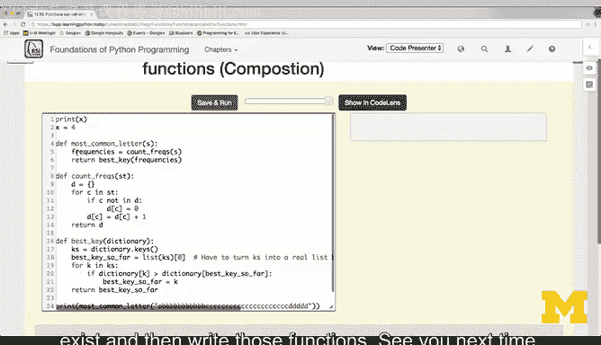

# 密歇根大学《Python3编程（课程1、2）》｜Python 3 Programming（Python for everyone进阶）（中英字幕） - P134：46_03_03_函数组合技术.zh_en - GPT中英字幕课程资源 - BV1CM411Z72u

Welcome back。You've already seen that a function is a useful way to abstract from a bit of code to something that has a name and has parameters。

The parameters help to make the code more reusable。

You pass in a different parameter value and get a different result。

 and the name makes it so that you can refer to the whole action of the function with a single name。

 It makes your code easier to read and understand。In this video。

 we're going to carry the abstraction process one step further。

 We're going decompose what a function does into a set of actions。

 and some of those actions may be implemented in other functions and we'll just invoke those other named functions。

So in other words， inside of a functions code， we're going to invoke another function。For example。

Here we have a function， some of squares that takes three inputs。X， Y， and Z。

It takes the square of each one。On mines 6，7 and8。And it adds them all up and returns the sum。

And in order to get the square of each of those inputs。We invoke the square function。

 which is defined up here。So we' inside the function sum of squares。

 we're invoking the function square。Let's see that execute in slow motion。So first。

 we define the two functions。And then we set values for A， B， and C。

 Those all get set in the global frame。And now we're ready to invoke some of squares。

So we get a new stack frame。And we。Get the values。For the parameter names， so x。

Gets whatever a used to be bound to or still is bound to。 So that -5 came from there。

Y gets the value that B had， which was 2。Z gets the value that C had， which is 10。Now。

 when we execute sum of squares， we get to line 6。And on line 6。We are invoking the square function。

We're invoking that inside of the definition of some of squares。So when we invoke it。

 we get another stack frame。So this is going to give us a local name space for variables for the execution of square。

And。It's also interesting to note that we have a variable x。Whose value is5 in sum of squares。

 there's also an x whose value is -5。 but these are different variables。So， we could。

Change the value of x in square， and that would not have an effect on sum of squares。In fact。

 we'll see that。Because we do a similar thing with the variable y。A mine， too， we create。

A value for y in the square stack frame。So now y has the value 25？

There's also a value for y in the sum of squares frame， but it has a different value too。

And we have not changed anything here。Once we continue the execution。We'll go forward。

 the square stack frame is going to disappear。We're going to return the value 25。

But the Y in sum of squares is completely unaffected。That explains the mechanics。

Now let's try doing functional decomposition to write a little bit more useful function。

Remember from last week when Steve taught you about dictionaries。

You had some code to accumulate a dictionary of counts。I've turned that into a function。Count freaks。

shorthor for account frequencies。It takes one formal parameter。S T， short for string。

 to remind me that the。Input parameter is going to be a string。

 and it's going to count frequencies for whatever string is passed in。Now， the。

Coode should look a little bit familiar。From last week， we start by making an empty dictionary。

 we iterate through all of the characters in the string。

If the character is not yet a key in the dictionary， meaning this is our first time seeing it。

We add it as a key in the dictionary， and we give it an initial value of0。

Then regardless of whether we've seen this character before or not。

 we're going to increment the counter that's associated with it。

So if this was the first time we saw it。It starts with a0， and now it's got one for its count。

 but if we've already seen this character， say three times before。

And the account will get updated to before。So the new things here over what you saw last week are that we've turned the bit of code into a function。

And before you just saw how to do this with a particular string。

 Now we're making it work for any string。 We've made the string be a formal parameter of the function。

And the other thing that's different is instead of printing out the result at the end or assigning it to a variable。

 we just return it。And then whatever code is invoking count freaks will decide what to do with the return value。

Similarly， you had code last week given a dictionary to find the best key in the dictionary。

 to find the key that had the maximum value associated with it。So again。

 I have turned that into a function。 I called it best key。

And it will take any dictionary as an input。That dictionary should have keys and values where the values are numbers。

 and it's going to return the key that has the highest value。Given both of these functions。

 count freaks and best key， I can now compose a bigger function， most common letter。

So it's going to take a string as an input。 And just to distinguish it。

 I've chosen to give it a different parameter name。

 I could have called it ST just like I used for count freaks， but。I decided to call it S here。

And we're doing this in two steps in step one。We count the frequencies in S。

 which creates a dictionary。 And I've assigned that to a variable called。Frequencies。

I pass that dictionary into the best key function。 And when I get back is。One key。

 the key that has the highest value， I return that and that should be the most common letter。

In our string S。So let's run this and make sure that it actually works。Down at the bottom。

 I'm invoking most common letter。On line 21， and I'm passing in a string that has a bunch of bes。

 a bunch of C's。 You can see that it's got more Bs。Than any of the other letters。

And what we should get as our output is just the letter B。And sure enough， that's what we get。

If I change my string。And give it a whole lot more Cs。Now， when I run it。

 I should get the letter C instead。 And sure enough， I do。

Now I've described this as a composition process。Often， though。

 you'll actually solve problems in the opposite order by decomposition。You might start by saying，Hey。

 I want to find the most common letter。So let's decompose that into first finding the frequencies of all the letters and then picking the one with the highest frequency。

When I start that decomposition process， those functions may not exist yet。

 but I just refer to them by name， and then afterwards， I fell in definitions for them。So really。

 how I wrote this code。I started by defining most common letter。And I referred to the functions。

 count freaks and best key， even though those functions didn't exist。

 because I'd given them names that made me know what they would do。

 I was able to write that function and have it be clear what it was going to do。

 And then I had to go and fill in。The other two functions。As a little aside。

 you may be wondering why it works to have On line2， a reference to the count Fs function。

 which has not been defined yet。When we talk about executing Python code from top to bottom。

So we shouldn't be able to refer。On line， too。To a function that isn't defined until line 5。

The reason we don't get an undefined variable error。Is that。Even though On line， too。

 were referring to count freaks。We don't actually execute line2 until after we invoke on line 21。

 the most common letter function。So by the time we actually execute line 2， countfs has been defined。

If we were not inside a function definition， we really would have a problem。For example。

 if I say print of x and then x equals4， I will get an error because on line1， x is not defined。

The difference。Is that inside a function， we're not actually going to refer on line 5 to count freaks until line 5 executes。

 and by that time the count Fs function has been defined。So to summarize。

 functions can call other functions， it's called composition。

You get multiple stack frames when that executes， each one has its own name。

 space and its own local variables。As a problem solving strategy， it's helpful to decompose。

 define a function by referring to other functions that don't yet exist。

And then write those functions。

See you next time。