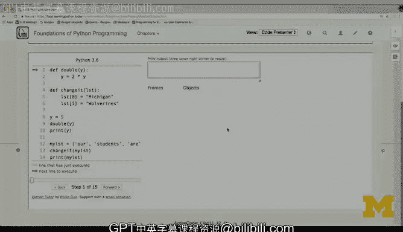
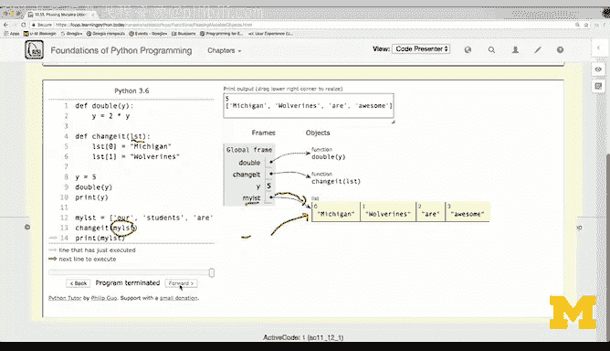

# 密歇根大学《Python3编程（课程1、2）》｜Python 3 Programming（Python for everyone进阶）（中英字幕） - P135：47_03_04_可变对象与副作用.zh_en - GPT中英字幕课程资源 - BV1CM411Z72u

Welcome back。

There's one more tricky thing that we want you to be able to reason about with functions。

 It's called side effects。If a function makes a change to a mutable object。

 like a list or a dictionary， that's called a side effect。

The vocabulary here is that the main effect of a function is the value it returns。

 and any other lasting impact that it has is a side effect。

One other thing that I'll refer to as a side effect is printing something out in the output window。

Let's see a side effect of mutating a list。First， this code gives us a little reminder that variables are local。

So we create these two functions。We make a local variable Y that's in the global frame。

And then we invoke the double function。The double function。Takes as input。Some value。

 which it assigns to a formal parameter y。So， notice that。We have a different Y。嗯。

They happen to have the same value， but they are completely different。Variables here。

And then we're going to assign on line 2 of the code。A new value for why。

Watch what happens in the double stack frame。 It's not going to affect what happens in the global frame。

So when we execute line 2。In the double frame， Y now has the value 10。

That did not have any effect in the global frame。You might also have noticed that the double function。

Doesn't have a return statement。 And therefore， it returns the value none。

It doesn't actually matter in this case， because。We don't do anything with the value of double。

 We're not assigning it to anything。When we do finally get to line 10。

 and we're going to print out the value y。We get the value Y from the global frame。

 So it's the value 5 that's going to print out not the 10 that we had in the local frame for the double function。

And sure enough， we get the value fought。 Now， that was just a reminder。

That we have local variables and changing a local variable doesn't affect the global variable。

But our next lesson is that even though we don't affect a global variable。

 we might affect a value that is shared by a local variable and a global variable。

So variables are local， but objects are not。Here we're going to see that we mutate an object inside a function and it stays mutated。

On line 12， we've created a list called My list。 Its value is this list of four strings。

 Our students are awesome。 That's you。😊，And then we're calling， change it。On line 13。

 we call change it。That creates a new stack frame。For the change it function。

And its formal parameter， LST。Gets a value。 The value it gets is whatever。My list hat as its value。

 Well my list was pointing。To that list object。 And so the LST variable。

In the change its stack frame。That LST variable also points to the same list。This is important。

 because。Now， when we get to line number5， list square bracket 0 gets a different value instead of being our。

 it becomes Michigan。And instead of students。We get wolverines。So notice that my list and list。

These are still two different variables， but because they're aliases for the same list。

When we finish this execution， and then we print my list。My list has the mutated value。 The variable。

 my list is pointing to the object， which has been mutated。

 And we get Michigan wolverines are awesome。 instead of our students are awesome。😊。

So we call this a side effect。The change at function is having a side effect on the list object。

Just as we talked about earlier， when we first introduced the idea of multiple aliases for the same list object。

 this can get confusing if you're not careful。Sometimes it's clear that a function is going to have side effects and you expect it。

 but sometimes you'll be surprised and debugging can get difficult。What happened to my list。

 you'll ask。To avoid potential confusion， it's best to just avoid side effects in your functions whenever you can。

If functions never ever have side effects， that's a style called functional programming。

There are programming languages built around that principle of functional programming。

 but Python is more flexible， and we will sometimes make use of side effects。

But you should do it sparingly and consciously。

See you next time。