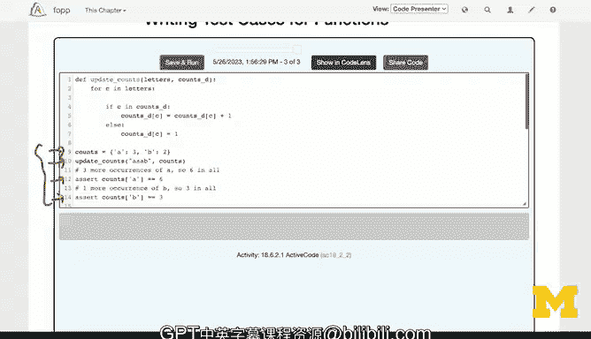

# 密歇根大学《Python3编程（课程1、2）》｜Python 3 Programming（Python for everyone进阶）（中英字幕） - P136：48_03_05_函数测试用例设计.zh_en - GPT中英字幕课程资源 - BV1CM411Z72u

。When you write a function， it's usually a good idea to write some tests to make sure that you've implemented it correctly。

And you can do that with search statements。Let's think conceptually for a minute about how you'd know whether a function was implemented correctly。

There are three things that a function can do when it runs。First， it can return a value。

And for those， we're going to write return value tests。Second。

 it could modify the contents of some mutable object like a list or a dictionary。

 and for those you're going to write side effect tests。

 the third thing a function can do is it can print something out or write something to a file。

Tests of whether a function can do that correctly or beyond the scope of the testing framework we're showing you here。

 so you won't be writing those tests。To check whether a function computes the right outputs。

 you'll write what we call a return value test。 Basically， you assert that the function。

 when given a particular input produces the output that uses expected to produce。 For example， here。

 we assert that square of 3 should be equal to 9。Remember that in Python。

Assert doesn't make something be true。It checks whether it is true。And if so， it does nothing。

But if not， it raises a runtime error。 I suppose I made a mistake and just had the function return x instead of x times x。

Then when I run this code， I would get an assertion error because square would return of three would return 3。

Not9。Now， which inputs should you write return value tests for？This is an art， not a science。

 You can never test whether a function produces the right output for every possible input。

 so you have to come up with some representative inputs。

 You hope that if the function does the right thing for these representative inputs。

 itll do the right thing for the rest of the inputs as well。

And I suggest that you first start with an easy one for the square function that's something like two or three。

But I could get the right answer for that without having the function fully correct。I suppose。

 I said。Let's assert that the square of two。Is4。And I realize， oops。

 I forgot to return x and instead I do x plus x。Yeah。Well， that passed the test just fine。

But maybe not on some other inputs。 if I try to also do。Square of。Three equals nine。

 I would find out that I had implemented it wrong， on line5 I'm getting an error。

So after testing on a basic input like two。The next thing。

 you know I happened to know here that I had implemented wrong， so I showed you three。

 but which other inputs would I try？The next things I would try would be some kind of。

Degenerate inputs like zero。What is the square of 0， Well， that should be 0。

 And I would say square of one should be one。Now if I ran these。

I would get an assertion error on line six because I'm supposed to get one， but I actually get two。

Another thing you might do to choose test cases is to think of what could possibly go wrong。

Have you've ever tried to teach a child about multiplying two negative numbers together。

And that that yields a positive number， you know that that kind of thing can be confusing for people。

Now I'm not really worried that the Python interpreter will get confused by it。

 but just for good measure。I'd say， yeah， a place where something could go wrong would be。

Square of minus2。Or square of -3 should be equal 9。If a function has a side effect。

 we'll have to do other things， but this is good and oops。Scratch that。Yeah， when I run this。

I still have。An assertion error on line 6， I know I did something wrong in my implementation oops。

 instead of x plus X it was supposed to be x times X。

 and we'll find out with all of these test cases， whether we pass them all and if we do。

 hopefully we've made enough test cases that we now feel confident that we've correctly implemented the square function。

If a function has a side effect。Your test will require more than one line of code。

 You'll need to set up a variable that points to some mutable object。 Then you'll call the function。

 Then you'll write an assert statement that checks on the value of that variable。

 checking to see whether it's been changed correctly。For example。

 you've seen before a function that takes a string and produces a dictionary with the letters as keys and frequency counts as values。

Here I've got a version of that。codeode。Possibly correct， possibly not。

 and I want to write some tests for it。So I'm starting。With a variable that's going counts。

 that's going to point to this dictionary。I'm going to call the function。Passing in。That dictionary。

And then I'm going to make an assertion。It's supposed to update the counts。It's not just。

Counting that there are three A's and1 B， it's supposed to add those to whatever was in counts。

So I'm hoping after update counts runs that counts。

Is going to point to a dictionary and that dictionary。Has。A。Initially with3 and B with two。

 I'm hoping that afterwards。A will be6。And so I'm asserting that after running update counts。

 a should be three plus the three extra A's that we we found。

 and we had one extra B so that we should end up with3。 So I'm asserting that counts。

 sub B should be 3 counts of a should be 6。All of these lines together。8 through 13。

 I think of as one side effect test。I first set up the variable。On line 8。

 I do an invocation of update counts on line 9， and then the remaining lines are asserting what the state of counts should be after that function is executed。

Let's try running it。We'll find out whether update counts actually does what I'm expecting it to do。

And it turns out。No， it doesn't。There's an assertion error on line 11。

So that means something must be wrong。With that function。We'll come back and debug it in a minute。

But as long as we're going to do this， we might as well create all of our test cases。

 and then when we fix the updateate counts function。

 we'll see whether the fix is good enough to make all of the tests pass。

Now I have a couple ways for you to think about how to decide which tests to run for a side effect test like this。

The first is just to think about edge cases。 What if we were to start with an initial count dictionary that was empty。

I'm going to copy this code。And edit it to make a second test for us。So instead of starting with。A。

 having three and B， having two， I'm going to start with。An empty dictionary。

 Now if I update the counts with AA A B。Then I should end up。With three A's。And 1 B。

Let me fix my comments so it won't confuse me。Three more occurrences of A and there weren't any before。

 so three and all。And one more occurrence of B， so one and all。So， this is。

Kind of a degenerate case or an edge case where the initial count dictionary is empty。

Another edge case would be。Instead of passing in an empty dictionary。

 what if I passed in an empty string？So I start。With counts of A's 3 and B is 2。

And instead of passing an AAAB， I passed in an empty st。So there are no more occurrences of A。

And there should be three in all。There are no more occurrences of B， they started with two。

 so there should be two in all。不是。So those are two degenerate cases or edge cases。

 one where the count dictionary that's passed in is an empty dictionary and another where the string that's passed in is empty。

So that illustrates one approach to coming up with test cases。

 another approach is just to imagine things that could go wrong。

Perhaps if we use the same name for our dictionary inside and outside the function。

 we'd somehow get a local copy and the global copy won't get updated。

 that's actually not what happens in Python， but if we can imagine something like that going wrong。

We might as well make a test case that will tell us if it ever does。Oh in the function。

 I called the dictionary counts D。I'm going to do a version of this test case。

Where instead of calling it counts， I call it counts D。And that's what I pass in。And。

That's what I make my asserts about。The way that local and global variables work。

 it's actually fine to do this， but if we were worried。

 the test case would help us and check to make sure that we don't get any problem from that。

All right， so now we have a bunch of tests， I run it， I still find out that on line 11。

 I have a problem。Let's debug the code to make the first test pass and we'll see if the others also pass at that point。

When we invoke。Update counts。We're getting。Letters。Yeah。Bound to。Yeah。A A， A B。

And we're getting counts D。Heting bound to this dictionary。Where a is3 and B is two。

We're going to go through the letters。For each of the letters。We first set counts sub D。

 counts D sub C equal to1。So the first letter C。Is going to get bound to A。And so。In this dictionary。

We're going to count d sub C if C is a。That's this spot， and we're going to set it equal to one。

It's going to turn out we didn't want to do that when we get to line  four。

 we check whether it's in the dictionary and we increment it to B2。

So that's what's turning out wrong。We really only want to set counts D to be 1。If。

If the character is not yet in the dictionary。So what I wanted for this code。Was to set。

It' basically this code should have been。Inside an else clause。Now， if I do that。

Hopefully the assertion error on line 11 will get fixed and maybe the rest of them。

 the rest of the test will pass as well， let's see。So I have no output here， but I have no errors。

 So in fact， I。I have corrected。The the problem and I have。A lot of confidence。

 because I didn't just correct it for one input and one output。 I corrected it for。

Several of them where I was trying to think about what could possibly go wrong and none of those things went wrong。

To review， a return value test can be run on one line。

 it just asserts that the result of calling the function on particular inputs is a particular value。

For a side effect test， you'll need to write several lines of code。One line。

Assigns a mutable object to a variable。Second line invokes the function passing in。That variable。

That mutable object that object should get。Chaanged as a result of running the function。

 and then we can have one or more assert statements and all of these together made up one test。

You can write several tests， one for typical input， one each。

 one for every edge case and one for every kind of input that you can imagine。

Might not be handled correctly by the function。Again。

 I really encourage you to write these tests for very small bits of code， it may seem like overkill。

 but when you start to have more complicated programs。

It's really helpful to have these automated tests so that you know when you change something that you haven't broken something else。

I'll see you next time。

