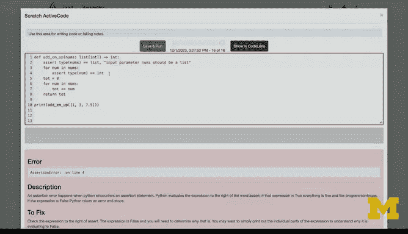

# 密歇根大学《Python3编程（课程1、2）》｜Python 3 Programming（Python for everyone进阶）（中英字幕） - P137：49_03_06_程序员之道：函数参数类型强制.zh_en - GPT中英字幕课程资源 - BV1CM411Z72u

。Welcome back for this short way of the programmer segment on using assert statements to enforce variable typing。

We've previously seen that Python provides a way to annotate variables。

 including parameters of functions as to their intended types。

 but it doesn't enforce those type annotations。As a programmer。

 you might find it useful to enforce the types yourself。Especially for function parameters。

 for example， consider this function definition with its type pins。The function is called Adamom up。

It takes an input parameter nus， which is supposed to be a list， all of whose elements are integers。

And the function is supposed to return an integer。Now in normal operations。It'll do just that。

I can invoke this function。I can pass in the list。1，3， and 5。We'll print out the results。嗯。

And you can see it works just fine。But it doesn't enforce。The types I could pass in。A string。

 instead。I'll get an error because when it gets down to line four， it's trying to。

Add together an integer and a string。But the real problem here is I did pass in the kind of thing that it was expecting to have。

 and it really would be better。If I just put an assert statement at the top that says nus。

Is supposed to be a list。Now I run it， I'll still get an error。But it's a much clearer error。

 it tells me that the assertion there。Didn't work。 And I can even。

Put a useful string to go with the assertion。Input parameter， nus should be a list。

And now when I get the error， it'll tell me very clearly。

What my problem was that I passed the wrong kind of input。As with all assert statements。

 they never get the work of your program done， all they do is alert you in a more timely and perhaps easier to understand manner that something's going differently in the program execution than you the programmer intended。

Now I could if I wanted to be。Really careful about it。

 I could have assertions that every single one of the elements。In Ns， is also an integer。

So I could say for numb in nus。Assert。At the type of numb。Is an integer。Now， if I pass in。A list。

 but that list contains。A floating point number。Instead of。

Just going on and giving me the wrong thing， I get the assertion error online for。

These are a useful tool for programmers can help you turn problems that would be hard to detect and diagnose into much easier problems。

They don't solve the problems though， you'll still have to do that in this case I would do that by making sure that when I invoke the function。

It has a list of integers。I'll see you next time。

