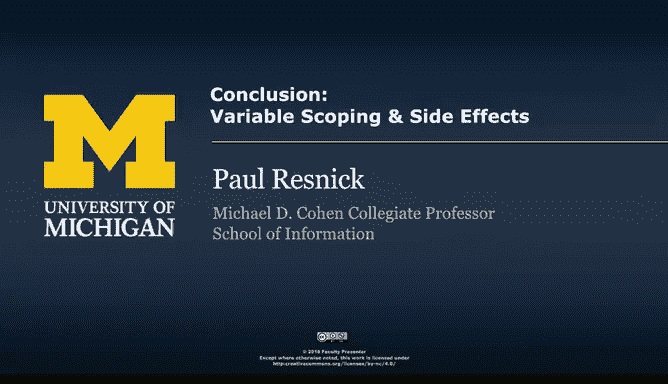

# 密歇根大学《Python3编程（课程1、2）》｜Python 3 Programming（Python for everyone进阶）（中英字幕） - P138：50_03_07_变量作用域与副作用总结.zh_en - GPT中英字幕课程资源 - BV1CM411Z72u

Few。You've now seen some of the subtleties of passing parameters。Accessing global variables。

 Don't do it。Functions calling other functions and functions having side effects。

You should now be able to avoid the use of global variables and function definitions by creating formal parameters for all values that are needed。

And you should be able to identify whether a function has any side effects。

 including mutations to lists and dictionaries。 As much as possible。

 I encourage you to avoid side effects， come as close to strict functional programming as you can。

Speaking of functional programming， why did the functional program return her TV？

Because she kept muting the sound by accident， she returned the TV and asked for one that was immutable。

Okay， that one was a stretch。 We'll see you next time。

