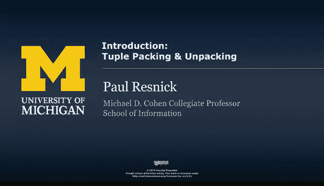

# 密歇根大学《Python3编程（课程1、2）》｜Python 3 Programming（Python for everyone进阶）（中英字幕） - P139：51_03_01_元组打包解包导论.zh_en - GPT中英字幕课程资源 - BV1CM411Z72u

Welcome back。 This will be a short lesson。 I just want to introduce a cool feature。

 packing and unpacking。It doesn't really let you do anything new。

 but it lets your code be a little more readable。At the end of this lesson。

 you should be able to one recognize when code is using implicit tuple packing。

And use implicit Tple packing to return multiple values from a function。

And you should be able to read and write code that unpacks the Tupo into multiple variables。

See you at the end。

