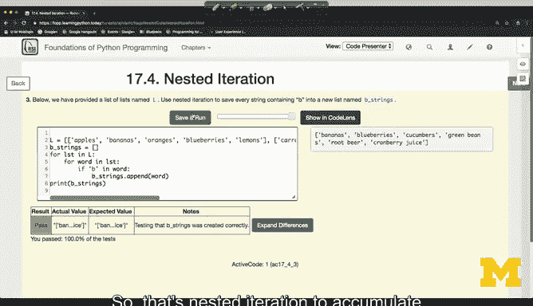

# 密歇根大学《Python3编程（课程3、4、5）》｜Python 3 Programming（Python for everyone进阶）（中英字幕） - P13：12_02_02_嵌套迭代.zh_en - GPT中英字幕课程资源 - BV1gj41177yd

Welcome back。With nested data structures， we'll often want to traverse all the contents and print or extract some of the items。

We do that by nested iteration with one forlo indented inside another。

Here we have a list called Dusted one。We've seen it before。 and on line， too， we iterate。

We go through all of the items in nested one。 We're going to call this the outer loop。

Because it goes through the outer list。The loop variable or iterator variable x。

We'll be bound to one of the items each time。So the first time that we execute lines 3 through 5 X will be bound to the list。

 ABC。So we'll have x。Bound to。ABC。And then we execute lines3 through five。

Then will change X and make it be bound to DE and will execute lines 3 through5 again。

As part of the loop。I just print level1 on line 3 because we're going to have a lot of stuff printing as a way of making things look nice in the output。

And then we're going to do an inner loop on lines four and5。So on line4 we started another iteration。

 we have another iterator variable or loop variable。It's called why。And why will' get bound。

First to A and then to B and then to C。 So the first time we execute line 5， y will' be bound to a。

And it'll print out a few spaces， level 2， colon， and then it'll print out A。

We'll go on why we'll get a new value， it'll be B and we'll print out level 2 B。

We get all the way through ABC。And then we're done。With the forlo。For the first value。X bound to ABC。

Then we go on to let x have a new value。 X is going to be bound to D and E。

 and we do the inner loop again。When we do the inner loop again， y will get bound to D。

 and then y will get bound to E。So， let's see how。How the whole thing unfolds when we run it。So。

 you'll notice that。9ine，3。Print level one。 that gets executed three times。

And the reason is that we have three items in the outer。In the outer list。

 So we execute the outer loop three times each time we print level 1。 And then the first time。

We go through A， B， And C。So line 5 executes three times once with y bound to A。

 once with y bound to B， and once with y bound to C。And one thing it's important to keep track of。Is。

Which variable names are we using for the outer loop and which are we using for the inner loop。

You'll notice that the。Variable X is used as the iterator variable or loop variable in the outer loop。

And then we see it again。On line4， when we're creating the inner iteration。

And that's a very common pattern， because when we do this nested iteration。

 we're letting X be bound to each of the inner lists。And then。In the inner loop。

 we're going to want to have。An iteration through each of those lists。

So if you're ever tempted to say for x in nested one。And then。For x in。Wai。That's not gonna work。

The reason it's not going to work is that。4 x。Is defining the iterator variable It saying。

 here's a new variable name that's going to get bound to something。

What you really wanted in this inner spot is for。Y in x， you want the x to refer。

To a variable that's bound as part of running the outer loop。

Here we have a traversal where we're supposed to accumulate something from the innerlas。

 rather than just printing them。So we're supposed to write code to create a new list that contains every person's last name and save that list as last names。

So each item in the outer list is itself a list， and those lists contain last names like Turner and Damon。

And wig。This requires an accumulation pattern。What makes me think that it's going to be an accumulation？

 Well， we had create a new list。And it contains every person's last name。

Those are kind of triggers that suggest to me that we're going to have an accumulation。

So to solve this。Let's set up our usual template for an accumulation pattern。

Since I'm accumulating a list， I start with an empty list。For something。In something。I'm going to。

Refer to a cubee。Here， and at the end， I will have my list。Now， instead of calling it a cube。

I'm going to call it last names because they told us we're supposed to accumulate it into a variable called Last names。

Now， what am I going to iterate over while I'm going to iterate。Over the whole giant list。

So that's called info。And I can name my loop variable anything I want to。

But since these are all entertainers。I'm going to call my variable Ener。

Now what am I going to do with each of these entertainers？Well， I'm going to extract。

Just the last name。And this is a very well structured piece of data because every inner list。

Has the last name in position 1。You' notice it's the same always。 It's always position  one。

Where we have the last name。And that means we can always just do something with。

Entertainer position 1。What are we going to do？We're going to append。That entertainer。To the end。

Of the existing list of last names。And I see that。 I misspelled last names。

And just to help me see what's happening， I'm going to print last names each time。

 So when we execute this， I will see as the list accumulates。Oops。

 it looks like I accidentally deleted my print statement as I was getting rid of all the markings on the screen。

 Let me see if I can undo it， and make it come back。I I can't make it come back。

 so I'm going to type it again。And now we can see on each iteration。

 when we get to line 6 on'm printing。And the first time， I only have Turner。

But the next time I have Turn her with Damon appended。And so on。

So that's how I would go about answering an exercise like this I'd first figure out。Oh。

 I'm going to need an accumulation pattern。 I would make the little template for that。

 and I would start filling in parts of the template。

 and I would have to come up with the insight that the last name is always in the same position in each of the inner lists。

And therefore， I can always refer to position square bracket1。Knowing that the entertainer variable。

Was going to be bound to a different one of these inner lists。Each time I went through here。

 the first time I get to line 5， it's bound to the first inner list， and I get。Turner。

The second time Ener is bound to that second interlist， Matt Damon 1970， and we get。

Damon's last name appended to our list of last names。Now， note that we don't have。An inner loop。

In this problem， we have four entertainer and info， but we don't have another for loop listed here。

But we do have an outer loop， and we have square brackets to extract an item。From an inner list。

 so we have an outer loop here on line four。And then we have another square brackets on line 5 to extract。

A name from one of the inner lists。If we're extracting things from two levels into a nestta data structure like Turner and Damon are getting extracted from info。

 we will always need a combination of two iterations。And square bracket index operations。

We could have。Info square bracket1。Square bracket。0。So that would be using two square brackets。

And if I do that， I will。Going to get rid of the print statement on line 6 so that we don't get confused by it in the output。

I will just get mat directly。 So if I want to extract mat， or I can extract Damon by doing。

Square bracket one， square bracket one。Or I can have a four loop。

 as I do on line 4 with a square bracket on line 5。I could have。2，4 loops。

Then I'll print a whole lot of stuff。But it's all the inner values， Tina Turner， 1939。And so on。

So that's two， four loops。Or two square brackets。 We've already seen a for loop with an inner square bracket。

 We can also have a weird thing， where we could say。For vow in。Info square bracket1。Print bow。

This going right pass here so that it knows we don't want to do anything in that for loop。

So here on lines 12 and 13。I am。Only looking at Val Square bracket at one。

 That's the inter list Matt Damon 1970 actor。And I'm printing that。And printing each of those values。

 So in any case， if I'm trying to get values like Tina and Turner and Matt and Damon out of this nested data structure。

 I have to do some combination I either need。2 square brackets。Or I need two，4 loops。Or I need。1。

4 loop。And a square bracket。1，4 loop and a square bracket。Two levels of nesting。

Some combination of two four loops and square brackets。Here's another problem， where we accumulate。

In this case， we do need nested iteration。Because we're not always going to extract the same thing from each in list。

Our task is to use nested iteration to save every string containing B。

Into a new list named B strings。So this is another accumulation pattern。 we're going to。

Tverse this nested data structure， finding each of the vegetables and fruits。

And accumulating all of the ones that contain the letter B。So this is an accumulation pattern。

These strings is eventually going to be a list。Of words that all contain the letter B。

 like bananas and blueberries， but not lemons。Initially， it's empty。

 and I'm going to iterate through。The outer list。So for each of these。Lists in the outer list。

I'm gonna check。Whether the items in it。Are B words。So I'm going to say for word。Enlist。

Be strings dot append。Of。😔，Word。And when I finish， I'll print out B strings。Now。

 this isn't quite right because I'm going to actually append all of the words even when they don't contain the letter B。

 So I've got apples when I shouldn't have apples。But I do now have just a simple list。

 not a nested list。 I just have all of the items that appeared anywhere。

At the second level in the list。 now they're in this flat list。

So what do I have to do instead of automatically appending every word。

 I have to append it only if it has some property， if something， something。

If the word has some nice property， I will append it， and otherwise I won't bother。

Now what do I want to put into this？If expression。At this point。

 when people start learning about nest iteration， they sometimes forget about。

The nice built in things that Python has given us。And I'm just first going to remind you。

 and then I'll show you the hard way， but first I'll show you the easy way if we want to check on whether word has the letter B。

We have the in operatortor。So if B is in the word， then we append it。And otherwise。

 we don't depend it。Now， we managed to pass the test。 We just got bananas and blueberries and。

Green beans， and so on。Now， there's a lot of ways that you can go wrong when you start writing this kind of code。

 you might be attempted to say things like append list instead of aend word。And what do you get。

 you get a bunch of lists。Rather than getting single words。

You might be tempted to append the letter B instead。

 then you just get a list of the letter B a whole bunch of times。

But what we really want is to append the word。If we do this， and by the way， it gets easier。

If you use mnemonic variable names， like word。If I had called this， why。And this one X。

It'd be a lot harder to remember what exactly I ought to be printing here。

 I'll be more tempted to do something like a pending X。Yeah， well， for B in。You。

 I'll say X instead of for B and Y， I should be saying B and Y， this gets a lot more complicated。

I can get the right answer。But it's a lot harder。 It was a lot easier when I used mnemonic names for。

List and L for word inlist。If B is in the word。Then accumulate that word into our final value。Now。

 what's the complicated way that and sometimes these students do things if they don't remember that we have this nice in operator？

While they start to iterate。A third time。For character in word。If。Character equals B。Then。

We appendend。The word。And that almost works if you don't remember about the in operator。

 it almost works， but it fails when a word has more than one B in it。

You'll see bananas came out fine， but blueberries got in here twice。

Because it got in there once for the first B。 and a second time when we got another B in the word blueberries。

So there's a way to get around this if you remember the fancy。Break。Command that ends the。

Inner iteration， the inner for loop。 This will break us out of。L。Intermost for loop that were in。

So this actually should work， I think yes， it does， but it's the complicated way。The simple way。Is。

To just check here。If。B is inward。So that's nested iteration to accumulate some of the values from the inner lists。

We'll see you next time。