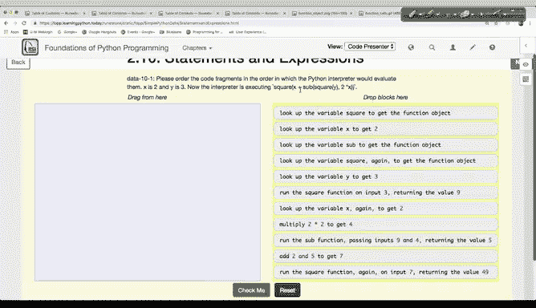

# 密歇根大学《Python3编程（课程1、2）》｜Python 3 Programming（Python for everyone进阶）（中英字幕） - P13：13_01_09_深入理解语句与表达式.zh_en - GPT中英字幕课程资源 - BV1CM411Z72u

Welcome back。Now， for this video， I want to be a little bit more precise about how python evaluates expressions in the order that Python evaluates different expression parts in。

Now， when we're doing a function call， the first thing that Python does。

Is it evaluates the function that we're calling itself so it evaluates。The function。Itself。

So in other words， let's suppose that we're calling this add function。

 the first thing that Python is going to do is it's going to look up what is the value of this expression。

 and it's going to hopefully see that a as a function。Now。

 the function call expression might be something more complicated than just a variable name as long as it evaluates to a function。

Then the next thing that Python is going to do is it's going to evaluate each one of the arguments in order so it evaluates。

The arguments。From left。Toright。And so in this example， the first argument is square。

 so Python is going to compute the value of this expression。

 and then it's going to compute the value of this expression。And then finally。

 after Python knows what function it's calling and what the value of every argument is。

 then Python is going to finally call the function。

And then the value that that function call returns is going to be the value of this overall expression。

So let's see that in action。So here we assign x to 5 and y to 7 and the first thing that Python does is it evaluates this add function。

 so it sees that add as a function， and so the next thing that it does is it evaluates each one of its arguments。

 so first it evaluates this subexpress， and it sees that square itself is a function and so it's going to repeat that process and it looks up square and finds that it's a function。

Then it repeats that process looks up Y finds that its value is 7。

And then it's going to call square on 7 and get 49。

Then it's going to look up the value of this square function。

 and it's going to see that it's a function。It's going to compute the value of each one of its arguments。

 so it's going to see that x is 5。And then it's going to call square on five。To get 25。So so far。

 what Python did was it found what's the value of add and then it computed the value。

Of its two arguments。 and then it ended up getting 49 as the first argument and 25 is the second argument。

 And so now that we have the function itself and all of the arguments。

 then we can finally call the function add on 49 and 25。And as a result。

 we're going to get 74 as the value of this overall expression。Now。

 suppose that we have this complex expression， square of x plus sub of square of y and 2 times x。

 and we're asked to figure out what order is Python actually going to evaluate these arguments in。

Now， bear with me for a bit as I drag each one of these blocks in the correct order。Okay。

 so the first thing that Python is going to do is it's going to try to look up the square function。

And so if we see， yeah， look up the variable square to get the function object。

And then it needs to compute the value of each one of its arguments。

 so here there's only one argument。And so the first thing that Python is going to do when figuring out what's the value of x plus sub of know this function is it's first going to look up the value of x because that's leftmost。

 So it's going to be look up the value of variable x。

I'm going to look up the value of variable x to get 2。

And then before we can add x plus this expression， then we need to compute the value of this expression。

So when computing the value of this expression， then we need to in turn look up the value of the sub function。

So， we need to。Look up the variable sub to get that function object。

And then we're computing of the value of its arguments， so the first argument is square of y。

 so in order to do this， we need to look up square of what's the square function。

 so we look up the variable square again to get the function object。

And then we need to compute the value of its argument， so we need to look up the value of y。

 so we look up the value of y to get 3。And then we back up and we need to compute the value of the second argument to sub。

 And in order to do that， we need to look up x again to get2。

And we need to multiply two by two to get four。So now we have the value of both of these expressions。

Oh， excuse me， there is one more thing here， so after we look up the value of variable y to get 3。

 we actually call the square function。So here， after we look up Y to get three。

 we have to run the square function。Okay， so now we have the value of this sub expressionpression or this argument and this argument。

 and so now we can finally call this sub function。So we run the sub function。On inputs 4 and 9。

 giving us the value 5。And so then we get x plus 5， so that's going to give us 2 plus 5。And we get 7。

And that means that we're calling square with7 as an argument。

And so we run the square function again on the input 7， giving us the final value of 49。

That's off for now， until next time。