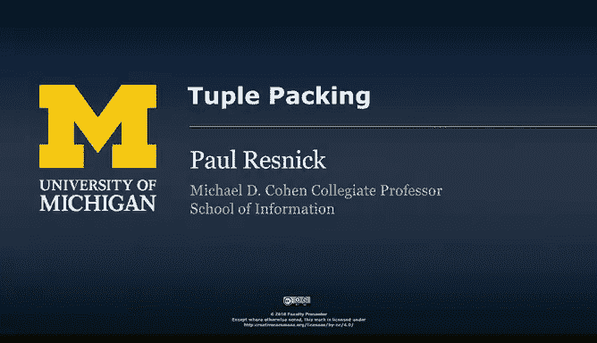
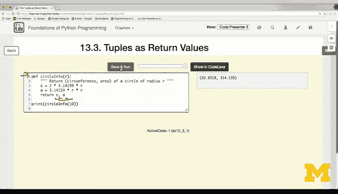

# 密歇根大学《Python3编程（课程1、2）》｜Python 3 Programming（Python for everyone进阶）（中英字幕） - P140：52_03_02_元组打包操作.zh_en - GPT中英字幕课程资源 - BV1CM411Z72u

Welcome back。In many places where the Python interpreter is expecting a single value。

But the code provides multiple expressions separated by commas。

It automatically packs all those values into a single tuple。

This is just a convenience that makes the code look a little nicer。

 It looks like you're working with multiple values when really it's just making one tuple out of them。

For example， in this code， we have several pieces of information about an actor。

 Julia Roberts and a movie she was in Duplicity。We can explicitly make those different pieces of information into a tuple using parentheses like we do on line number one。

So we have open parenthsesis there， closed parenthsesis。 This is our usual way of creating a tuple。

 In between， we have a bunch of values。 There's Julia Roberts，1967。

 All of these values are separated by commas indicate where one expression ends and another begins。

So， that's。The syntax that you've already seen for creating tuples， it turns out that。

Line 3 does exactly the same thing。 It's exactly the same。

 except that we've left out the parentheses。No more parentheses here。

 and it implicitly reads that as， oh， we got a bunch of values， we got to pack it into a tuple。

On line 4， you can see。As with any tuple。Julia is the name of a variable。 We look up its value。

 its value as a tuple。 square bracket 4 says， go and get the fifth item。 So Julia is1，2。3，4，5。

So what prints out here should be2009，So lines 1 and line 3 are。Just synonyms for each other。

 ion 3 is just a way that maybe looks a little bit better as if you have multiple values。

One place where this is especially useful is when a function wants to return multiple values。

For example， in this code。Circle info is a function。And。It wants to return two values。

The circumference of the circle and the area of the circle。

You can only return one value from a Python function。

 but that value can be a tuple as we've done here。So that works fine。

I can print the circle information of a circle with radius 10， and it has。A circumference of 62。

83 and an area of 314。But I also have the option if I think it looks better to leave the parentheses out。

 and it will automatically return a tuple。And I'll get exactly the same output。There you go。

So that's tuple packing。We'll see you next time for unpacking。

