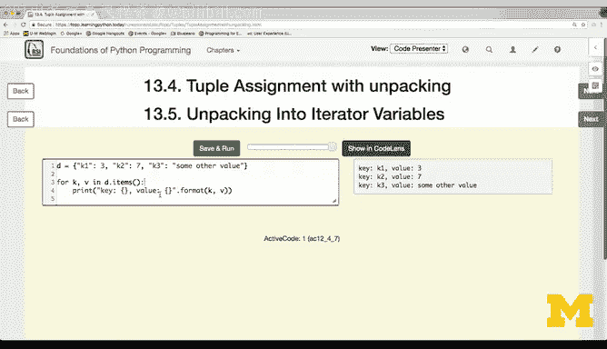
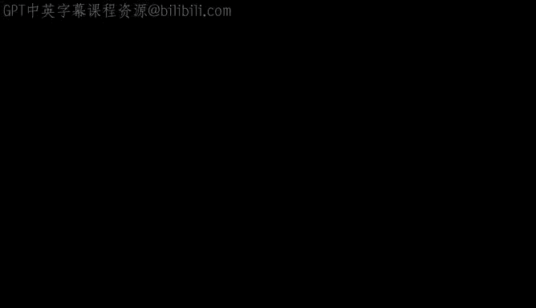

# 密歇根大学《Python3编程（课程1、2）》｜Python 3 Programming（Python for everyone进阶）（中英字幕） - P141：53_03_03_元组解包赋值.zh_en - GPT中英字幕课程资源 - BV1CM411Z72u

Welcome back。Last time you saw that on the right side of an assignment statement。

 multiple expressions separated by commas will be automatically packed into a tuple。So line1。

 the variable Julia gets bound to a tuple。Square bracket at0 will be Julia。

Square bracket one will be Roberts and so on。But instead of referring to the elements of that tuple with square bracket 0 and square brackets 1。

We can unpack them all at once into a bunch of different variable names。

So we've put a bunch of variable names here on the left side。 and what that does。

 it's as if we've said name。Equals Julia。Square bracket 0。Surname。Equals Julia。Square brackets1。

And so on。So it's just going to take Julia， which is a templeple and take all of the values from that and put the first value that goes positionally。

Just like we do， when we're。Calling functions， the first value。Goes to the first variable name。

 the second value goes to the second variable name and so on。Notice， however。

 that the number of variable names on the left hand side of the assignment statement has to equal the number of values that are on the right hand side。

If I run ABCD equals 1，2，3， I will get an error。We need more than three values to unpack on line one because we have four variable names。

So if I have four variable names， that'll be better。It works。But if I have five variable names。

 I also get an error。Too many values。Not enough。 variable names。

There's even a way to pass a templeple to a function and have them automatically unpacked into the parameter names。

In this code， we've defined a function add。It just returns the sum of its two inputs。

If I say to add3 and4。That will。Give me 7。Now， I can take 5 and 4， and I can tell。

The add function to get your values from the Tuple Z on line 6。

 I'm saying to add the contents of the Tuple Z， and it unpacks the first element of z into the variable x。

So x gets 5， y gets 4， and we see that9 prints out。Now I had to do a special little notation。

This asterisk。In order to tell。The Python interpreter that I wanted Z to be treated as a templele whose components would be unpacked。

And assigned to the two parameter names x and Y。If instead， I tried to。Just say add of Z。

 I'm going to get an error。Because。What it's going to try to do is treat z as a single value。

Assign that value to x。And then it looks for what value should I give to y。

 and there's nothing for why。So I get an error here。Addd takes exactly two arguments。

It has two parameter names， x and y。That's what the。Eror messages telling us， but only one was given。

 We only gave it a single value。The templepo，5，4。That didn't work。 There was no problem on line 6。

 though， because the star Z said， hey， even though it's a single value， a tupo 5，4。

 you should unpack that value， and 5 should go for the first variable name。

 and 4 should go for the second one。Unpacking is particularly useful for making iteration code more readable。

For example， when you iterate over a list of temples。In this code。

 we iterate over the key value pairs in a dictionary。So， we ask for。All of the items from d。So。

 that's going to give us。A tuple with K1 and 3。And then， another tuple with。K2。And 7， and so on。

 We get a sequence of all of these， and we're iterating through that sequence。So。At line 4。

 the value of P will be one of these tuples。And we can ask for P square bracket at 0， to get。

K1 and P square bracket 1 to get。re。Let's see what happens when that runs。

We have this key K1 value 3。That's coming from the first temple。Remember。

 we have this format string where we're substituting in P square bracket0 there。 So we get key colon。

 and then we're substituting in。Kwan。And then just the word value colon。

 And we substitute in whatever P square bracket one is。At this point， in the string。

 So we get the three。On the next iteration， P is bound to K2 and 7， and so we get。Key colon K2 value。

 Col 7。Reading that code is a little hard because you have to remember。

That when you're using this P square bracket 0， let's see P was a tuple。

 That tuple was representing a key value pair in the dictionary。

 and therefore P square bracket 0 must be the key。We can use mnemonic variable names to help us。

Make that a little bit more readable。Let's do this in two steps。

 Sose I say K equals p square bracket 0。And v equals P square bracket 1。And， I can。K。And V， here。

And this is just if I pick a good variable name like K for representing a key and V for representing a value。

It's easier to read line six and remember that what I'm printing out is the key and the value。

And once we have that idea， we can go even farther。

 And instead of unpacking ourselves on line 4 and 5， we can。Have Python do it for us。

So we can stick two variable names here， K comma V。

And it's going to automatically take each item and unpack it into the two variables。 K and V。

 This is going to give me exactly the same result。So that's unpacking。

 You've got one tupo and multiple variable names。The Tuple has to have the same number of values as the number of variable names。

We can do that with explicit assignment。Where there is an equal sign。

 or we can do it when there's behind the scenes assignment， like iterator variables in a for loop。

 as you've seen here， K and V are having sort of behind the scenes assignment to a tuple。

 and we're getting them to get unpacked into the two variable names K and B。

There's also behind the scenes assignment whenever you have parameter names in a function。

 and we can also do the automatic unpacking there。But that requires you to use the star notation to tell Python to do the unpacking。

We'll see you next time。

