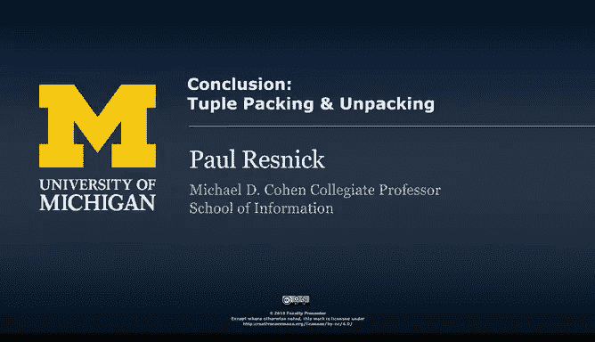

# 密歇根大学《Python3编程（课程1、2）》｜Python 3 Programming（Python for everyone进阶）（中英字幕） - P142：54_03_04_元组打包解包总结.zh_en - GPT中英字幕课程资源 - BV1CM411Z72u

Well， that was quick。You now know how to recognize when code is using implicit tuple packing。

Use implicit Tple packing yourself to return multiple values from a function。

And read and write code that unpacks a tuple into multiple variables。For a quick lesson。

 a quick joke。You know what I love doing more than anything。

Trying to pack myself into a small suit case， I can hardly contain myself。See you next time。

