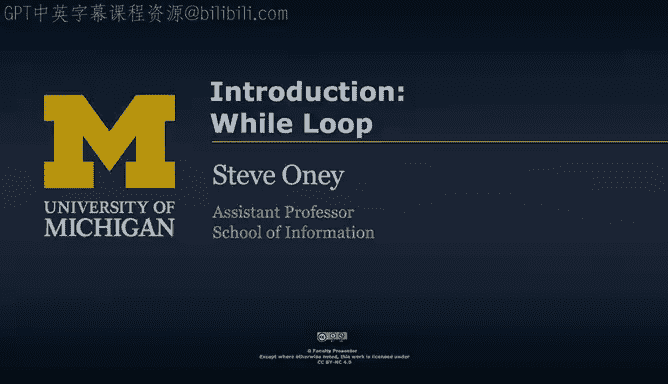

# 密歇根大学《Python3编程（课程1、2）》｜Python 3 Programming（Python for everyone进阶）（中英字幕） - P143：55_04_01_while循环导论.zh_en - GPT中英字幕课程资源 - BV1CM411Z72u

In this lesson， we're going to learn about indefinite iteration and the wire loop。

You've already learned about four loops where reiterate through every item in a sequence and run a block of code for each item in that sequence。

 but there are other kinds of iteration that we might want to do。For example。

 suppose that you want to write a program that asks the user if they want to continue and asks them to enter yes or no。

We know how to do this once， but suppose that we want to keep asking the user to enter yes or no if they enter anything else。

 so if we ask them do you want to continue and they enter maybe。

 then we want to prompt them again to enter either yes or no。

We don't know how many times we would need to ask the user， that depends on how the user responds。

 and so we wouldn't be able to use a for loop for this。By the then of this lesson。

 you'll learn how to use indefinite iteration to solve this and many more kinds of problems。

 we'll learn this with theW statement， which is a little bit more complicated than a for loop。

 but is also a lot more expressive than a for loop is。

We'll also extend our knowledge of four loops to learn about the special break and continue statements that work both with four and our new while loops to give us greater control of when our code gets run。

 so let's get started。