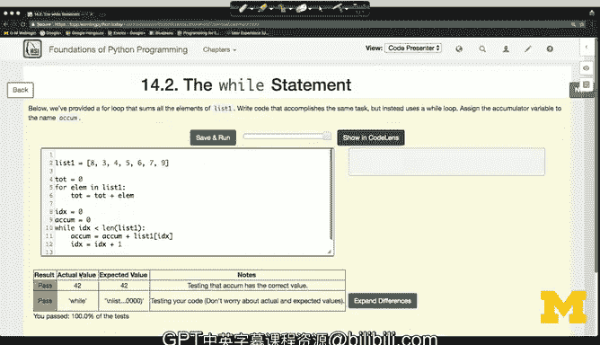

# 密歇根大学《Python3编程（课程1、2）》｜Python 3 Programming（Python for everyone进阶）（中英字幕） - P144：56_04_02_while语句解析.zh_en - GPT中英字幕课程资源 - BV1CM411Z72u

Welcome back。 So you've already seen the for loop as a way to iterate over every item in a sequence。

 A while loop is a much more general way of iterating。

So a while loop is kind of like a hybrid between a four statement and an if statement。

So a while loop looks like this。 You say while。 And then just like an if statement。

 you have a conditional that comes after the while。And then you have a piece of code。

That will run if this condition is true。But unlike an if statement where after you're done running this piece of code。

 if you use a while instead， then by the time you get to this end of code。

 then we loop back up here and check， now， is this condition still true。

 So in the sense that it loops back up to the top， that's kind of like a force statement。 So again。

When we get to a wild statement， we check。 iss this condition true， If the condition is true。

 then we run this piece of code。And then we go back up and check， is this condition still true。

So if this condition is not true， just like an if statement。

 then we skip this block of code and execute the next code block。So let's see this in action。

So here I have some code that's going to take the sum of numbers 1 plus 2 plus 3 plus whatever and we pass in。

So here we pass in a number called a bound as an argument to our sum2 function。

And we're using a wild loop in order to do this。Zu。

On line  eleven1 we print out the value of some2 four which should be one plus two plus three plus four。

Wwhichch is going to give us 10。And then here we print out the sum 2 1000。

 which is going to be a much larger number。 So first。

 I'm just going to run my code just to make sure that it still works correctly。Im good。

 So I see I get 10 here。And I get this number from line 13。Okay， so now that we've done that。

 let's look a little bit at how it works。So。You see that we initialize two variables here。

 so we start out the sum to be 0， and this is going to be kind of akin to our ad variable。

So what it's going to keep track of is the sum。Su far。And then we have this other variable。

 which we call a number。 And what this is going to keep track of is where we are。

And that's going to start out as one。 But then we're going to set it to 2 to 3。

 and then so on until we get to n， which in this case is a bound。

So now here we have a while statement。 And our condition is。

 while a number is less than or equal to a bound。 Again， a bound here is whatever we're adding up to。

So as long as our a number variable is less than or equal to a bound than what we do is we first say the sum equals its previous value plus a number。

 so when a number starts out as1， then the sum is going to be 0 plus 1， which is going to be 1。

So then after that， what we do is we say a number equals a number plus1。 Again。

 a number keeps track of where we are。 So a number is going to start out as one。

And then it's going to go to2， and then 3。And then，4。And so on。

 until a number is less than or equal to a bound。 Again。

 a bound here is the number that we're adding up to。 So it's going to keep going up by one。

Until we get to a bound。And as we're doing that， as we're incrementing this a number。

 then we're adding that number to the sum that we have so far。

And then by the time this wire loop is done running， the sum is going to have the correct answer。

But let's inspect this code just to make it a little bit more clear。

So i'm going to open up code lens and here I have the same piece of code except I'm only printing out some two when called with four。

So the first thing that we're going to do is evaluate the function so we can see that sum2 is the function that we declared right here。

And then we print out the value of some two， when called with four。

So what that means is that a bound is going to have the value for。

And then we start out the sum with value 0 and a number with one。 Remember。

 the sum keeps track of the sum。So far。An a number。Keeps track of where we are。

And now we're at the important bit， the while loop。Again。

 we say while a number is less than or equal to a bound。 The first time that we run this。

 a number has the value 1，1 is less than or equal to a bound， which is 4。 And so， yes。

 we do run this code。So in this code， we say。The sum equals the sum plus a number。

 So the sum is going to go from 0。To one， then we say a number is a number plus one。

So it goes from one to two。Now， the next time we run this， we check。

 is a number still less than or equal to a bound。 So in this case， a number is now 2。And we ask。

 is2 less than or equal to 4， Yes， it is。 And so we run the code in here。

 And we say the sum equals the sum plus a number。 A number is now 2。

 So the sum is going to go from 1 to 3。So the sum is now three and then a number gets its previous value plus one so a number is going to go from two to three。

And we ask again， is a number less than or equal to a bound？ Yes，3 is less than or equal to 4。

 So we run this code。 So the sum goes from 3 to 3 plus a number， which is 3。 So the sum goes to 6。

and a number is going to go from three to four，And then we ask， is 4 less than or equal to 4。 Yes。

 it is。 So the sum is going to go from 6 to 6 plus 4 or 10。

and a number is going to go from four to four plus one or five，And now here's another key point。

 So now a number is 5。And when we ask， is five less than or equal to 4， it is not。

 So this condition is false。Meaning that we're done running our while loop。

And we can see that the sum here has the value that we actually want。

So now when we're done running our while loop， we skip to line 9， which returns the sum。

 and we get 10， which is the correct answer。So let's answer a few questions。First， true or false。

 You can rewrite any for loop as a while loop。 Well， this is true。

 A while loop is a much more general form of iteration。

 It's capable of expressing what you can express in a for loop and more， as we'll see in a bit。

This question asks which type of loop can be used to perform the following iteration。

 You choose a positive integer at random and then print out the numbers one up to and including the selected integer。

In this case， we could actually use a for loop if we wanted to。

 because we could use the range function。 and any time you can use a for loop。

 you could also use a wire loop。 So I'm going to say here that the answer is a。In this question。

 we're asked to write a while loop that's initialized to 0 and stops at 15。

 If the counter is an even number， Append the counter to a list called even nus。So I'm going to say。

 count equals 0。And I want it to stop at 15。 So I'll say while count is less than or equal to15。

And I'm just going to say， count equals count plus one。

So what we're doing in this code is we're initializing count to be 0。

And then inside of the wire loop， as long as count is less than 15。

 we assign its value to its previous value plus 1。 So count is going to go from 0 to 1 to 2 to 3，4，5。

6，7，8，9，1011121314， and then 15。And then it does get assigned to 16。 But as soon as it's 16。

 then we exit this wire loop because 16 is not less than or equal to 15。

And so by the time we're done with this wireless account is going to be sixteen。Now。

 this question is asking us to do a little bit more， it's saying if the counter is an even number。

 append the counter to a list called even nus。so i can check if counter is an even number by saying if count。

Modulular2 is 0。 Again， that's just saying if the remainder when divided by 2 is 0。

And what we want to do then is we want to append it to this list， which I'll call Eve nus。

W need to start out as an empty list。 And if count is even， I want to say you。Dot append came。

So let's test our code to be sure that it works。Okay。

 so we can see that now our code passes all the tests， and even nus has the value，0，2，4，6，8。

 and so on，2，14。This question says below， we've provided a for loop that sums all of the elements of list1。

 write code that accomplishes the same tasks， but instead uses a while loop。

Assign the aumd variable to the name， a cube。So the strategy that we're going to take in order to do this is we're going to have one variable that's going to keep track of the current index。

 So I'm going to call that variable ID X。I d x is going to be zero and then one and then two3 four5 six。

And then by the time it's 7， we want it to stop because there isn't a seventh item。

So let's select the code to properly set IDX first。I'm going to say IX。Equals0。And I'll say， while。

I D x。Is less than the length。Of list one。Then I D x equals I x plus。Now。

 an important point here is that I said while I D X is less than the length of list 1。

 and I initialized it to 0。 So why did I do both of these things， Well， first， I initialized it to 0。

 Because， again， lists and sequences are 0 indexed。

 meaning that we have to start out at 0 to get the first item。Now。

 I said less than the length of list 1 rather than less than or equal to， because here list 1 is 1，2。

3，4，5，6，7 items long。 So the length of list  one is 7。But we only want to go until the last item。

 And because we're0 indexed， we have the last item is actually item 6。

 So by the time we get to I D X equals 7。 than we want to break out of this loop。

 We only want I D X to be 0，1，2，3，4，5，6。 So I'm going to say less than the length of this list。

 not less than or equal to。Okay。Now， we don't just want to loop through all of the indices of this list。

 We also want to assign a new variable， a cube to be the sum of every item。

 So I'm going to start out。A cube equals 0。To say that we haven't seen anything so far。

 And then just like on line six year， where we say total equals total plus the value of that element。

 I want to say。A kim。Equals a k。And then I want to say plus the value at index I D x。

 and I get that by saying list。1， sub I X。So when IX is 0， this is going to be 8。when i d x is，One。

 this is going to be3 and so on。So again， as IDX iterates through all of the indices， this。

Is going to be the value at that index。 And so we add the value at that index to the previously accumulated value。

 Now， let's run our code and be sure that it's correct。

So we can see that our code works as we wanted it to。That's off for now， until next time。

