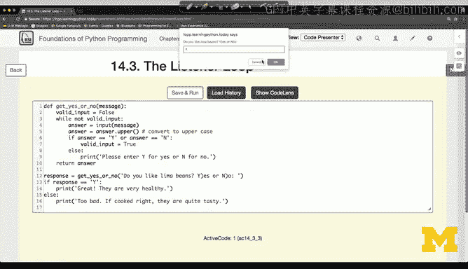

# 密歇根大学《Python3编程（课程1、2）》｜Python 3 Programming（Python for everyone进阶）（中英字幕） - P145：57_04_03_监听循环模式.zh_en - GPT中英字幕课程资源 - BV1CM411Z72u

The listening loop is one of the most common patterns that you'll encounter when using wire loops。

What the listener loop is is essentially a pattern that waits for some input or some value before deciding to terminate the loop。

So you can only use loops with the listener loop because by definition。

 a listener loop doesn't necessarily know how many times it's going to run。

 even after your program starts， you don't know how many times you're going to actually have to execute the code in a while loop。

So for example， what this piece of code does is it keeps asking the user for a next number to add up。

 so it's going to ask the user for input， and then it asks the user to enter0 if there are no more numbers to enter。

So， again， before we run this program， we have no way of knowing how many numbers the user is actually going to input。

 And so we can't use the for loop。 We instead need to use a while loop， and we need to say。

 while the user has not entered the number 0。So let's look at this code in this code。 again。

 we're adding up the numbers that the user inputs。 We're going to add those numbers into this variable。

 the sum。The sum is going to start out as0。And then we're going to use another variable x to store what the user put in。

Here， we're just going to arbitrarily initialize x to be negative 1。

 The reason that we do that is because in our while loop， we say if x is not equal to 0。

 So if we started x out as 0， then we would skip our while loop。 So in our while loop。

 we assign x to be whatever the user inputted， but we cast it to be an integer。

 So x is going to be an integer representing whatever the user just entered。

 And then we add that value to the previous value of the sum and reassign the sum。 In other words。

 we add x to the sum。Now， when the user has had enough numbers that they've entered and the enter0。

 then we're going to exit this while loop and we're going to print out the sun。So let's run our code。

So here we're asked， what's the next number to add up， I'm going to say 10。

And then the next number to add up， I'll say 20。And then I've entered 10 and 20。

 So that's enough for me。 So I'm just going to say 0 to say that there are no more numbers。

 And when I do that， then I can see that I get the sum of 10 and 20 is 30。

 I can do this any number of times。 so I can do 5，4，3，2，1， and then 0。And I'm going to get 15。

 And again， Python isn't going to know how many numbers we actually add up before entering zero。

 which is why we need to use a while loop here。So this pattern is called the listener loop pattern。

 Again， we're kind of listening for a particular input。 In this case。

 we're listening for the input is x equal to 0。 and while that input is anything other than the termination value。

 then we keep running our code in the while loop。Let's look at a slightly more complex example。

In this code， what we're going to do is we're just going to ask the user if they like lima beans。

 and we asked them to enter Y for yes or n for no。 But here's the problem。

 When the user inputs a value for whether they like lima beans or not。

 then they could input anything， they could put in a number they could put in any other letter。

 but what really want is for them to enter Y or N。So what we're going to do is we're going to keep asking them for a valid input until they enter either y or N。

And then by the time that they've produced a valid input， if they say why， then we print out great。

 they are very healthy， If not， and we print out too bad。

 So let's run our code first to see what we're actually running。So again， we ask。

 do you like lima beans， Y or N， I'm going to put in something else。Now， when I hit， okay。

 then I'm going to get。This prompt again。 And it's going to say， do you like lima beans， Yes or no。

 So I'm going to enter something else。And I'm going to keep getting this prompt。

Until I enter either Y or N， I'm going to say why for yes。

And I get great。 They are very healthy。So。A couple of notes here。 So first。

 all of these print statements appeared kind of suddenly because of a kind of quirk in the interpreter that we actually use。

 These should have been printed out as I was inputting numbers。

 The important thing to focus on here in the output is that we printed out great。

 They are healthy when I finally entered why， for yes。Okay。

 so the important part of this code is this function。 get yes or no。

What this function does is it's going to keep pestering the user until they enter in either Y for yes or n for no。

 If they enter in any other invalid input， then it's going to ask them again for input。

So in this code， we first create a variable that keeps track of whether their input is valid。

 We initialize that to be false because the user hasn't actually put in anything。And then we say。

 while the user's input is not valid， then ask the user for an answer。

 and we assign that to the variable answer。 We then convert that to the uppercase。

 So lowercase y gets converted to capital Y， lowercase n gets converted to capital N。And then we say。

 if answer is either of the valid possible input， either capital Y or capital n。

Then we assign valid input to be true。And what that means is that the next time we actually go through this while loop。

 valid input is true。And so not true is going to be false， and false is actually good in this case。

 because that means we're breaking out of the while loop and returning whatever the user answered。

If the input is not valid， then we instead print out， please enter Y for yes or and for no。

 That's what gets printed out here。And then we go back up to the top of this loop and we say。

 while not valid input， valid input is going to be false。

Meaning that not valid input is going to be true。Meaning that we're going to ask the user again to enter in y or N。

So as long as the user enters anything other than Y N。

 then this while leaf is going to keep asking them to enter in yes or no。

Until they actually enter in Y or N， in which case we're going to return what they entered。

That's all for now， until next time。

