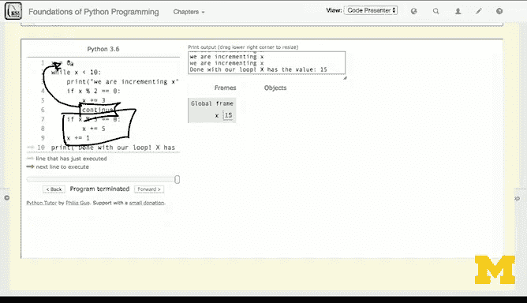
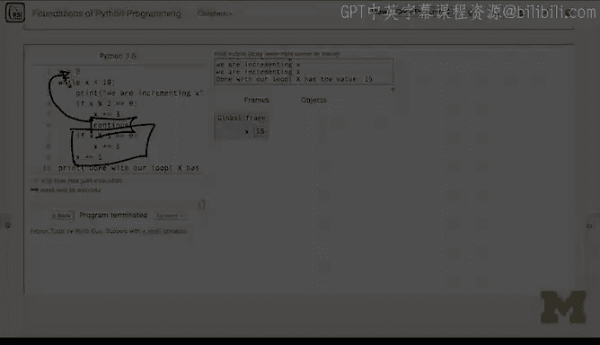

# 密歇根大学《Python3编程（课程1、2）》｜Python 3 Programming（Python for everyone进阶）（中英字幕） - P146：58_04_04_break与continue控制.zh_en - GPT中英字幕课程资源 - BV1CM411Z72u

Welcome back。Break and continue are two special kinds of statements that can be used within while or for loops。

A brake statement breaks out of whatever loop contains it。So here， if we're within a loop。

And we encounter a break statement。 Then Python is going to break out of the loop immediately。

 So this break statement is going to say that the program should jump from here。To here。

 and it's going to skip the rest of whatever is in the body of the for loop。

 And it's not even going to check the condition again。A continued statement is similar。

A continuous statement， like a brake statement， does skip whatever is in the rest of the loop。

 So it's not going to run this code， but unlike a brake statement。

 which takes us to the bottom of the loop。A continue statement instead says to continue at the top of the loop。

 and so it's going to check this condition once more。

So let's see what break and continue statements do in code。So here we have a while loop。

 This condition is true， meaning it's always going to be。 Well， true。

 So what that means is that without a brake statement， then this is almost by definition。

 going to be an infinite loop。We'll talk in more detail about infinite loops later on， but in short。

 that's when we never escape the while loop because the condition after the while is always true。

But here in the body of the loop， we first print out this phrase will always print。

And then we call break。 and then we say print does this phrase print。 And then here we print out。

 We're done with the while loop。 So I want you to think a little bit about what this code is actually going to print。

So what I expect to happen is that when we run this code， even though this says wild true。

 this is only going to print out once because after this prints out。

 then we break out of our while loop。And then we skip what's here because that comes after the break。

 And then we print out we're done with the wire loop。 So I expect this。In this。To print out。

 let's run our code to be sure that that's the case。So you can see。

The only things that print out are this statement and this statement。Now。

 what would happen if I replaced the brake with a continue？So when I run this code。

 what I should expect is that it's going to get stuck in an infinite loop。

 The reason is that we on line to print out this phrase will always print。

 and then this continued statement jumps to the top of the loop and checks the condition again。

 And here， this condition， again， by definition is going to be true。

 And so we're going to print this out again and then continue。 And so we have an infinite loop。

 and I would expect this phrase will always print to beprinted out。 Well。

 a huge number of times before our program actually stops terminating。

 And you can see when we look at our code。 that that's exactly what happened。

So let's look at another example to see how a continued statement works。

So here we have a slightly more complicated piece of code。We have a number x， which we set to 0。

 And then we say while x is less than 10。And as long as x is less than 10， we print out。

 we are incrementing x。Now， what we do is we say if x is even。 So in other words。

 if x modular 2 is 0， then we add 3 to the value of x。 So x would jump from 0 to 3。

 and then we say continue， which takes us。Back to the top of this for loop。

Then we say if x modo 3 is 0。 In other words， if x is divisible by 3。

 then we assign x to be xs value plus 5。 And almost regardless， then we add one to x。

 And by the time we're done， we print out done and we print out the value of x。Now。

 let's run this code in code lens to see what happens。So again， we start x as 0。

 and we say while x is less than 10， print out where in commanding x here， x is divisible by 2。

 so x is going to jump from 0 to 3。Now again， when we hit this continue statement。

 we're going to go to the top of this while loop。So we jump back up to the top。

 we ask is three less than 10， Yes it is。In this case，3 is not an even number。 So we check。

 is it divisible by 3， which it is。 And so we add 5 to x。 And then we add one more on to x。

 And so x ends up with the value 9，9 is less than 10。 So we print out we're incrementing x。

9 is not even， but it is divisible by 3。 So x gets the value 14 and then 15。 And then now。

 when we check our condition，15 is not less than 10。 So we say we're done with our loop。

 and x has the final value of 15。So again。Here， we used a continue statement to ensure that we weren't going to run what was in the rest of this loop。

 We instead jumped to the top of the wire loop。

That's off for now， Until next time。

