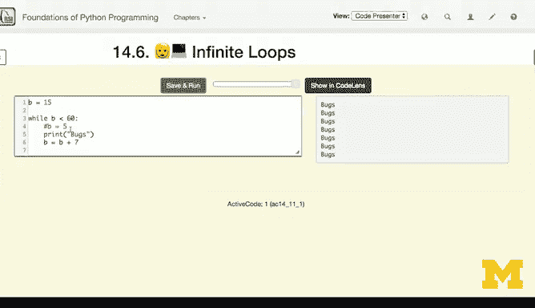

# 密歇根大学《Python3编程（课程1、2）》｜Python 3 Programming（Python for everyone进阶）（中英字幕） - P147：59_04_05_程序员之道：无限循环处理.zh_en - GPT中英字幕课程资源 - BV1CM411Z72u

Welcome back， so as we talked about before， a while loop is generally more capable than a for loop。

 but there are a few drawbacks to use in while loops。

The first is that it can be a little bit more tedious to express the same concept as you might have seen in some of the code samples from before。

 but the second is that you can get stuck in what's called an infinite loop。

An infinite loop is a loop that never terminates。 In other words， your program， if it could。

 would keep running forever。Now， remember that if we have a while loop like this。

 then every while loop has a condition。And by the time we get to the end of the while loop。

 then we're going to go back to the top and check if this condition is still true。

And what that means is that if you ever run the code in this while loop。

 then it better have a chance of switching this condition from true to false。

 but if that's not the case， in other words， if this condition is always true。

And we always reach the end of this Y loop， then our code is going to be stuck in what's called an infinite loop because if we always reach the end of this Y loop。

 then we're always going to go back to the top and if this condition is always true。

 then we're always going to run this code once more and that's called an infinite loop because your program would keep running infinitely if it could。

In reality， this textbook has a mechanism to prevent your code from running too long。

 and pretty much every interpreter has some way of breaking out of an infinite loop。

 but they can be frustrating nonetheless， and they're important to be able to recognize。

Now this code is actually stuck in an infinite loop， so if I ran my code。

And I would see first that my cursor is stuck on a pointer。 so that tells me that something's wrong。

 if I even try to click。Or type anything。Then I'm not going to be able to because this computer is working so hard trying to run this little while loop that has three lines。

Now after a while， then the Python interpreter is going to say that this code ran too long。

 but until then I'm not going to be able to do anything on the page。So as it's evaluating this。😊。

Let's try to analyze why we're actually stuck in an infinite loop。So here we go。

 The code finally finished running and you can see that it printed out bugs many， many times。

 so I'm going to scroll to the bottom here。You can see that it printed out bugs a lot。In at the end。

 I'm going to get a message that this program exceeded the runtime limit。 So in other words。

 this program tried to run for too long and。This probably indicates that your program is stuck in an infinite loop。

 so let's look at why this program is stuck in an infinite loop。

So here we initialize a variable B to B15。So that looks good so far and we say while B is less than 60 so this condition is of course going to be true while B is 15。

 so when B is 15， then we're going to run this code。And then we say B equals 5。Well。

 that looks a little bit out of place， but let's come back to it in a little bit。On line 5。

 we print out bugs， which as you can see。Gets printed out a lot because this wire loop is run a lot。

 And then on line 6， we say B equals its previous value plus 7。Now， let's come back to this line。

 B equals 5。Because what assigning b equal to 5 does here is it kind of resets the value of B。

 so again， our check is if b is less than 60， and so if we keep resetting b to B5。

 even if we increment its value to B 12 later on by adding 7 to it。

 then B is still always going to be less than 60 because every time we run this loop。

 we reset b's value to 5。So maybe if line 4 was accidental。 so if we commented it out。

 then we would actually be able to run our code。So again。

 the problem here was that we were resetting b to b5 every time we ran this code。

So it's important to be able to recognize how infinite loops occur， they can incur in many。

 many ways， so this example is just one of many ways to accidentally write an infinite loop。

As you get more experience in writing while loops， you'll become more adept at being able to identify in fixed infinite loops。

That's all for now， Until next time。