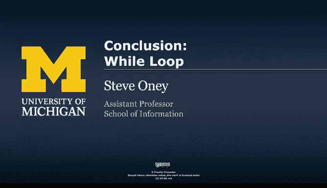
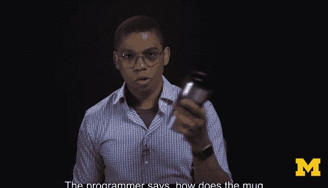

# 密歇根大学《Python3编程（课程1、2）》｜Python 3 Programming（Python for everyone进阶）（中英字幕） - P148：60_04_06_while循环总结.zh_en - GPT中英字幕课程资源 - BV1CM411Z72u

So in this lesson， we learned about indefinite iteration and wire loops。 Now。

 although wire loops have downsides like being more complex than a for loop and potentially prone to accidentally creating an infinite loop。

 wire loops allow us to express things that would otherwise not be possible with a for loop。

 like if we aren't sure how many times we need to iterate， then we should probably use a while loop。

So now for a dad joke， a programmer walks into an outdoor stores and a sales person shows them an insulated mug。

The salesperson says this mug is amazing if your drink is hot， then it's going to keep it hot。

 if your drink is cold， then it's going to keep it cold。

And the salesperson hands the mug to the programmer。 Now， the programmer looks at the mug。

 Look at it very closely。 They inspect it for a matter of minutes， just looking very， very skeptical。

And finally， the programmer asks， well， how？The salesperson responds， well， how how what。

The programmer says， how does the mug know whether to keep your drink hot or cold？

That's all for now。 See you next time。

