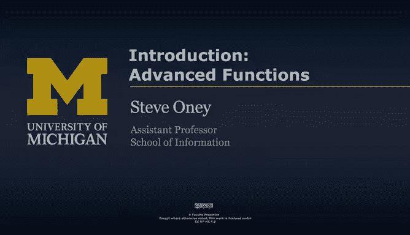

# 密歇根大学《Python3编程（课程1、2）》｜Python 3 Programming（Python for everyone进阶）（中英字幕） - P149：61_04_01_高级函数导论.zh_en - GPT中英字幕课程资源 - BV1CM411Z72u

In this lesson， we're going to extend our knowledge of how to define functions and learn how to define in call functions in a way that's more flexible。

 readable and concise。We'll learn about optional parameters which allow us to define functions that have arguments that are not strictly required。

This can help us simplify function calls and improve code readability by reducing the number of arguments passed into most function calls。

We'll learn about keyword arguments， which allow us to call a function with the arguments in any order。

 and this can be helpful when we're calling functions that have lots of arguments and we only want to specify a few。

And we'll learn how to define Lambda functions， which are small functions that can be defined only in a single line of code。

 and they can help make our code more concise and readable。

Understanding these features is crucial not only for writing good code。

 but also for being able to read， understand and use code that other programmers right。

 so let's get started。