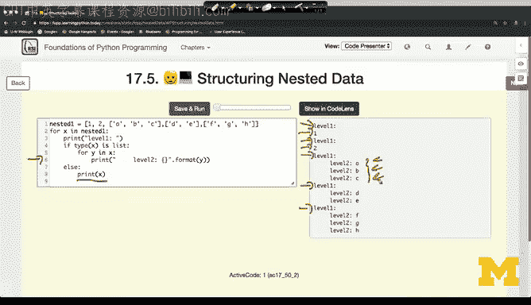

# 密歇根大学《Python3编程（课程3、4、5）》｜Python 3 Programming（Python for everyone进阶）（中英字幕） - P14：13_02_03_结构化嵌套数据.zh_en - GPT中英字幕课程资源 - BV1gj41177yd

Welcome back for this way of the programme or segment on good design practice for creating nested data。

😊，Basically， be consistent。 Don't mix two levels of nesting with three， for example。

Consider this example。 This is bad design practice On line 1， we've got a variable nested one。

 which is assigned to a list。 It has。Couple elements。 that are numbers。

And then it's got a few elements that are lists。Having this mixture is going to make it hard to traverse the nested data structure。

So for example。If I try to run this now， I'm going to get an error。

The error tells us that we are trying to。Iterate through an integer object， on line number 4。

But to understand what's going on， we need to go up。A couple lines first。 So on line number two。

 we are iterating through all of the items in nested one。So x is going to be bound to1。

 and the next time through x is going to be bound to2。

 and then the third time through x will be bound to the list ABC。Each time we're going to print out。

Level 1。Just to remind us that we've made it through one more iteration。

But then the action is post happening at line 4。We've seen something like this before。

 If we really had lists all the way through as all of the elements of nested one being lists。

 then we could iterate through each of those items where X was going to be。A list like ABC。

 we could iterate through it and print out each of the items。Saying something like。Level 2。A。

Our problem is happening when。We get to this for the very first time。 We've printed level 1。

And then we're getting an error on line 4 because x is bound not to a list， but to the integer 1。

So when we now say for y in x， we're saying for y in this， so that's the integer object。

 and it is not iterable， it is not a list。And the problem is really coming because we wanted to get to items like A and B and C。

 which does require this nested iteration。But our data wasn't structured in a clean way。

 so we couldn't just always assume that x was going to be a list。

 sometimes x was going to be a number。So let's see how to solve that problem。

The basic solution is to use some special case logic in our code， we'll check whether the type of x。

Is a list， if it is。We'll do a nest iteration， and if it's not， we'll do something else。

So that's what's going on on line4。We started iterating。X this first time is bound to the value 1。

 and we check， is the type of x。List。If it is， then we would iterate through it。 But since it's not。

We're just going to print it。So I would expect one to show up。And then we'll do our second iteration。

As will be bound to 2。And we'll get two to show up in the output window。The third time。

 x is going to be bound to a list。A。B and C。Now when we check is the type of X list。

The answer will be true。And so will iterate。 And for each。Why。

The while be bound to A and then to B and then to C。 for each of those， we'll get。

Something that says level 2。Ai。And level 2。B， and so on。

So let's just check my reasoning there and see if that's what actually happens。And， indeed。

That is what's happening。Each time we get to line 3。We print out this level 1。And the first time。

 x was bound to the value 1。So we just print it。The second time， we print2。The third time。

We iterate through the list ABC， and we execute line 6 three times once。Printing out A。

 once printing out B and once printing out C。And you can imagine this would get pretty complicated with lots of special cases if we had more levels of data nesting and we were not consistent about the level of nesting。

The solution when we're in control of a data structure is to make it very regular with always the same kinds of items and the same level of nesting。

 In other words， don't mix integers， lists and dictionaries as items in a single list。Sometimes。

 however， we aren't in control of the data structure。

Maybe our evil predecessor on the project structured the data。In a not very careful way。

Or we get it from an external source that structured it。 however they want it to。 When that happens。

 you'll have to notice and add some special case logic like the F statement that I've got here on line for。

So that's my advice for following the way of the programmer。 Don't put trip hazards in your way。

Make the nest of data structures you're going to traverse be as regular as possible。

But if somebody else puts the trip hazards in your way。

 be prepared to jump over them with some if then statements to handle differently structured data in different ways。

See you next time。