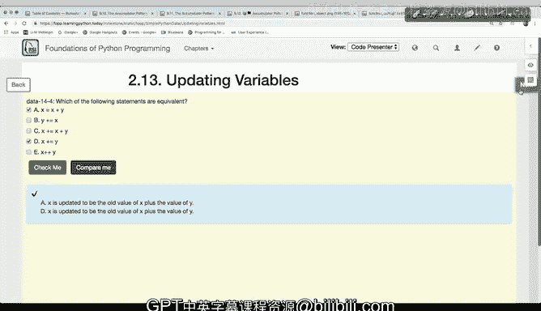

# 密歇根大学《Python3编程（课程1、2）》｜Python 3 Programming（Python for everyone进阶）（中英字幕） - P14：14_01_10_变量更新.zh_en - GPT中英字幕课程资源 - BV1CM411Z72u

Welcome back。 So we've seen how to assign variables to different values。 For example。

 on line one here， we have code that assigns the variable X to the value 6 and what that does。

Is you can imagine。Of variables， values table。That says x。Now points to6。

And so what that means is that after we've assigned x to6 on line 1。

 if we print out the value of x on line 2， then this should print out6。

 because Python asks what's the value of x， it looks in this variables values table。

 it sees that x points at6 and it gets 6。Now， what happens if we say something like On 3。

 x equals x plus1？Now， on first blush， this might look almost like a contradiction。

 but the way that Python evaluates this expression is it first computes the value。Of this expression。

 and then it takes the value of this expression and assigns it to the new value for x。

So in other words， what Python is first going to do is it's going to ask what's the value of x and Python is going to get 6。

And then it takes that and adds one to it， so the value of this expression。

 x plus 1 is going to be 7。And so all Python does is it computes the value of x plus1。

To which we get 7。 And then it puts that as the new value for x。 So x is no longer6。X is now 7。

So now when we print X on line 4， then this prints out7。So if we run our code。

You'll see that when we print out the value of x on line 2， we get 6。

 but then after reassigning x to be x plus 1 on line 3， then when we print out x on line 4。

 then we print out7。Now this kind of operation where we say x equals x plus 1 x or whatever x's previous value was。

 we want to add one to it and reassign that to x， that's actually really common and for that reason Python includes a shortcut for incrmenting and decrementing like that。

So let's run through this code， so on line1， we assign x to have the value6。And then， we print out。

The value of x， which is going to print out 6。On line3。

 we have this special syntax where we say x plus equals 3。😊。

X plus equals 3 is a shortcut for saying x equals x plus 3。

Now it allows us to just say the name of the variable x only once here。

 so it's a little bit shorter in less verbose， especially if we have much longer variable names。

So again， this increments x by 3 and reassigns it。If we have our variables values table here。

On line  one， we have assigned x to B 6。Then we print out that on line3。

 we say x equals x plus 3 by saying x plus equals 3， so x is no longer 6。 x instead becomes 9。

Then when we print out x， this prints out 9。And then we can do the same thing with subtraction so we can say x minus equals 1 as a shortcut for saying x equals x minus1。

And so that's going to take x from 9。And it's going to reassign it to the value 8。

 and now when we print out the value of x， then we're going to print out8。

So you can see x goes from 6 to 9 to 8。So we can do reassignment as many times as we want。

 so we can say S equals1， and then we can add two to it。

 then we can add three to that and four to that， etc ce。If I run this code。

 you'll see the different values of S。 So S starts out as one。 when we add2 to that， it becomes 3。

 when we add 3 to that， it becomes 6， when we add 4 to that， it becomes 10 and so on。

 Later on in this course， you'll find an even a much shorter way to actually do something like this。

Now let's run through some multiple choice questions。

What gets printed out when the following statements execute， so here we assign x to be 12。

 so x has the value 12， and then we say x equals x minus1。So the value of this expression。

 we replace。X with 12， and we subtract one from 12 to get 11， and we take 11。

And that's x is new value。 So x is no longer 12。 X is now 11。So when we print out x。

 we're going to print out 11 or C。Next question， What gets printed when the following statements execute。

 So here we first assign x。To be 12。Then we say x equals its previous value minus3。

 since x goes from 12 to 9。Then we say it's previous value plus 5。 So x goes from 9 to 14。

Then we say x equals x plus 1， so it goes from 14 to 15。And so x ends up with the value，15 or C。

Next question。Construct code that will result in the value 134 being printed。

So the first thing that we want to do is we want to assign an initial value for bank balance。

 if I tried to put this first， then Python when trying to evaluate the value of this expression。

 would say that it didn't find a variable named my bank balance。

 so I know that this line can't come first。Here。I can do the assignment first。

 so I can assign my bank balance to 100， and then I can reassign it like I do here。

 So this looks valid。 And by the end of running these two lines。

 then my bank balance is going to have the value 134。

Then if we print out the value of my bank balance on line 3， then we're going to print out 134。

Next question， which of the following statements are equivalent。So。

i see this statement reassigns x to its previous value plus y。This statement assigns y instead of x。

 so I know that this can't be equivalent to State A。

X plus equals x plus y looks like it's similar to statement A。

 but what that's really saying because we have plus equals here is x equals x plus x plus y。

So here we have that extra x plus， so that's not equivalent to statement A。But statement， D is。

Then statement E just wouldn't work， so statements A and D are equivalent。

That's all for now， until next time。