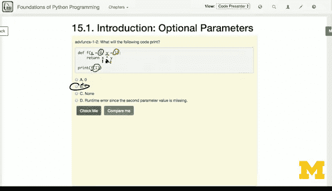
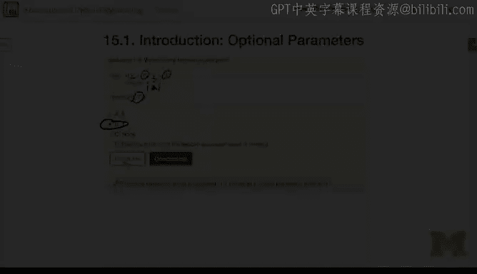

# 密歇根大学《Python3编程（课程1、2）》｜Python 3 Programming（Python for everyone进阶）（中英字幕） - P150：62_04_02_可选参数介绍.zh_en - GPT中英字幕课程资源 - BV1CM411Z72u

Normally， when we define a function， we specify a number of arguments that that function accepts。

 For example， this function F has three arguments， X， Y， and z。

And when we specify that there are three arguments。

 then normally we have to supply values for all three arguments when we call it， so for example。

 when I actually call F on line 4， then I have to specify a value for x。

 a value for y and a value for Z。If I try to specify no value frizzzi， for example。

 by removing this8， then I get a runtime error。Optional parameters allow us to specify default values for arguments to say that we don't always have to specify them when calling the function。

I can add a default parameter by adding equals and then whatever default parameter I want。

 so here I'm going to say z equals 7 by default。Now。

 by specifying that z equals 7 within the function definition。

 I'm saying that when this function is called， if z is not specified， then you use the value 7 for z。

Now， when i call this function f I should get x is2。W is 5。And Z。

 even though I didn't specify it in this call， because it has the default value of7 is going to be 7。

If I do instead specify a value for z， for example， here I'll say z is 9。

 then I'm going to get z equal to whatever value I specified， which overrides the default。

Let's look at another piece of code in code lens。Here， on line  one。

 we define a variable called In to have the value 7。

And then we declare a function F that has three arguments again， so here the arguments are called x。

Y， N Z。And here， y and z have default or optional parameters。

 so the default value for y is 3 and the default value for z is initial whose value is7。

 so the default value for z is going to be 7。So let's move forward in our code so we see we set initial to be7。

And then we declare this function， F。Now， when we call the function F on line 5 here we're specifying that x should have the value 2。

And so when we run this piece of code， then we're going to print out x has the value2。

 which is what we specified。Why has the value 3， Because that's its default value。

And z has the value 7 because that's the default value for z here。 remember again。

 initial had the value 7。So when we run this line of code， then we print out。X， Y， Z， R 2，3， and 7。

When we get back to line 6 and we call F with 2 and 5。

 then what we do is we see that x should get the value 2。Wai。

Should get the value 5 overriding the default value of3， and then z is not specified here。

 so z is going to once again be7。So when we move forward， we can see x is 2 Y is 5。 Z is 7。

And when we print out x Y and Z， we see that x， Y and z are 2，5 and 7。Now， on line 7。

 we instead specify values for every single argument。So we see that we pass in2 for x。

We pass in5 for y， which overrides the default value of 3， and we pass in 8 for z。

 which overrides the default value of 7。So when we run this code， we should see that x is 2， y is 5。

 and z is 8。Now， looking at this code， you might have the question。

 what happens if we change this value of initial from 7。

 which is set to z to something else down here。 so suppose we say something like initial。Equals 10。

So let's do that and look at code lens。So here we have the exact same code on line 1。

 we set the value of initial to be 7。And then， we define our function。And then on line 5。

 we set initial to be 10。And then on line 6， we call our function except we set x to B2。

We don't set a value for y， meaning that it gets the default value of 3。

 and we have z equal to initial。Now， note that again， initial was reset on line 5。

 but when Python interprets an optional parameter， it interprets the value of initial when this function was evaluated。

 So what that means is that even though we changed initial on line 5 and its current value is 10。

 when we evaluated the function definition here， initial was 7， and so when we run our code。

 we're going to get value of x， is going to be 2。 The value of y is going to be 3。

 and the value of z is going to be 7， which again was the value of initial when we defined our function。

So here again， you can see that the value of z。Is 7 rather than 10。And so when we run our code。

 we print out x， Y， and z， R 2，3， and 7。So let's do some multiple choice questions here we define a function F that has two arguments。

It has x whose default value is 0 and y， whose default value is1。

And then here we call that function F and pass in no arguments。

 meaning that x gets its default value of 0 and y gets its default value of 1。

 meaning that we return 0。Times 1， which is going to be 0。

And because we print out the value that's returned here， we're going to print out 0。

So I would say the answer is a0。In this question， we're asked what will the following code print。

 and we have the same function F as before， So it has argument X， whose default value is 0。

 in argument y， whose default value is 1， except this time when we call our function F。

 then we actually pass in1 for the value of x。And so what that means is that x is going to be 1。

And y is going to have its default value of 1。 And so we print out one times1。

 which is going to be one。

Let's solve for now， until next time。

