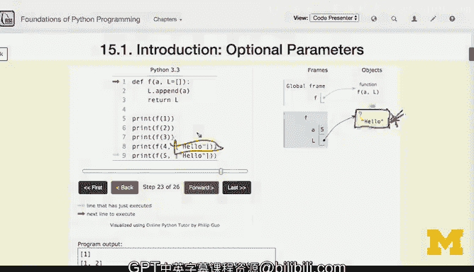

# 密歇根大学《Python3编程（课程1、2）》｜Python 3 Programming（Python for everyone进阶）（中英字幕） - P151：63_04_03_可变性与可选参数.zh_en - GPT中英字幕课程资源 - BV1CM411Z72u

The fact that optional parameters， default values are only evaluated once can lead to some unintuitive outcomes。

 So here we define a function that has two arguments， a。And L。E's default value is an empty list。Now。

 note again that because this value is only evaluated once。

 what that means is that we have an empty list。That lives somewhere in the frames and objects as the default value for L。

So here， after we define our function F， then we first print out F called with the value 1。Now。

 in the body of F， we actually mutate the value of L。

 So what that means is that when we call F on line 5， we pass in one for a。

 and L is going to be that empty list that we created right here。

When we run line 2 to say L dot append a， then we append one to our empty list。

 And now our list is a list that has one item whose value is one。And now on line 3。

 we return that list L。 but the thing to note here is that even though this list is going to go away in code lens。

 it actually keeps its value of a list that has one item whose value is one。

So even though this disappears in code lens。By the time we get to line 6。

 this list still has the value。Wan。So now on line 6， when we call F with a equals 2。

Then you can see that L。I this list that has one item in it already。So now on line 2。

 when we append a to our list， we have add two onto this list。 So we're going to say。

List is now a list that has one and two in it。And so if we kept calling our function F to add new values to our list。

 then we would get a longer and longer list as our default value for L。So here。

By the time we get to line 7 and we call F with 3， Then when we call this function。

 our list L already has two values in it。 And on line 2， we add 3 on as a third value in our list。

 So the important thing to note again here is that as our default value gets mutated。

 it affects feature calls to this function， F。Now， an important distinction here is distinguishing between lists that are different objects。

 but have the same value versus this list， which is the same object。 So， for example。

 on lines 8 and 9。 we pass in two different values for L on line 8。

 we pass in a list that has the string Hello as its one item on line 9。

 we pass in a list that looks identical。But because these are separate expressions。

 then these are actually separate objects。What that means is that by the time we get to line 8。

And we print out the value of F called with a equals 4， and L equals the list with the item， hello。

Then when we actually call L dot append A， then we're mutating this list。

And that has no effect on this list。So here we're mutating this list to add four onto it。

If you can see here。And then when we get to line 9。Then we're mutating a different list。

 So note again here。That we have a list。Whose only value is hello。

 It doesn't have the four that we added on to this list。That's all for now， until next time。

