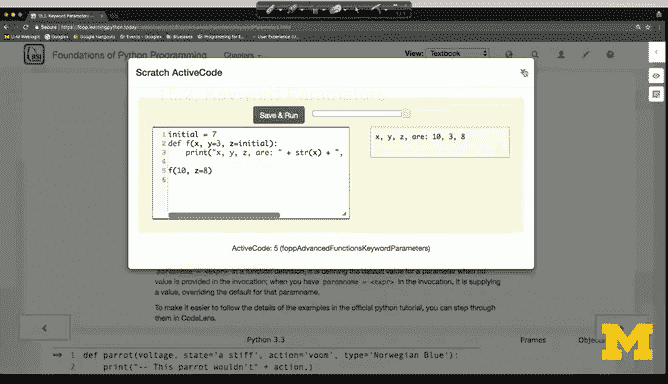
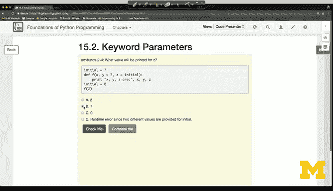
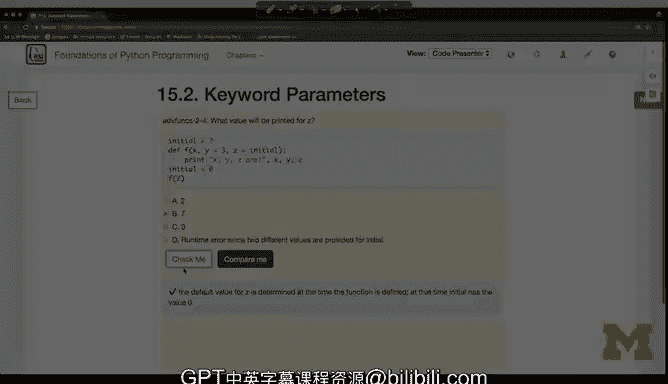

# 密歇根大学《Python3编程（课程1、2）》｜Python 3 Programming（Python for everyone进阶）（中英字幕） - P152：64_04_04_关键字参数详解.zh_en - GPT中英字幕课程资源 - BV1CM411Z72u

Keyword parameters are closely tied with optional parameters。

So here we have our function F that takes in three arguments， x， Y， and z。

And y and z have default values of three。And7。ow here on line five we can see that we can call our function by only providing x。

And then y and z get their default values。On line 6 here， we call our function with x equals 2。

And y equals5 in z getting its default value。but suppose we wanted to call our function and provide a value for x。

And Z， without actually passing in a value for y。 So in other words。

 we want to give y whatever its default value should be。So if we wanted to do this。

 we would want to kind of skip a value for y。If we tried to do something like。

Skipping Y by saying two blank 8， Then we would get a syntax error because Python doesn't understand this format。

Instead， what we can do is we can use a keyword parameter。So rather than skipping an argument。

 we can just say that this8 is intended to be the value for z。

And we do that by saying z equals 8 when we call our function。Now。

 what this does is x gets the value2。And Z gets the value 8。And we never specified a value for y。

 So y gets its value 3。 And when we run our code。We can see。That in this second call here。

 that this is the case。 So again， x is 2。Z is 8。And then why its it default value。

So these are keyword arguments。We could also do this for x， so we could say x equals 2。N z equals 8。

 And this would have the same outcome。And the nice thing about keyword arguments is that they allow us to put our arguments in any order。

 so here I'll say x equals 20。And z equals 8， but I'll specify z before I specify x。Now。

 note that keyword arguments aren't going to give arguments that don't have default values。

 default values。 So， for example， if I tried to call our function F and just specified Z equals8。

 then we haven't passed in anything for x， and we get an error because we haven't actually specified what x is。

So if we wanted to do this， we would have to specify at value for x somewhere。

 or we would need to give x。A default value in our function definition。

So it's also possible to accidentally specify multiple values for the same argument here。

 So the easy case to see。It would be if we specified z equals 8 and then z equals 4。 If we did that。

 we would see that we have a keyword argument repeated on line 5。

It's less easy to see if we accidentally do it by saying something like。

Passing in 10 for x by passing it in as the first argument。 And then later on。

 accidentally specifying that x equals8 here we get the same kind of error。

 So we see that we have multiple values for the argument X on line 5。 And that's because here。

It looks like x should be 10 by virtue of the fact that we pass 10 in as the first argument。

 and then here it looks like x should be 8 by virtue of the fact that we specified x equals 8。

Another thing to note about keyword parameters are that keyword parameters always have to be expressed after positional arguments。

So I'm going to modify our code to say that x should be 10 and z should be 8。

And this works just fine。But if I change the order of this。To say that z equals 8。

 and then we pass in 10。 Then we're going to get a syntax error。 And that's because， again。

 keyword arguments always have to come after any positional arguments that don't specify a keyword。

 So in other words， we have to put z equals 8 after specifying that x is 10。

So if I change the order here again。Then we'll see that our code is fixed。Now。

 let's look at some questions that involve keyword arguments。

So in this question， we're asked what value will be printed for Z。

So we call our function f we specify x is2。We specify y is 5。 And then we have z equals initial。

 And so what that means is z is going to be the value of initial As soon as this function is declared。

 we can see that initial is set here。 And so the value of z is going to be 7。

in this question we asked what value will be printed for why，So we have the same function definition。

 so we specify initial equals 7， and then we provide default values for y。

 which is going to be 3 and for z， which is going to be 7。And then when we call our function F。

 we pass in a value for x， which is 2， and a value for z， which is 10。

 And so what that means is that y gets its default value， which is 3。

 so we should get3 printed out for y。In this question we asked what value will be printed for x。

So we have the same function definition。X， Y， and Z。And when we call our function F。

 we specify that x is2 here。But then we also specify that x is 5。 And this isn't going to fly。

 Python is going to give us a runtime error because we try to specify two different values for x 2 and 5。

So the answer here is E。this question were asked what value will be printed for z。

So we have the same function definition as before。 argumentsments， X， Y， and Z。

We specify that Z's default value is going to be initial。When we define our function。

 the value of initial is 7。But it just so happens that we overwrite that value later on so that it's 0。

But again， these default values are only evaluated when we declare the function and when we declare this function。

 F initial had the value 7。 And so we can just almost replace this。With the value 7。

 And it doesn't matter that we changed initial later on。 Z is going to have the value 7 by default。

 So the answer here is B。

That's all for now， Until next time。

