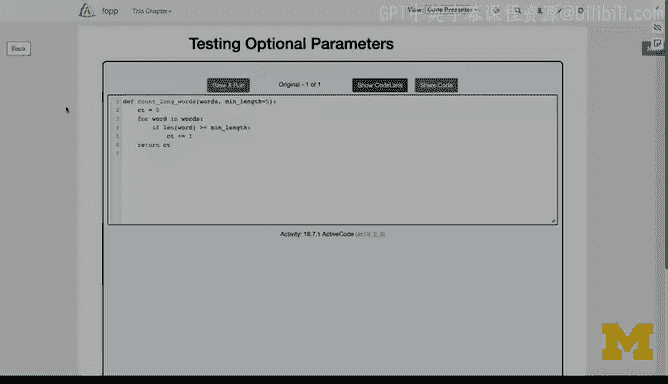
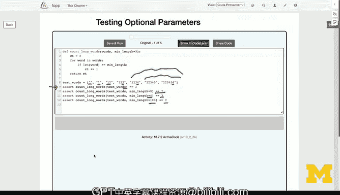

# 密歇根大学《Python3编程（课程1、2）》｜Python 3 Programming（Python for everyone进阶）（中英字幕） - P153：65_04_05_可选参数测试方法.zh_en - GPT中英字幕课程资源 - BV1CM411Z72u

When you write a program that has optional parameters。

 it's a good idea to write automated tests with ins of the function that do or don't specify the optional parameters。

For example。Check out this function， which counts the number of long words in a list。

The parameter min length determines how long a where it has to be to be counted。By default。

 only strings with five or more characters。So that's the default parameter of five。

This function does its work by returning a value， doesn't have any side effects。

So we need return value tests， but what inputs should we test？

Here are some of the tests that I think would be useful。For all of the tests， I use this same。

List of test words。And I included a bunch of words or strings in it。

I deliberately included strings of different length and。I did this thing of。

Making the string itself remind me of what the length is。

 So the last character in the string tells me how many characters are in the string。

 This one has six characters， and。This one has four。

It starts with a string that has no characters in it。So。In this list of strings。

 there are seven strings in all。 I want to do a test of what happens if I just pass that in。

With the default。And the default is a in length of5。 So I should find out that there are actually。

Two strings。That are are long enough， at least to have five characters。

 so that's my first assertion is that we're doing a return value test when we omit the optional parameter。

Next， I want to try some extreme cases， though one of them is a min length of zero。And all of them。

 all seven of them are longer or at least zero characters。

 so I can assert that I should get the value 7 as a result there。If I。Tell it the min length is 4。

So something other than the defaults， I want to check that。It's a sort of a normal value。

 but not the default， I want to see what I get there and there are three strings that have at least four characters。

 then I want to try the other extreme。I'm in length of 100。

And there are no strings that are that long。So I have sort of two extreme cases where I give mid length of 100 and mid length of zero。

I have。Two intermediate length ones， one where I have omitted the optional variable。

Optional input and another where I've specified something other than that。

I can then run these if it passes all of these， I'll be pretty confident that it works for。

Other lists of strings and other men lengths。So I ran it and I got through all of the assertions without getting any errors and it makes me think。

 yeah， probably this function is implemented correctly。That's testing optional parameters。

 I'll see you next time。

