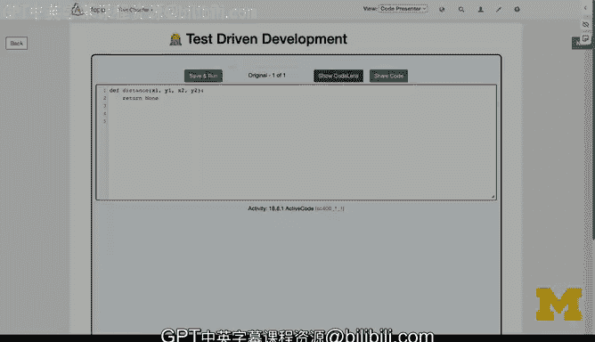
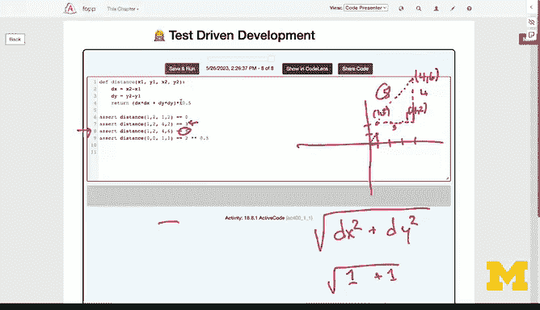

# 密歇根大学《Python3编程（课程1、2）》｜Python 3 Programming（Python for everyone进阶）（中英字幕） - P154：66_04_06_测试驱动开发实践.zh_en - GPT中英字幕课程资源 - BV1CM411Z72u

Welcome back。

Writing test cases goes hand in hand with the incremental bit at a time development process that we've encouraged you to do。

Let's work through an example。 We're trying to define a distance function。

 We have a skeleton of it here on lines1 and2。 It takes as inputs two points。

 One point is defined by the parameters x1 and y1， the other point by the parameters x2 and Y2。So。

 for example， if we invoke the function to ask for the distance between points 1，2 and 4，2。

 we would do that by typing。Distance。And we want to go from the 0。12 to the 0。42。

When I say the  point1，2， that's referring to coordinates。 So as if we have some。Some graph。Yeah。And。

The point1，2 has x equals 1， and y equals 2。 So that's the point。1，2。

And the 042 has x equals 4 and y equals 2。I could start writing the code for this function。

But I'm going to show you an approach called test driven development。

 where you write the test cases first and only afterwards write the code。For this input。

The distance is 3， because we move。To get from1，2 to 4，2， we move three units。Along the x axis。

 and we don't move at all on the y axis， so that's a total distance of three。想嘅。

Make that be one of my test cases。I assert。That the distance from 12 to 42 is three。

But that's not all the possibilities。 What about if both X and Y were to change？

This distance was kind of easy to calculate because the Y didn't change。

And perhaps you remember from a high school geometry class that if you have a right triangle with sides of length。

3 and 4， the hypotenus will have a length of 5。 So let's suppose that y 2， instead of being。

Just two was。We move three along the X axis， let's move。F along the Y axis。Up to the 046。

 And we want to know the distance。Between the points 1，3 and 46。

 well if this has length 3 and that has length 4。Then。The hypotenus of this right triangle。

We'll have length 5。So I'm going to assert。That by distance function。When I go from one two。To four。

 six， it ought to give me the value five。Now let's add a test case where we don't get an integer result。

So how about。The distance from the origin 0，0 to the 011。For this。

You're going to have to know what is the correct。The correct value。We're trying to find out。

This distance。From 0，0 to 11。You're going to have to。Remember the Pythagorean theorem？

Which I won't actually ask you to remember it， I'm going to tell it to you。And。It's the square root。

Of the。Distance along the x axis squared plus the distance along the y axis squared。

So the distance along the x axis is in this case we went from 0 to 1， so that's1。

And the distance along the Y axis。Was also。1。So。The distance from 00 to 11。Should be the square root。

Of。😔，2。Now， Python doesn't have a built in square root function。In the math。Majoel。😔，There is。嗯。

The square root function so I could import。math。And say math， that square root of two。

 or if I didn't feel like doing that。I can do the trick of remember the square root is just taking something to the one half power。

So， I could say。Two to the 0。5 power。I'm going to do that so that I don't have to bother with。

Importing。The square root function。And。One more test case。 Let's think about a degenerate case。

 What if we ask for the distance between a point in itself。Distance from one，2。To itself。Well。

 intuitively， that distance is zero。You go from a point and you don't move at all。

 that should be zero。WeWe've written all these test cases now we can。

Start trying to implement the function。Of course。With nothing implemented if I run it。

 I get an assertion error。Looks like I don't even get the assertion error。

 I have a invalid syntax on line7。It's telling me that。

That's even telling me where I've got it wrong， I've got a single equal there。

I should have two equals。Okay， now when I run it。I get that assertion error that I was expecting。

So let's try to do a little bit better。Returning none doesn't seem to be very useful。

Perhaps I could always return zero。Of course， that's not right but。

Distance between any2 points is not zero， but between some pairs of points， it is。

So I could try running that。 I still get my assertion error on line 4。

 if I had happened to put my other one first。嗯。At least the first test will pass。

Now I get my error on line 5 instead of On line 4。Okay， I can do a little bit better。And I can say。

 let me calculate。D x， the distance along the X axis is x2 minus x1。

 The distance along the y axis is y2 minus y1。And I'm going to return Dx。그。

So I was getting an assertion error from this one， I was passing the first thing。

Now let's see what happens。I got an error。Because I had a variable D Y that I never used。

 My code coach can have told me it's not an error， but it's reminding me that that wasn't a good idea。

 So so that the code coach won't。wonon't get involved I'm going to。Comment that out。

The assertion error I get is here now， so when I give it the distance between one，2 and4，2。

It's correctly getting that that distance is three。But it's failing。When we got to line 8。

 because the I didn't get the five that I was looking for。Has the distance between one， two。

 and four， six。So to solve that。I， it's time now to really use the Pythagorean theorem。

 I'm going to have my D Y is the Y distance。And then I'm going to return。

Using my formula square root of dx squared plus dy squared I'm going to get Dx。Times d x。

Plus dy times dy， and then I'm going to take that to the one half power， take the square root。

When I run that？Now hopefully I'm going to pass the assertion on line 8 and maybe even on line 9。不后。

I got them all to pass。You get the idea that having these tests is a way to know whether the implementation you've done of the function is correct or not。

 writing the tests first can help you get clearer about what the function is supposed to do。

 and it also provides a way to know that you've done it correctly。

That's test driven development where you write the test first and then write the code。

I'll see you next time。