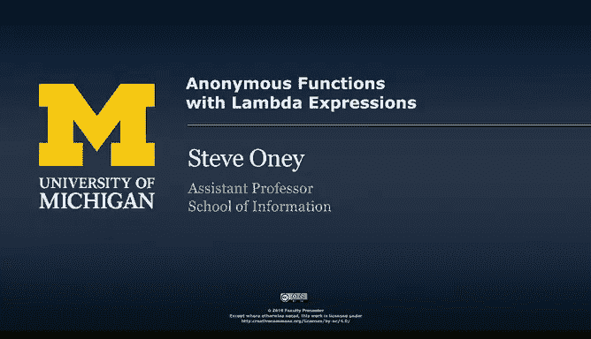
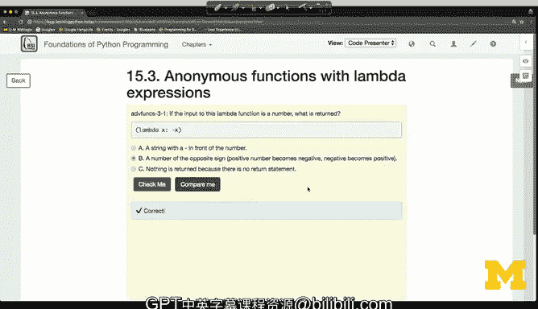

# 密歇根大学《Python3编程（课程1、2）》｜Python 3 Programming（Python for everyone进阶）（中英字幕） - P155：67_04_07_lambda表达式匿名函数.zh_en - GPT中英字幕课程资源 - BV1CM411Z72u

Limbda expressions are an alternative way of defining functions。

So suppose that we have this function definition and here I'm using As as a stand in for a list of arguments。

 so I might have x comma Y comma Z。these arguments might even have default values I might have x equals one。

Et cetera。 And we have some return value expression。So that might be return x plus5。

Or any expression that we want to return。If we have that kind of function。

 then we can express it using a Lambda expression。This is a lambda expression。

Whatever we wrote for our list of arguments here， we could transplant to our lambda expression and reuse it down here so we could have lambmbda。

And then our argument might be x。And why。And then we say colon。

 and then whatever value we want to return， we can again specify in our lambmbda。

 So we might say return。X plus y。And this expression has a value whose type is a function。

We don't even need to give this function a name like we do when we use de。

If we do want to give it a name， we can say funk equals and then provide our lambmbda function。

 but we can also make it an anonymous function。 In other words， a function that doesn't have a name。

So let's look at some code examples。Here on line 1， we define a function F。

 It takes in one argument X， and it returns x -1。 And again。

 this is kind of the traditional way of defining a function。

If we called our function by saying print F called with three。Then we should get the value，2。

If we print out the function object itself by saying print F。

Then we should get that this is a function named F。And if we print out the type of F by saying print。

The type of F。Then we should get that F is a function。Now。

 if we wanted to write this function with an equivalent Lambda expression， then we would say Lambda。

X。Which is our argument。 And then we want to return x -1。 So we just write x -1。Again。

 we don't need to add a return statement for lambmbda expressions in Lambda， the return is implicit。

So if we print out the value of this expression。Then we should see that it's a function。

 So in this case， it's a lambda function specifically。If I instead say。L， F equals。This value。

And if I print out。LF called with3。Then we should get to。And if i print out。

The type of this lambda function。Then we should see that just like F， our lambda function。

 LF is a function。So suppose that we wanted to convert this traditional function definition called last cha into a lambda function。

Then what we could do is we could say last char equals a lambda。

It takes in one argument s so lambda s。Colon， and then again， remember。

 the return is implicit with lambmbda。 so we can just say S sub negative 1。

And now the value of this expression。Is a function。Which is equivalent to this function。

We don't necessarily need to actually give it a name。 but here we chose to give it the name last cha。

So let's answer some multiple choice questions about Lambda functions。

So this question asks if the input to this lambda function is in number then what's returned。

 So here we have a Lada expression。It takes in one argument， x。And it returns negative X。

 And so what that tells me is that if we pass in  one， we should get negative  one。

 if we pass in negative 10， we should get positive 10， et cetera。 And so that， to me， is B。

 A number of the opposite sign。 So positive numbers become negative。

 negative numbers become positive。 So I would answer B。That's off for now， until next time。

