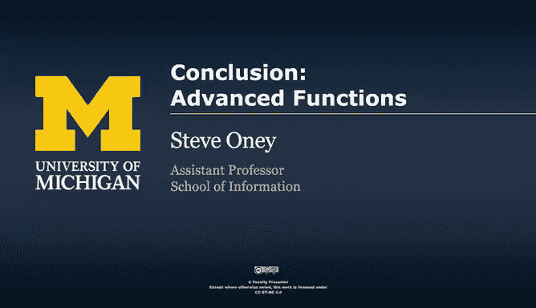

# 密歇根大学《Python3编程（课程1、2）》｜Python 3 Programming（Python for everyone进阶）（中英字幕） - P156：68_04_08_高级函数总结.zh_en - GPT中英字幕课程资源 - BV1CM411Z72u

So in this lesson we learned about optional parameters。

 which allow us to define a default value for a parameter。

 and this can be especially helpful if there's a standard value that we usually want to pass in。

We also learned about keyword arguments which allow us to call a function and specify which arguments have which value using arguments。

 names rather than their positions。And this can be especially helpful if we only want to pass in a subset of the possible arguments to a function that has a lot of possible arguments。

And finally， we learned about Lambda functions， and Lambda functions are a short way of defining simple functions that we're going to use going forward。

 especially when we cover sorting。So now for a dad joke。

You might know that there's a stereotype that programmers prefer to always stay indoors。

 which by the way is totally untrue， but bear with me so one day a programmer and their kid were arguing because the kid wanted to go outside and throw a baseball。

 but on this day the programmer didn't。Now， the kid said to the programmerYou never like doing outdoor activities。

 sometimes I think that if you could write a function named throw baseball instead of throwing a baseball you would。

And the programmer responds， no， that's totally unfair。

 I would never define a throw baseball function。 I would define a throw function。

 and baseball would be an argument。

That's all for now。 See you next time。