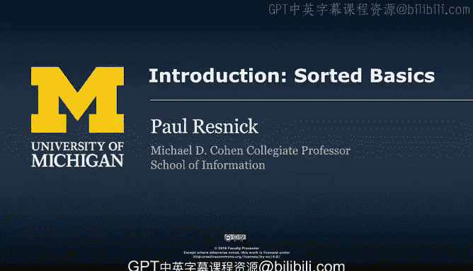

# 密歇根大学《Python3编程（课程1、2）》｜Python 3 Programming（Python for everyone进阶）（中英字幕） - P157：69_05_01_排序基础导论.zh_en - GPT中英字幕课程资源 - BV1CM411Z72u

Welcome back。In today's lesson， you're going to learn a powerful new command for sorting。Sortings of。

It's a big deal in the computer science curriculum。 in a typical computer science curriculum。

 you would learn several different sorting algorithms。

 and you'd analyze properties of those algorithms。In my first programming course。

 back as an undergraduate。I had to implement something called merge sort， where you take the items。

 you keep chopping them in half until you get to very small lists， which are already sorted。

 and it turns out that taking two already sorted lists and merging them together into an even even bigger sorted list is something that you can do pretty easily goes pretty fast and so we build up from these small sorted lists until we have the whole thing sorted。

So I spent days and days in the computer lab was before we had personal computers。

 so I had to go to the computing lab and every time I hit run。

 I had to wait for the mainframe to run the program and print out a。

Stack of papers telling me how the program had run。After many hours over several days。

 I very proudly took stack back back home and showed all my roommates， ya， you know。

 I finally did it。It won't be so hard for you， we are not going to look at details of sorting algorithms。

 we're just going to use a built in Python function。

But we do want you to have a little mental model of what happens inside of a sorting algorithm because it's going to help you to figure out how to invoke it well。

 and we've given you these great videos from Sientti University illustrating sorting algorithms using Hungarian folk dances。

You'll watch a couple alternative Hungarian dances showing different sorting algorithms。

 Don't worry about the details of the algorithms， but do notice something that they have in common。

 I always involve a bunch of pairwise comparisons， which are interactions between a pair of dancers。

 two dancers will look at each other or each wearing a number and they look at their numbers。

 and they do dancing and the one with the higher number always ends up on the right at the end of that interaction after they've done a whole bunch of these pairwise comparisons。

 the dancers are in order by their numbers。So again。

 the particular sorting algorithm is not our focus here。

 we're just going to call a function that does the sorting for us and whatever sequence we give it comes back sorted in the order we wanted。

At the end of this lesson。You will be able to invoke the sorted function to sort any sequence。

You'll be able to specify either low to high order or high to low using the reverse parameter。

 You'll be able to specify a property to sort by， using a key function。And in a later lesson。

 you'll learn some more advanced sorting things， so we'll see at the end。

