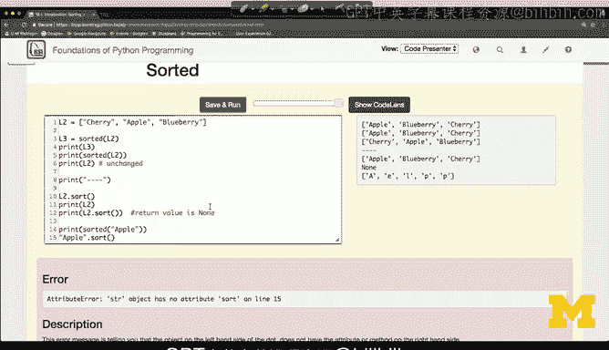

# 密歇根大学《Python3编程（课程1、2）》｜Python 3 Programming（Python for everyone进阶）（中英字幕） - P158：70_05_02_sort与sorted方法调用.zh_en - GPT中英字幕课程资源 - BV1CM411Z72u

Let's get started。Python provides two ways to sort a sequence。The dot sort method。

And the function sorted。We'll start with the dot sort method。 It operates on a list。

 and it doesn't return anything， but it changes the order of items to be from lowest to highest。

For example， on line 4。We first specify the list， L 1， and we have。

The dot notation saying we're going to do a method on L 1。And we're going to do the sort method。

 not passing any parameters to that sort。Once we've executed that on line  four。

 when we get to line 5 and print。By magic， L1 is going to have its item sorted from lowest to highest。

-2 then 1 then 3， and so on。So， let's run that。And sure enough。We get them。sortred。

Based on the print statement on line 5。On line 6， we're doing the same thing。

 except instead of sorting the first list， we're sorting L 2， which has three strings in it， cherry。

 apple and blueberry。What does it mean for one string to be smaller than the next， Well。

 we use dictionary order or alphabetic order。 So Apple begins with a blueberry again begins with B。

 So Apple comes before blueberry。And we get the list apple。Blueberry。Cherry。

Our second option is the sorted function。It sorts the items in exactly the same order。

 but there are a few things that are different about this way of telling Python to sort。 First。

 of course， is that we're using the function syntax instead of the method syntax。

 So no period the sequence is going to be sorted。 we pass in as a parameter to the sorted function。

And we're going to get a value back。 That's our second difference。 We get a value back。

 and we can either assign that value to a variable as we've done on line 3。

 or we can use it in an expression。 So， for example， on line 5。

We're passing it directly to the print function。A third difference is that when you invoke sorted on a list。

It doesn't change the original list。It produces a new list that has the same items in a different order。

 So when we get to line 6 and we print the original list。That original list won't be changed at all。

So let's run that。And you see。That we get from line 3。Apple blueberry cherry。

And the same thing from line 5， the same result of calling sorted is getting printed again on line 5 on line 6。

 we're asking to print whatever is the current value about 2。

And that is unchanged from the original list。So。Notice the difference here On 10 through 12 were doing the original way。

So we see from line 11。That we invoke using the dot notation。

And then we don't have to pass the list as a parameter because it's being specified before the dot。

When we use sort。If we then print on line 11。We see that。The listist L2 itself has been modified。

And one other minor thing to notice here is that when we call sorted， it returns a list。

When we invoke the sort method， as we do on in this lower half on line 12， we don't get a value back。

 We just get the value None。 All of the action of the dot sort method is a side effect。

 It changes L2， but it doesn't return anything useful。 The value that we get back is just none。

So that's the basics of sorting in Python。 For the rest of these lessons。

 we'll be using the sorted function rather than the sort method。 It's just safer that way。

 We've emphasized previously how confusing things can get when you use mutation operations。

 So we avoid them whenever we can。 One other nice thing about the sorted method is that we can we can apply it。

To any sequence。Not just to lists。We could， for example， try to。sortrt。A string。Rather than。

Sorting a list。So you might wonder。What is this going to produce。

 And I encourage you to try to pause this and make a prediction。 What will this do。

 Is this just going to give us apple back。Well， no， it's not going to give us Apple。

 It's going to treat。Apple is a sequence of characters， A， P， P， L， and E。

So it's going to give us a list of single letters and they're going to be in alphabetic order。

So we get A， E， L， P and P。Li。Comparable operation。

Will fail because we can't destructively sort a string。 Strings are immutable。

And that's going to give us an error。This sort attribute is not available for strings。

 So that sort you can only do on lists。But the sortded function you can do even on immutable sequences like strings。

Though in general， we're going to use sorted and not sort。

See you next time when we sort things from highest to lowest。

