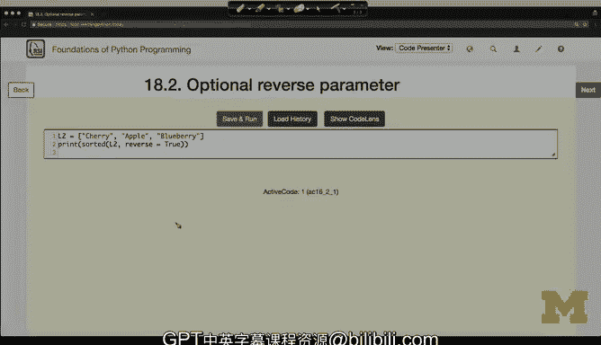
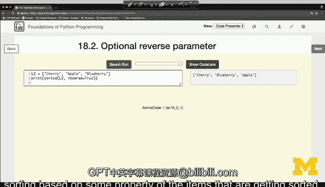

# 密歇根大学《Python3编程（课程1、2）》｜Python 3 Programming（Python for everyone进阶）（中英字幕） - P159：71_05_03_可选reverse参数.zh_en - GPT中英字幕课程资源 - BV1CM411Z72u

Welcome back。

What if we don't want to sort from the smallest item to the largest。

 but instead we want the reverse order？Well that's easy。

 you've already seen how you can reverse a list。There's actually a reverse function。

 or you could do a list accumulation。That means you could just call the sorted function。

To get the list from lowest to highest， and then afterwards do something。

To reverse the order of that sequence。But it's actually even easier than that because we can specify an optional parameter for the sorted function called reverse。

That's an optional parameter， its default value， if you don't provide a value for it is false。

But if you pass the value true in， you get the list back in the opposite order。You can see that。

Online number two。In addition to saying what list we want to。So。

 we're also saying that the reverse parameter should get the value true。And when we do that。

We'll get the things in reverse order。Cherry， blueberry， then apple。

 I hope I'm not making you too hungry with these examples。So this reverse equals true。

Is just passing a parameter， the usual thing that we've seen before for functions。

The actual value that we're passing in here。The word true is just a boolean value。

 if you'll recall from when we were doing Boolean values， I could change this。

 and instead of passing the Boolean value true， I could pass the Boolean value false。

 and that would say don't give this back in reverse order。Not reversed。So we would get apple。

 blueberry， and cherry。Now。False is the default value for the reverse parameter。So， if I。

Leave it out entirely， I get the same thing that I would get as if I say reverse equals false。

So if I don't want it reversed， I don't have to say it， if I do want it reversed。

 I have to say reverse equals true。Then I get it。In the reverse order。

So that's sorting a sequence in the opposite or the reverse order。

 we'll see you next time when we specify a custom order for sorting based on some property of the items that are getting sorted。

