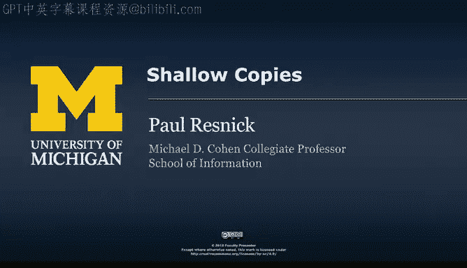
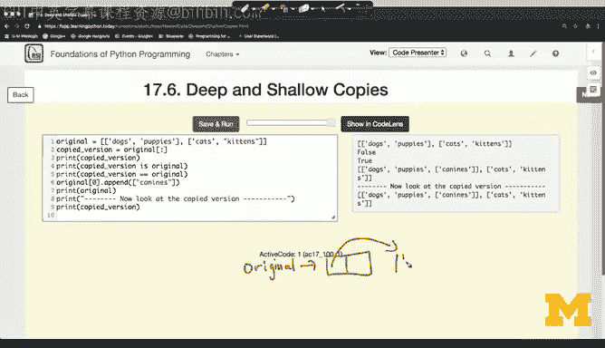

# 密歇根大学《Python3编程（课程3、4、5）》｜Python 3 Programming（Python for everyone进阶）（中英字幕） - P15：14_02_04_浅拷贝.zh_en - GPT中英字幕课程资源 - BV1gj41177yd

Welcome back。Earlier in this specialization， we took a deep dive into aliasing and the confusions that can occur when you mutate a list or a dictionary that has many aliases。

 many different variable names that are pointing to the same list or dictionary。

And the same thing is true if you have instead of variable names。Pointing to a single list。

 if you have a single list that is included as an element in multiple other lists。

If you mutate the inner list that is part of several outer lists。

 all of those outer lists will look like their contents have changed。

The best way to keep track of these confusing situations will be with a reference diagram， of course。

So let's take a look at an example。 one way that you can get a list included in multiple lists by accident and thus get this confusing situation is when you copy a list。

As in this code snippet。Let's start by just running it。So you can see that on line  one。

 we create a list called original。 Its value is a nested list。 The outer list has。2 inter lists。

 as its elements。Let's set ourselves up with a reference diagram。We're gonna say that。Original。

Is a variable name。And its value is a list。That list has two items。The first item is itself a list。

And that list。Has。

Dogs。As an element。And it has puppies， as an element。The second element of original。Is another list。

Which is。As as its values， cats。And kittens。So that's all that happens on line one。Online， too。

 we make。A copy。Of original。We use the slice operator。Coon inside of square brackets。

 you may recall that always creates a slice。 If I said original。Square brackets，1， colon， 4。

That would。Make a slice beginning with the item at index 1 and going up to。

 but not including position 4。 Of course， I can't do that for this list because it only has two items。

But if we leave off。The value before。The colon， we start at the beginning of the list。

 If we leave off the value after the colon， we go all the way to the end of the list。

 So this says take a slice beginning at the beginning of original and going to the end of original。

So that makes a new list。And that new list has as its elements， the same elements that original had。

The first element is dogs and puppies。 the second element is cats and kittens。

And we assign that to a variable called。Copiied version。So that's what happens online line too。

Now just to show you what the output looks like。A line，3。We print out copied version。

 and sure enough， it looks like it has exactly the same stuff that original has in it。On line 4。

 we check is copied version the same object as original。

And the answer to that is false copied version is pointing to one object。

Original is pointing to a different object。Online5。We check whether they have the same contents。

 The answer to that is true。 So original and copied。Are not the same object。

 They're different objects。But they're both lists。 They both have two elements。

 and those elements are these inter lists， dogs， puppies and cats kittens。

 It's true that they are equal equal。It's not true that they are is。Each other。

 so copied version is not original， but it is equal to the original。 It has the same contents。

On line 6， we see where our confusions are going to happen when we have multiple outer lists that point to the same inner list。

So original square bracket 0。Is the first inner list。That's dogs， puppies。And on line 6。

 we say dot a pen of canines。So that is going to append to the end。Of this list， another item。

But notice that this item。His canines。In square brackets。 So this item is actually another list。

That list。Has only one item， canines。But it is a list， it's not just the string canines。

So now on line 7， if we print original。We get。This list here， where the first element is dogs。

Puppies like before， but we've appended to the end。Of that list， the list canines。And then。

The second element。Is still cats and kittens。On line 9， we print the copied version。Now， on line 6。

 we just said to change original。We didn't say anything about changing， copied version。But on line 9。

 you can see。That this square bracket canines has magically appeared after dogs and puppies。

 And that's because copied version。Even though we didn't say to change it。

 the copied version has is its first element this list， and we mutated that list。

That's shallow copies for you。See you next time。