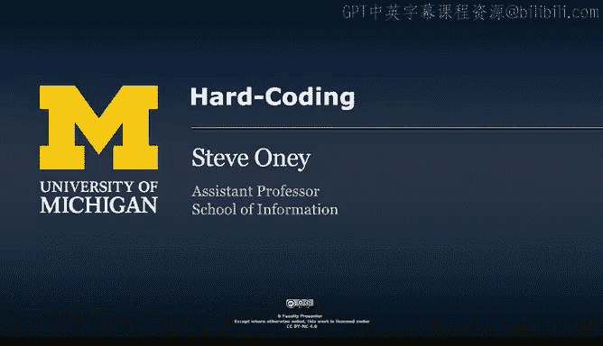
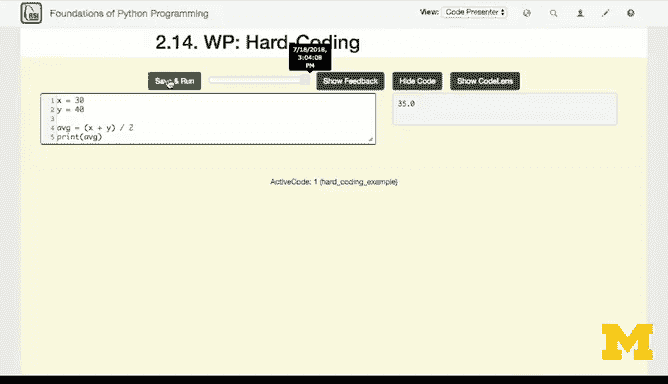

# 密歇根大学《Python3编程（课程1、2）》｜Python 3 Programming（Python for everyone进阶）（中英字幕） - P15：15_01_11_硬编码.zh_en - GPT中英字幕课程资源 - BV1CM411Z72u

The last thing I want to talk about in this lesson is hard coding。 And before I get to that。

 I'm just going to tell a kind of motivating story from my childhood。 So I have three older siblings。

 And when they were doing algebra。Then if you remember algebra。

 then you often get problems of the type solve for X， solve for Y， solve for Z。And one day。

 I overheard my sister talking on the phone with a friend about a math problem that they had。

And they were trying to solve for the value of x。 And I overheard my sister saying the value of x is 3。

And when I heard that， I thought that I had found out some hidden secret about algebra， x is 3。

 I could take every single problem that involved x and just substitute3 in。

 I had cracked the code and I didn't have to learn algebra anymore， I could just skip that grade。

Of course if you have actually taken algebra， then you know that x isn't3。

 you know that you have to solve for the value of x every single time。

So what I was thinking of doing there was a form of hard coding or thinking that x is3 for every single problem。

So in the context of solving Python programs， what hard coding is is it's writing down the answer without actually going through the work of computing the answer。

So let's suppose that I want to write a program to print out the value of x and y averaged。

 so if I have x equal to 10。And y equal to 20。Then I could hard code my answer by saying average equals 15。

0。And I， let's say， print out。That average。And so yes， in this case。

 I happened to get the right answer that the average of x and y is 15。

 but my answer is hard coded because I said that the average was 15。

And what that means is that if I changed the value of x here to be 30， the average should be 25。0。

 but instead I still get 15 because my answer was hard coded。

So what I'll do is instead of writing out。Average equals 15。

 I want to actually write out the expression that's going to reference x and y to compute that average。

 so I'll say average equals x plus y divided by 2。And so even though I still get the same answer of 15。

 then because this answer is no longer hard coded， if I change the value of x to 30。

 then my answer is still going to be correct， same thing if I changed the value of my answer y to 40。

So in your assignments， we'll often say don't hard code your answer and what that means is that you have to write expressions that actually reference the variables and rather than just jumping straight to the answer。

 you actually have to write expressions and statements that will actually compute the answer in your code。

Until next time。