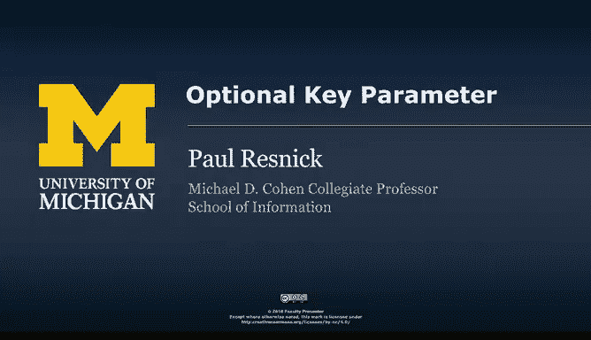
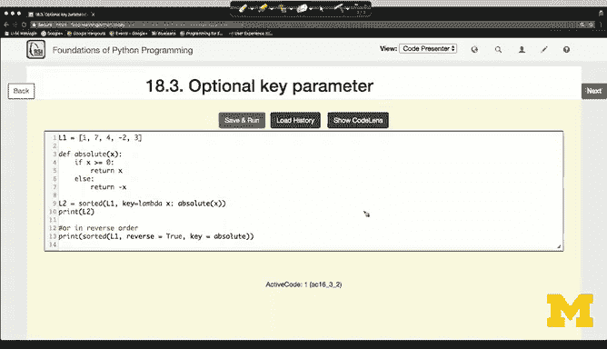

# 密歇根大学《Python3编程（课程1、2）》｜Python 3 Programming（Python for everyone进阶）（中英字幕） - P160：72_05_04_可选key参数解析.zh_en - GPT中英字幕课程资源 - BV1CM411Z72u

Welcome back。We're going to learn something that's extremely useful and powerful。

 but conceptually a bit tricky。 So hang in there on this one。 Once you get it， you're going to think。

 wow， this is really cool。😊，At least I do。So let's say we have a list of numbers like L1 created on line1。

 and we want to sort them on some property like their absolute value。So from line9。

We're printing out the absolute value of three。Which is just3。 But the absolute value of -119。Is 119。

 and on lines 12 and 13， we're just going through each of the items in the list。

And we're outputting their absolute value。 So we get 1，7，4。Instead of minus2。

 we get its absolute value， which is 2 and finally three。Now， suppose we want to sort。L1。

 based on the absolute value。We can just tell the sorted function to use absolute value as the property that we want to sort by。

AndThe way we do that is we use this other optional parameter。Called key。

So here's another optional parameter just like we had reverse in the previous video here we've got key and we can specify a value we're going to specify absolute。

And that tells the sorted function to sort by the absolute value。Here you can see。That。

 instead of having -2 first。-2 is coming after one because its absolute value is bigger。

We printed out the sorted。Versin of L2。We can also do it in reverse order by combining the use of reverse equals true with key equals absolute。

And we've got that here。Now that all seems pretty straightforward until you start to really think about what's going on。

The thing that we are passing。As a value for the key parameter。Is the value of the variable absolute。

That value is a function。So we're passing a function absolute to another function sorted。

I hope your first reaction to that is。Like， it should blow your mind like。

 we're passing a function to a function。So yeah， that's really weird。But eventually。

 you're going to say， wow， that's really powerful。So to make sense of this。

 we need to have a little mental model， a way to think about what's going on inside the sortded function。

We're passing it in this function and what is it doing with that function？

What it's doing is before it starts comparing any of the items to each other。Remember comparisons。

 that's like the pairs of dancers comparing their numbers to each other。

So before it does any of those comparisons， the sortdid function uses the function that you pass in。

 absolute。And uses that to determine numbers to assign to each of those dancers。

 That is behind the scenes。When you call sorted。Sored is going to call。The function that you provide。

 And it's going to call it once for each of the items in the sequence。

 It's going to do that to determine some property of that item， like its absolute value。

 It's going to write it down on a little post it note。That the item carries around。

 And then the sortded function does all the kinds of comparisons between the items。

 But the comparisons always between the values that are on those post it notes。So for example。

How is this working， We've got this sequence 1。7even。4。in-2 and 3。

Before we do any of those comparisons between pairs of items。We're going to run our function。

Absolute on each of the items in turn， and we're going to annotate the item with a little posted it note。

 So we're going to have a post note for one that its absolute value is one。And for 7。

 that its absolute value is 7。For four that its absolute value is4。Those are kind of uninteresting。

 but for-2， we get that the absolute value is 2。 And that's going to change things a bit。

Then we go and do these pairwise comparisons， one against 7 and 7 against4 and 7 against-2。

 and all of that， there's a whole bunch of those that happen behind the scenes in the sortded function。

But whenever it's doing a comparison， it uses。It uses the post it notes to determine the order。So。

 we end up with。Wen。And then minus-2。And then，3。4 and 7。

 And the reason we end up with -2 coming after one is because we had。The comparisons。

 based on their posted notes。1 had the one， but -2 had 2。So-2 with its post it note of 2。

 ends up coming after one。So if you think of that as being the process that's going on。

You invoke the sortded function。 The sortded function calls your function like absolute。

 and it calls it once on each of the items in the sequence。

I'm going to prove to you that that really is what's going on。The way I'm going to prove that is。

I have modified the absolute function here， just a little bit。By having it print something out。

Just added this thing on line 4。So every time the absolute function gets invoked。

We're going to print something out。So on line 10。We're saying to print something。

Then we call the sorted function， and then we print something to say， hey， we're done with sorting。

Well，You'll see that。9ine 10。Generates that。And line 12 sprint statement saying that we're done is there。

 Then everything in between。Is death that's happening because of calls to absolute that happened during the execution of line 11。

So we pass in the value absolute。To the sortrdid function， we never actually say。

Invoke the absolute function。We never do that。 But inside the execution of the sortrdid function。

 it is calling absolute。And it's calling it。1，2，3，4， five times。

Once for each of the five items in the list， and you can see is calling it for the value1 for the value7。

 for minus2 and 3。So that's what's going on behind the scenes when the sorted function is executing just so it can get。

The right number is onto the post it notes so that it can use those for doing all the comparisons that lead to sorting of the items。

So the thing that you pass in for the key parameter has to be a function。

 so often we'll call it the key function。It has to be a function like absolute is here。

It's a function。It has to be a function that takes one input。

 That input is going to be one of the items。At a time from the list。

And it has to return some value that's going to go on the post it note， some property of the item。

 so typically a number。And I just want to mention one thing here about。Passing in a function。

 we can either pass a function by name。As we did in originally with this。

 we just say the absolute function。Or we can pass in a lambda expression。

Remember from a previous lesson that lambmbda expressions are expressions that produce anonymous functions。

So instead of specifying absolute here， we could specify a lambda expression。

So this is a lambda expression。This whole expression。Evaluates to a function object。

 That function takes one input x。And returns as its value。Whatever this expression returns。Now。

 if you write this like this。It might look a little silly to an experienced programmer because really this lambda expression is returning a function that does exactly the same thing。

That absolute does。But。You might still want to do that just if it makes it clearer for you。

This is a conceptually challenging thing。 This idea of passing in a function for the key parameter。

 And I find a lot of students， really。They just understand it better this way。

 where the lambmbda reminds them that they're producing a function。 And when they just see。Qi。

Equals absolute。It doesn't， doesn't quite click that absolute is referring to a function object。

So if this helps you， you're welcome to do it this way。

There are other places where we'll have other lambda expressions which make even more sense。

 and we'll see that in a later lesson。So， to summarize。

If you want to sort a sequence based on some property of the items， call sorted。

And pass a value for the key parameter。The value for the key parameter has to be a function。

That function takes one item as input and returns a value to write on the post note。

 a property of the item。The value for the key parameter can either be the name of a function。

Like absolute or a lambda expression， like I've shown a 9，9 here。So play around with this a little。

 do some exercises。Keep trying it until it makes sense。

 And then you'll be able to sort anything anytime。

See you next time。